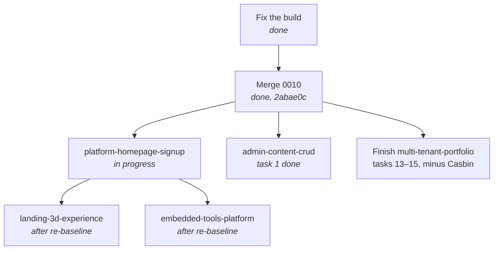

# Specs

Spec-driven development for **next-0000**, a multi-tenant portfolio platform.
Process: [../steering/workflow.md](../steering/workflow.md). Product:
[../steering/product.md](../steering/product.md). Read
[../steering/current-state.md](../steering/current-state.md) before starting
anything.

## Step zero is done

`feature/release-awesome/0010` was **merged into `development` on 2026-11-01**
(commit `2abae0c`), bringing the entire tenant surface: `/:username` routes, the
`profiles` table, `queries-by-user.ts`, migration `0005`. Zero conflicts.

Merging it was never sufficient. The **platform** surface — homepage,
registration, approval gating, safe username allocation — exists nowhere, and
that is what [platform-homepage-signup](./platform-homepage-signup/requirements.md)
builds. Its preconditions (tasks 0.1, 0.2, 0.4) are complete; task 1 writes
migration `0006`.

## Index

| Spec | Goal | Prerequisite | Status |
|------|------|--------------|--------|
| [platform-homepage-signup](./platform-homepage-signup/requirements.md) | Platform homepage, registration with waitlist approval, username safety, tenant-correct contact delivery, Casbin removal | ✅ met | 🔧 **In progress** — tasks 0.1, 0.2, 0.4 done |
| [landing-3d-experience](./landing-3d-experience/requirements.md) | 3D hero for the platform homepage; resolve the 78 MB model | `platform-homepage-signup` task 6 | ⚠️ **Needs re-baseline** — written for the owner's portfolio hero |
| [admin-content-crud](./admin-content-crud/requirements.md) | The admin pages the navbar links to; fix the published-only testimonials read | ✅ met | 🔧 Task 1 done (G10 fixed); tasks 2+ **need re-baseline** onto `profiles` and `blogs` |
| [embedded-tools-platform](./embedded-tools-platform/requirements.md) | Make `kind: "embedded"` tools renderable | ✅ met | ⚠️ **Needs re-baseline** — `tools` is per-tenant, so routes move to `/:username/tools` |

Prior specs, in the Kiro tree:

| Spec | Status |
|------|--------|
| `.kiro/specs/multi-tenant-portfolio/` | 41 of 61 done on `0010`. Property tests and final verification open. Its Casbin RBAC section is **superseded** by [ADR-018](../steering/decisions.md#adr-018--remove-casbin). |
| `.kiro/specs/best-practice-improvements/` | 9 of 11 done; tasks 2, 10, 11 open |

## Sequencing

**Why this order.**

- **Build first.** The gate fails on a clean checkout. Until it is green you
  cannot distinguish your breakage from the pre-existing kind.
- **`platform-homepage-signup` before everything else.** It owns the migration
  that adds `profiles.status`, hardens `handle_new_user()`, and narrows
  anonymous RLS. Those change the shape every other spec reads from. It also
  closes the cross-tenant contact defect
  ([G11](../steering/current-state.md#g1--apinotify-does-not-exist)),
  which ships broken the moment tenant portfolios go live.
- **`landing-3d-experience` after the homepage exists.** Its hero now belongs to
  the platform homepage ([ADR-019](../steering/decisions.md#adr-019--the-3d-hero-belongs-to-the-platform-homepage-only)),
  which `platform-homepage-signup` task 6 creates.
- **`admin-content-crud` can run in parallel** with the platform work — it
  touches the admin surface, which neither spec's migration reshapes.
- **`embedded-tools-platform` is blocked on a product decision**, not on code.

## Re-baselining the three earlier specs

All three were written when the product was understood as a single-owner
portfolio. The clarification — many users, root is the platform — invalidates
specific parts. **Each must be re-baselined before implementation, not during.**

### landing-3d-experience

| Was | Now |
|-----|-----|
| Hero of the owner's portfolio at `/` | Hero of the **platform homepage** |
| Content from `getSettings()` (Req 6) | Platform copy; **no tenant data** |
| `TenantData` props fed from `SiteSettings` | Platform props; the `TenantData` shape is no longer the right interface |
| Replaces `MaskReveal` and deletes it (Req 5, D2) | **Reconsider.** Per ADR-019, `MaskReveal` is a candidate to *repurpose* as the tenant hero rather than delete |
| Keeps the `ProfilePage` JSON-LD on `/` (Req 5.7) | **Wrong.** `ProfilePage` belongs on tenant pages; the root emits `WebSite` |

Requirements 5 and 6 need rewriting; design decisions D1, D2, and D6 need
revisiting. The asset pipeline (Req 2, D3, D4) and the performance budget
(Req 4) are unaffected and remain the valuable core.

### admin-content-crud

| Was | Now |
|-----|-----|
| Settings edit the `site_settings` singleton (Req 4) | Edit the signed-in tenant's `profiles` row |
| Blog targets the `posts` table (Req 3) | Target `blogs`, which is per-tenant and unique on `(user_id, slug)` |
| Lists read every row (Req 2.1, 3.1) | Read **only the signed-in tenant's** rows, scoped by `user_id` |
| `reorderEntities` kinds `"projects" \| "posts" \| "tools"` | Reorder must be `user_id`-scoped, or one tenant can renumber another's rows |
| `0010` has `updateSettings` + `AdminSettings` (noted as absent) | Those exist post-merge; reuse rather than rebuild |

Requirement 4 is the biggest change — it becomes a profile editor. Requirement 1
(the testimonials read fix) and Requirement 5 (shared behaviour) survive intact,
and Requirement 1 is still worth landing on its own.

> ⚠️ **`reorderEntities` is a live cross-tenant write risk.** It updates
> `sort_order` by id with no ownership check. RLS should block it, but the
> action does not verify, so correctness depends entirely on the policy being
> right. Add an explicit `user_id` filter when re-baselining.

### embedded-tools-platform

Blocked on one question: **is `/tools` a platform feature or a per-tenant
feature?**

| If platform-level | If per-tenant |
|-------------------|---------------|
| `tools` stays single-owner | `tools` gains `user_id`, RLS, and a migration |
| `/tools` is a root route and a reserved username | `/:username/tools` — no new reserved word |
| One registry for everyone | Same registry; rows scoped per tenant |
| Spec needs only a note | Requirements 3 and 6 need rewriting |

Everything else in that spec — the CSP analysis, the deferral of OCR and
background removal, the static import map, the nine light tools — is unaffected
either way and is the part worth keeping. See
[G16](../steering/current-state.md#g1--apinotify-does-not-exist).
