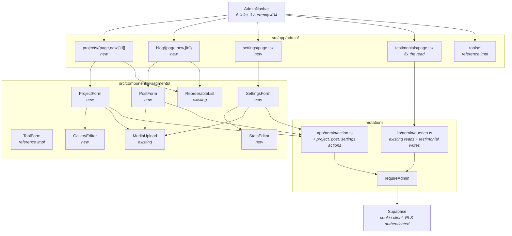

# Design — Admin Content CRUD

## Overview

Four admin surfaces — testimonials fix, projects, blog, settings — built by
replicating the tools module, which is already a complete working
implementation of exactly this shape. The design is deliberately unoriginal:
every new file has a direct counterpart under `src/app/admin/tools/` or
`src/components/Fragments/ToolForm/`, and the parts that already exist
(`reorderEntities`, `revalidatePosts`, the `*Input` types, the list queries) are
reused rather than reinvented.

## Architecture



Nothing in the data layer changes shape. No migration. No new table.

## Key design decisions

### D1 — Replicate the tools module; do not abstract it

**Decision.** `ProjectForm`, `PostForm`, and `SettingsForm` are written as
siblings of `ToolForm`, each with its own `useState` per field, its own
`slugify`, and its own local `input` / `labelCls` / `card` class constants.

**Rejected: a generic `<EntityForm schema={...}>`.** Four entities with
genuinely different field types — multi-select categories, a gallery array, a
Markdown editor with preview, a stats array — is too little repetition to
justify a form abstraction, and the abstraction would be harder to read than
four explicit forms. The repo already made this call: `reorderEntities` is
generic because reorder is identical across entities, while CRUD is hand-written
per entity.

**Cost.** The class-constant trio is duplicated four times. Acceptable; extract
it to `src/lib/utils.ts` only if a fifth entity appears.

### D2 — Fix testimonials with a two-line import change

**Decision.** Swap `getTestimonials` → `getListTestimonials` and add
`export const dynamic = "force-dynamic"`.

**Why this is not a drive-by fix.** It changes which rows an editor sees, so it
needs the regression test in Requirement 1.5. `getListTestimonials` is currently
unreferenced anywhere in `src/` — this change is what makes it live.

### D3 — `publishedAt` is owned by the action, not the form

**Decision.** The form sends `publishedAt` as it found it. `postToRow()` applies
the transition rules:

```typescript
function resolvePublishedAt(input: PostInput, existing: Post | null): string | null {
  // First publish stamps the date; unpublishing preserves it.
  if (input.published && !existing?.publishedAt) return new Date().toISOString();
  return existing?.publishedAt ?? input.publishedAt;
}
```

**Rejected: letting the form compute it.** The client clock is not trustworthy
for a date that orders public content, and `setPostPublished` toggles publish
without going through the form at all — the rule would have to exist twice.

Satisfies Requirement 3.5, 3.6.

### D4 — Slug collisions are reported, not thrown

**Decision.** Catch Postgres unique-violation code `23505` and return a named
Action_Result.

```typescript
if (error) {
  const msg = error.code === "23505"
    ? `The slug "${input.slug}" is already taken.`
    : error.message;
  return { ok: false, error: msg };
}
```

**Why.** `ActionResult`-never-throws is an architectural invariant
([architecture.md](../../steering/architecture.md#architectural-invariants) #7).
A raw Postgres constraint message is not an editor-facing error.

Satisfies Requirement 2.11, 3.10.

### D5 — The blog admin states its own limitation

**Decision.** `/admin/blog` renders a persistent notice: posts are authored and
stored, but `/blog` and `/blog/[slug]` are still `notFound()` stubs, so nothing
is publicly visible yet.

**Why.** Shipping a publish toggle that does not publish anything is the kind of
quiet lie that costs trust. Requirement 3.11 makes the honesty mandatory.

**Rejected: also building the public blog routes.** That is a separate spec with
its own SEO, pagination, and `generateStaticParams` concerns. Scope held.

### D6 — Reconcile `SettingsInput.stat` → `stats`

**Decision.** Rename the field in `src/lib/admin/types.ts` from `stat` to
`stats`, matching `SiteSettings.stats`.

**Why.** `SettingsInput` has no callers on this branch — `updateSettings` does
not exist — so the rename costs nothing now and removes a permanent foot-gun.

**Note for the `0010` path.** Branch `0010` *does* have `updateSettings` and an
`AdminSettings` component. If `0010` merges first, check which spelling it uses
before renaming, and re-baseline per the spec's Baseline assumptions.

Satisfies Requirement 4.7.

### D7 — Settings writes upsert, not update

**Decision.** `updateSettings` performs `upsert({ id: 1, ... })`.

**Why.** Requirement 4.8 requires the form to work when the singleton is absent,
and `getSettingsForAdmin()` already returns `defaultSettings` in that case. An
`update` against a missing row succeeds while changing nothing — a silent
no-op, the worst available behaviour.

## Components and interfaces

### New pages

| File | Mirrors |
|------|---------|
| `src/app/admin/projects/page.tsx` | `tools/page.tsx` |
| `src/app/admin/projects/new/page.tsx` | `tools/new/page.tsx` |
| `src/app/admin/projects/[id]/page.tsx` | `tools/[id]/page.tsx` |
| `src/app/admin/blog/page.tsx` | `tools/page.tsx` |
| `src/app/admin/blog/new/page.tsx` | `tools/new/page.tsx` |
| `src/app/admin/blog/[id]/page.tsx` | `tools/[id]/page.tsx` |
| `src/app/admin/settings/page.tsx` | — single form, no list |

Dynamic route pages take `params: Promise<{ id: string }>` and **must await it**
— Next.js 16 removed synchronous `params` access entirely. Copy the shape from
`src/app/admin/tools/[id]/page.tsx:11`, which is already correct, or generate
`PageProps<'/admin/projects/[id]'>` with `npx next typegen`.

### New components

```typescript
// src/components/Fragments/ProjectForm/index.tsx
export function ProjectForm({ initial }: { initial?: Project }): React.JSX.Element;

// src/components/Fragments/PostForm/index.tsx
export function PostForm({ initial }: { initial?: Post }): React.JSX.Element;

// src/components/Fragments/SettingsForm/index.tsx
export function SettingsForm({ initial }: { initial: SiteSettings }): React.JSX.Element;

// src/components/Fragments/GalleryEditor/index.tsx
export function GalleryEditor({
  items,
  onChange,
}: {
  items: GalleryItem[];
  onChange: (items: GalleryItem[]) => void;
}): React.JSX.Element;

// src/components/Fragments/StatsEditor/index.tsx
export function StatsEditor({
  stats,
  onChange,
}: {
  stats: Stat[];
  onChange: (stats: Stat[]) => void;
}): React.JSX.Element;

// src/components/Fragments/ProjectRowActions/index.tsx
// src/components/Fragments/PostRowActions/index.tsx
//   both mirror ToolRowActions: publish toggle + confirm-then-delete
```

`GalleryEditor` and `StatsEditor` are controlled, uncontrolled-state-free, and
compose `MediaUpload` for the image fields. Keeping them separate from their
parent forms is what keeps `ProjectForm` readable.

### New actions in `src/app/admin/action.ts`

```typescript
export async function createProject(input: ProjectInput): Promise<ActionResult>;
export async function updateProject(id: string, input: ProjectInput): Promise<ActionResult>;
export async function deleteProject(id: string): Promise<ActionResult>;
export async function setProjectPublished(id: string, published: boolean): Promise<ActionResult>;

export async function createPost(input: PostInput): Promise<ActionResult>;
export async function updatePost(id: string, input: PostInput): Promise<ActionResult>;
export async function deletePost(id: string): Promise<ActionResult>;
export async function setPostPublished(id: string, published: boolean): Promise<ActionResult>;

export async function updateSettings(input: SettingsInput): Promise<ActionResult>;
```

Each is `requireAdmin()` → `*ToRow()` → write → `revalidate*()` → return.

### Row conversion helpers

Private to `action.ts`, mirroring the existing `toolToRow()`:

```typescript
function projectToRow(input: ProjectInput) {
  return {
    slug: input.slug.trim(),
    title: input.title.trim(),
    short_description: input.shortDescription,
    long_description: input.longDescription,
    categories: input.categories,
    technologies: input.technologies,
    year: input.year,
    featured: input.featured,
    published: input.published,
    gallery: input.gallery,          // JSONB column
    thumbnail_url: input.thumbnailURL,
    live_url: input.liveURL,
    github_url: input.githubURL,
    linkedin_url: input.linkedinURL,
    gradient: input.gradient,
    sort_order: input.sortOrder,
  };
}

function postToRow(input: PostInput, existing: Post | null) {
  return {
    slug: input.slug.trim(),
    title: input.title.trim(),
    excerpt: input.excerpt,
    content: input.content,
    cover_url: input.coverUrl,
    tags: input.tags,
    featured: input.featured,
    published: input.published,
    published_at: resolvePublishedAt(input, existing),
    sort_order: input.sortOrder,
  };
}

function settingsToRow(input: SettingsInput) {
  return {
    id: 1,
    name: input.name,
    short_name: input.shortName,
    role: input.role,
    university: input.university,
    location: input.location,
    email: input.email,
    url: input.url,
    description: input.description,
    social_github: input.social.github,
    social_linkedin: input.social.linkedin,
    social_facebook: input.social.facebook,
    social_instagram: input.social.instagram,
    hero_back_url: input.heroBackURL,
    hero_front_url: input.heroFrontURL,
    hero_mobile_url: input.heroMobileURL,
    about_image_url: input.aboutImageURL,
    cv_url: input.cvURL,
    home_show_tools: input.homeShowTools,
    home_show_blog: input.homeShowBlog,
    stats: input.stats,              // JSONB; renamed from `stat` per D6
  };
}
```

**Verify every column name against `supabase/migrations/0001-init.sql` through
`0004_about_stats.sql` before writing.** The field names above are derived from
the `*Row` interfaces in `src/lib/queries.ts`, which is strong evidence but not
the schema itself.

### Revalidation

| Entity | Paths | Helper |
|--------|-------|--------|
| Projects | `/`, `/admin/projects` | existing `revalidatePublic()` |
| Posts | `/`, `/blog`, `/blog/[slug]`, `/admin/blog` | existing `revalidatePosts()` — **already written, currently only reachable via reorder** |
| Settings | `/`, `/about`, `/contact`, `/admin/settings` | new `revalidateSettings()` |
| Testimonials | `/`, `/admin/testimonials` | existing `revalidateTestimonials()` |

Use `revalidatePath`, not `revalidateTag`. In Next.js 16 `revalidateTag`
requires a second `cacheLife` argument and the one-argument form is a TypeScript
error; this codebase has no tag-based caching to extend.

## Data models

No schema change, no migration. Existing types are reused unchanged, except the
`SettingsInput.stat` → `stats` rename from D6.

Tables touched: `projects`, `posts`, `site_settings`, `testimonials`. All four
already exist with the needed columns.

## Correctness properties

**P1 — Admin reads are unfiltered.** For any set of rows with arbitrary
`published` values, each `getList*()` returns all of them, and the corresponding
public query returns exactly the `published = true` subset. Covers Requirement
1.2, 2.1, 3.1, 7.1.

**P2 — Unauthenticated mutations are inert.** For every mutation and any input,
calling it with no session returns `{ ok: false, error: NOT_AUTHORIZED }` and
issues no database write. Covers Requirement 5.2, 7.2.

**P3 — `publishedAt` is monotone.** For any sequence of publish/unpublish
toggles, once `publishedAt` is non-null it never changes and never returns to
null. Covers Requirement 3.5, 3.6.

**P4 — Row helpers are total and snake_case.** For any valid `*Input`, the
corresponding `*ToRow()` output contains only snake_case keys, no `undefined`
values, and no key absent from the table. Covers Requirement 5.5, 7.4.

**P5 — Slug round-trip.** For any title, `slugify(title)` is lowercase,
contains only `[a-z0-9-]`, has no leading or trailing hyphen, and is idempotent:
`slugify(slugify(t)) === slugify(t)`.

**P6 — Forms preserve input on failure.** For any field values and any action
error, every entered value is still present in the form after the failed
submit. Covers Requirement 5.7.

## Error handling

| Failure | Behaviour | Requirement |
|---------|-----------|-------------|
| No session | `{ ok: false, error: NOT_AUTHORIZED }`, no write | 5.2 |
| Slug collision, code `23505` | `{ ok: false, error: "The slug … is already taken." }` | 2.11, 3.10 |
| Any other Postgres error | `{ ok: false, error: error.message }` | 5.3 |
| Row id not found on edit page | `notFound()` | 2.3 |
| Settings singleton missing | `defaultSettings` in the form; `upsert` on save | 4.8 |
| `uploadFile` throws | Caught in `MediaUpload`; error shown inline, form state kept | 5.7 |
| Action error | Rendered to the editor; values retained; submit re-enabled | 5.7, 5.8 |

Admin surfaces **may** show `error.message`; public surfaces may not. That
asymmetry is deliberate — see
[ADR-003](../../steering/decisions.md#adr-003--queries-never-throw).
