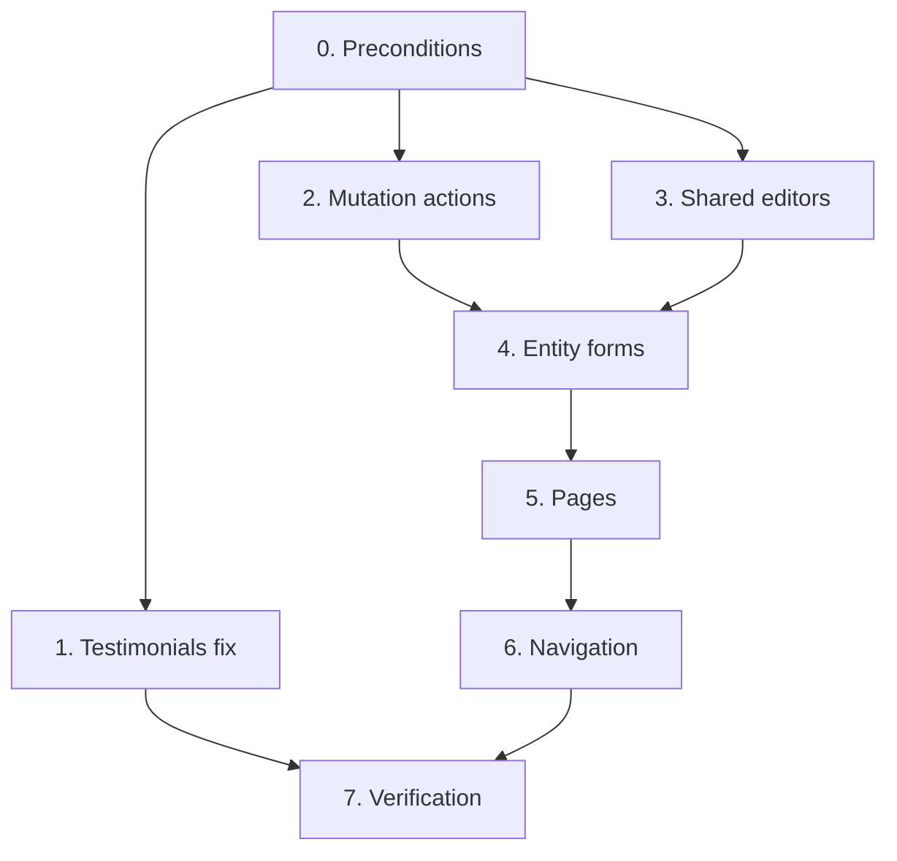

# Tasks — Admin Content CRUD

Strict order: schema verification → actions → shared editors → forms → pages →
navigation → verification. Actions land before forms so each form has something
real to call.

## Tasks

- [ ] 0. Preconditions
  - [x] 0.1 Green build gate
    - `npm install && rm -rf .next`, then all four of `typecheck`, `lint`, `test`, `build` green
    - Record the baseline test count and lint warning count
    - _Requirements: 7.5_
    - **Baseline recorded 2026-11-01** on `development` @ `efa8456`: typecheck clean · lint 0 errors / 8 warnings · **10 test files, 147 tests passing** · `next build` succeeds · `.next/static/chunks` = 2.2 MB raw, 602.1 KB gzipped across 30 chunks
    - Cause was confirmed as pure `node_modules` desync: `npm install` changed neither `package.json` nor `package-lock.json`
    - Note: `next build` in Next.js 16 no longer prints per-route JS size, so bundle deltas must be measured from `.next/static/chunks`
  - [ ] 0.2 Confirm the `0010` merge decision
    - This spec is written against single-tenant `site_settings`. If `0010` merges first, **stop** and re-baseline per `requirements.md` → Baseline assumptions
    - Do not start task 2 with the decision open
    - _Requirements: (baseline)_
  - [ ] 0.3 Verify every column name against the migrations
    - Read `supabase/migrations/0001-init.sql` … `0004_about_stats.sql`
    - Confirm each column referenced by `projectToRow`, `postToRow`, `settingsToRow` in `design.md` actually exists with that exact name and type
    - The `*Row` interfaces in `src/lib/queries.ts` are strong evidence, **not** the schema
    - Record any mismatch here before writing code
    - _Requirements: 5.5, 7.4_

- [x] 1. Fix the testimonials admin read
  - [x] 1.1 Swap the query and force dynamic rendering
    - `src/app/admin/testimonials/page.tsx`: import `getListTestimonials` from `@/lib/admin/queries` instead of `getTestimonials` from `@/lib/queries`
    - Add `export const dynamic = "force-dynamic"`
    - Add a visible published/draft indicator per row
    - _Requirements: 1.1, 1.2, 1.3, 1.4_
  - [x] 1.2 Regression test
    - An unpublished testimonial appears in the admin list
    - The same row does **not** appear in `getTestimonials()`
    - _Requirements: 1.5, 1.6_
    - **Done 2026-11-01.** Two files, 11 tests:
      - `src/lib/admin/queries.test.ts` (6) — `getListTestimonials` returns drafts, applies **no** `.eq()` filter at all, maps to camelCase, returns `[]` instead of throwing on error; plus the contrast pair asserting `getTestimonials` does filter `published=true` and hides the row the admin read surfaces
      - `src/app/admin/testimonials/page.test.tsx` (5) — pins the *wiring*: the page calls `getListTestimonials` and never `getTestimonials`, renders the draft, reports the draft count, and exports `dynamic = "force-dynamic"`
    - **Guard verified by reintroducing the defect**: swapping the import back made 3 of the 5 page tests fail, then the change was reverted. A regression test that was never seen to fail is not a guard.

- [x] 2. Mutation actions
  - [x] 2.1 Remove `SettingsInput.stat`, and add `BlogInput`
    - `src/lib/admin/types.ts`
    - **Re-baselined 2026-11-01.** The earlier plan was to rename `stat` → `stats`. Neither spelling is persisted any more: `profiles` has no `stats` column and `updateSettings` no longer writes one, so the field is removed rather than reconciled — along with `url`, `homeShowTools` and `homeShowBlog`, which are equally unpersistable
    - Add `BlogInput` carrying exactly what `blogs` has: `slug`, `title`, `summary`, `content`, `coverUrl`, `published`, `publishedAt`. **`PostInput` cannot be reused** — `blogs` has no `tags`, no `featured` and no `sort_order`, and calls the summary field `summary` rather than `excerpt`
    - _Requirements: 3.3, 4.3, 4.8_
    - **Removing those four fields forced part of task 4.3 forward.** `AdminSettings` had live controls for `homeShowTools`, `homeShowBlog` and a whole stats editor; typecheck cannot pass with the fields gone and the controls still there. Both cards and the three `*Stat` helpers are removed, which is the subtractive half of 4.3 done early out of necessity rather than ambition.
  - [x] 2.2 Add `projectToRow` and the four project actions
    - `createProject`, `updateProject`, `deleteProject`, `setProjectPublished` in `src/app/admin/action.ts`
    - `requireAdmin()` first; `revalidatePublic()` on success; `23505` → named slug error
    - Set `user_id` on create; filter on `user_id` on update and delete, following the `ownerId()` pattern — **not** relying on RLS alone, for the reason in [G20](../../steering/current-state.md#g2--admin-navbar-links-to-pages-that-do-not-exist---mostly-fixed-2026-11-01)
    - _Requirements: 2.8, 2.9, 2.11, 5.2, 5.3, 5.5_
    - **The existing tool and testimonial writes had the same hole, and the G20 fix turned it into a visible bug.** `toolToRow()` and `createTestimonial()` never set `user_id`. On a fresh install `tools.user_id` is `not null`, so the insert simply failed; on an upgraded database the column is nullable, so it inserted an orphan with `user_id = null` — which now **vanishes from the owner's newly-scoped list** while still matching the `published = true` branch of the select policy. `ToolForm` does receive a `userId`, but only passes it to `MediaUpload` for the storage path. Fixed for both, with update and delete filtered on owner too.
  - [x] 2.3 Add `resolvePublishedAt`, `blogToRow`, and the four blog actions
    - **Retargeted from `posts` to `blogs`.** `posts` has no `user_id` and `0005` never touched it, so its reads cannot be owner-scoped; `blogs` is the per-tenant table and is what `/:username/blog` already serves
    - `createBlog`, `updateBlog`, `deleteBlog`, `setBlogPublished`; set `user_id` on create, filter on it for update and delete
    - **`revalidatePosts()` is NOT reusable** — it revalidates the owner's root `/blog` paths, which belong to the legacy single-owner system. Write a `revalidateBlogs(username)` that targets `/:username/blog` and `/:username/blog/[slug]`
    - `setBlogPublished` must apply the same `publishedAt` rule as `updateBlog`; the rule lives in `resolvePublishedAt`, not in either caller
    - The unique constraint is `(user_id, slug)`, so a slug only collides within one tenant
    - _Requirements: 3.6, 3.7, 3.8, 3.9, 3.10, 3.11_
    - `getListBlogs()` and `getBlogById()` were added alongside — both owner-scoped. The actions need the read anyway: `updateBlog` and `setBlogPublished` load the stored `publishedAt` first, which is what keeps it monotone.
    - `resolvePublishedAt` takes the three values rather than the whole input, so `setBlogPublished` — which never goes through the form — applies the identical rule instead of a second copy of it.
  - [x] 2.4 Point `updateSettings` at `profiles`
    - **Done 2026-11-01**, outside this spec's original scope, because it was a live defect rather than missing work: `updateSettings` upserted `site_settings` with a hardcoded `id: 1` while `getSettingsForAdmin` read `profiles`, so the form never showed what it saved — and on a multi-tenant platform every tenant collided into one global row. See [G21](../../steering/current-state.md#g2--admin-navbar-links-to-pages-that-do-not-exist---mostly-fixed-2026-11-01)
    - `update` filtered on `user.id`, not `upsert`: the row is created by `handle_new_user`, and an upsert keyed on id could silently insert a profile with no username
    - Revalidates that tenant's own paths. The four unpersistable fields are deliberately not written
    - _Requirements: 4.1, 4.9_
  - [x] 2.5 Tests for the action layer
    - Each mutation returns `NOT_AUTHORIZED` and writes nothing when unauthenticated
    - Each `*ToRow()` emits only verified snake_case keys
    - `publishedAt` transition rules from 3.5 and 3.6
    - _Requirements: 7.2, 7.3, 7.4_
    - **Done 2026-11-01**, 27 tests in `src/app/admin/action.test.ts`:
      - all eight mutations refuse with `NOT_AUTHORIZED` and issue **zero** database calls when unauthenticated;
      - creates stamp `user_id`; every update, delete and publish-toggle filters on `id` **and** `user_id`;
      - `blogToRow` emits only keys that exist on `blogs`, all lowercase, and explicitly **no** `tags`, `featured` or `sort_order` — the column set is written out in the test, so a drift from the schema fails here;
      - `publishedAt` is monotone across first publish, unpublish, re-publish, and through `setBlogPublished`;
      - a `23505` collision names the slug and does **not** leak the constraint text; other error codes pass through unchanged.

- [x] 3. Shared editor fragments
  - [x] 3.1 Build `GalleryEditor`
    - Controlled `{ items, onChange }`; add, remove, reorder
    - Per item: `type` of `"image" | "video"`, `url` via `MediaUpload`, optional `caption`
    - _Requirements: 2.6_
    - Fully controlled — it keeps no state of its own, so there is no second copy to drift from the form's. Ordering is explicit move-up/move-down rather than a sort field, because the gallery renders in array order and the JSONB column has nothing else to sort by.
  - [~] 3.2 ~~Build `StatsEditor`~~ — **dropped**
    - `profiles` has no `stats` column and `updateSettings` no longer writes one, so there is nothing for this editor to persist. Requirement 4.3 now forbids offering the field at all
    - If per-tenant stats are wanted later they need a migration first, which makes them a separate spec
    - _Requirements: (superseded by 4.3)_

- [x] 4. Entity forms
  - [x] 4.1 Build `ProjectForm`
    - Every `ProjectInput` field; `categories` constrained to `PROJECT_CATEGORIES`, multi-select
    - Compose `GalleryEditor`; `MediaUpload` for `thumbnailURL`
    - Slug derived from title until touched — copy `ToolForm`'s `slugTouched` pattern
    - Surface action errors, keep values on failure, disable submit while in flight
    - _Requirements: 2.4, 2.5, 2.6, 2.7, 5.7, 5.8_
  - [x] 4.2 Build `BlogForm`
    - Every `BlogInput` field — note there is **no** tags, featured or sort-order control, because `blogs` has no such columns
    - Markdown textarea plus a preview toggle using the already-installed `react-markdown` + `remark-gfm` + `rehype-highlight`
    - `publishedAt` is displayed read-only; the action owns it
    - _Requirements: 3.4, 3.5, 5.7, 5.8_
  - [x] 4.3 Rework `SettingsForm` into a profile editor
    - `0010` already ships `AdminSettings`; this reworks it rather than building from nothing
    - **Remove the controls for `url`, `homeShowTools`, `homeShowBlog` and `stats`** — `profiles` has no such columns, so each is a field that silently does not save. `StatsEditor` is therefore **not needed**
    - No `username` control: changing it breaks every published link and collides with the reserved list. No `status` control: approval is an operator action in the Supabase dashboard
    - Say that `email` is the publicly displayed address and that contact-form mail goes to the account's verified sign-in address instead
    - `MediaUpload` for all five image/CV URL fields
    - _Requirements: 4.2, 4.3, 4.4, 4.5, 4.6, 4.7_
    - The subtractive half landed with task 2.1 out of necessity: typecheck cannot pass with the fields removed from `SettingsInput` while the controls remain. This finished it by adding the Requirement 4.4 note under the email field.
    - No `username` or `status` control was ever present, so 4.6 and 4.7 needed nothing.
  - [x] 4.4 Build `ProjectRowActions` and `BlogRowActions`
    - Mirror `ToolRowActions`: publish toggle plus confirm-then-delete
    - _Requirements: 5.9_
  - [x] 4.5* Property tests P5 and P6
    - P5 slug idempotence, P6 forms preserve input on failure
    - _Requirements: 5.7_
    - **`slugify` had three byte-identical copies** in `ToolForm`, `BlogForm` and `ProjectForm`, confirmed by md5. Extracted to `src/lib/slug.ts`: a derivation rule in three places drifts, and a property should be asserted once where it lives.
    - P5, 1000 runs each: output is always `[a-z0-9-]*`, never starts or ends with a hyphen, **never contains a doubled hyphen** — runs of non-alphanumerics collapse to one — and is idempotent.
    - A documented surprise: **non-ASCII is dropped, not transliterated.** `Ünïcödé` becomes `n-c-d`, since every accented letter is a non-alphanumeric run. A title in a non-Latin script slugifies to near-nothing, which is why the author can always override the derived value. My first expectation was wrong and the code was right.
    - P6, 25 runs plus five example-based tests: a failed save surfaces the error, keeps every entered value, and does **not** navigate away from the unsaved work. The property pastes rather than types, because a generated string can contain characters `userEvent.type` reads as key descriptors.

- [x] 5. Pages
  - [x] 5.1 `/admin/projects` list
    - `getListProjects()`, ordered by `sort_order`; `ReorderableList` with `kind: "projects"`
    - `export const dynamic = "force-dynamic"`; admin card/input conventions
    - _Requirements: 2.1, 2.10, 5.1, 5.10_
  - [x] 5.2 `/admin/projects/new` and `/admin/projects/[id]`
    - `params` is a `Promise` and **must be awaited** — Next.js 16 removed synchronous access. Copy the shape from `src/app/admin/tools/[id]/page.tsx:11`
    - `notFound()` when the id does not resolve
    - _Requirements: 2.2, 2.3_
  - [x] 5.3 `/admin/blog` list
    - New `getListBlogs()` reading `blogs`, owner-scoped, ordered by `published_at` desc nulls first then `created_at` desc
    - **No `ReorderableList`.** `blogs` has no `sort_order` column, so manual ordering is not merely unimplemented but impossible — Requirement 3.12
    - **The deferred-visibility notice is no longer needed**: `/:username/blog` is live, so a published post really is public
    - _Requirements: 3.1, 3.12, 5.1_
  - [x] 5.4 `/admin/blog/new` and `/admin/blog/[id]`
    - `getBlogById()`, owner-scoped
    - _Requirements: 3.2_
  - [x] 5.5 `/admin/settings`
    - `getSettingsForAdmin()` → `SettingsForm`; single form, no list
    - _Requirements: 4.1, 5.1_
    - Shipped with `0010`; needed no change here beyond the form rework in 4.3 and the action fix in 2.4.

- [x] 6. Navigation integrity
  - [x] 6.1 Verify every navbar link resolves
    - Click through all six links as a signed-in user. Zero 404s
    - _Requirements: 6.1_
    - **Mechanical, not a click-through.** `src/components/Layouts/AdminNavbar/index.test.ts` checks every href against the filesystem, so this is asserted on every run rather than verified once. Projects and Blog were added back to `ADMIN_NAV_ITEMS` **in the same change as their pages**, which is the discipline that test enforces.
    - The About pair (`/admin/about/section1`, `/section2`) stays unlinked — those pages still do not exist. The test asserts their absence too, so the list cannot drift back.
  - [x] 6.2 Verify active-state logic on nested paths
    - Exactly one item active on `/admin`, `/admin/projects`, `/admin/projects/new`, `/admin/projects/<id>`, and the blog equivalents
    - Note that `/admin` uses `exact: true` while the rest use `startsWith` — confirm `/admin/projects/new` does not light up two items
    - _Requirements: 6.2_
    - **The active item carried no `aria-current`.** It was marked by CSS classes only, so a screen-reader user got no signal which admin page they were on, while the public `Navbar` does set it. Added to both the top-level and child links, which also makes the state testable semantically rather than by matching class strings.
    - 12 tests in `src/components/Layouts/AdminNavbar/active-state.test.tsx`: exactly one item active across ten paths, and for every section a deeply nested path still lights exactly one — the case the mix of `exact` and prefix matching exists to handle, since `/admin/projects/new` is a prefix match for its section **and** starts with `/admin`.
  - [x] 6.3 Remove links for anything deferred
    - If a surface is dropped from scope, its link is removed, not left pointing at a 404
    - _Requirements: 6.3, 6.4_

- [ ] 7. Verification
  - [x] 7.1 Full gate
    - `typecheck` → `lint` → `test` → `build`, all green; warning count not above the task 0.1 baseline
    - _Requirements: 7.5_
    - **Green 2026-11-01:** typecheck clean · lint 0 errors / 9 warnings (the baseline) · 24 test files / 365 tests · build succeeds.
    - Net across this spec: **+12 test files, +218 tests**, warning count unchanged.
  - [x] 7.2* Property tests P1–P4
    - P1 admin reads unfiltered, P2 unauthenticated mutations inert, P3 `publishedAt` monotone, P4 row helpers total and snake_case
    - `fast-check`, minimum 100 runs, tagged `// Feature: admin-content-crud, Property N: <text>`
    - _Requirements: 7.1, 7.2, 7.3, 7.4_
    - **Done, and two of the four are better served by exhaustive tests than generated ones.** Where the input space is small and enumerable, `it.each` over the whole space proves more than sampling it:
      - **P1 was inverted by the G20 fix.** "Reads are unfiltered" became "reads must filter by owner". Covered exhaustively in `src/lib/admin/queries.test.ts` across every list and by-id read, including that each returns `[]`/`null` rather than querying unscoped with no session.
      - **P2** — `it.each` over **all eight** mutations in `action.test.ts`, asserting zero database calls. There are eight; enumerating them is complete where a property would only sample.
      - **P3** — a real property: any sequence of up to 30 publish/unpublish toggles, asserting the date never moves once set, never returns to null, and is set iff the post was ever published (500 runs). Needed `resolvePublishedAt` out of the `"use server"` module, since everything exported from one becomes a Server Action.
      - **P4** — a real property: arbitrary `BlogInput`, asserting the payload holds only columns `blogs` has, all lowercase, and **never `undefined`** — which Supabase drops silently, leaving the column at its old value on update (300 runs). Plus P4b: every create stamps the caller as owner, over arbitrary owner ids (200 runs).
  - [ ] 7.3 Manual end-to-end pass
    - For each of projects, posts, settings: create → edit → publish → reorder → unpublish → delete
    - Confirm the public `/` reflects published projects and testimonials and ignores drafts
    - _Requirements: 1.6, 2.9, 3.8, 4.6_
  - [ ] 7.4 Update steering docs in the same change
    - `product.md`: the admin route table — three ❌ rows become ✅, and the G10 warning on testimonials is removed
    - `current-state.md`: close G2 and G10; G5 stays open since the public blog routes remain stubs
    - `architecture.md`: the caching table row for `/admin/testimonials`
    - _Requirements: (ADR-014)_

## Task dependency graph

Task 1 is independent of everything else and can ship on its own — it is a
two-line fix plus a test. Tasks 2 and 3 are parallel.

## Notes

- **The navbar links to these surfaces were removed, not left pointing at 404s.**
  Task 7 of `platform-homepage-signup` pruned `/admin/projects`,
  `/admin/blog` and the About pair out of `ADMIN_NAV_ITEMS` when Casbin stopped
  hiding them. `src/components/Layouts/AdminNavbar/index.test.ts` asserts every
  href resolves to a real page, so **re-adding a link is part of building its
  page**, and the test fails if you do it early.

- **The tools module is the specification.** When a detail is unclear, read
  `src/app/admin/tools/page.tsx`, `tools/new/page.tsx`, `tools/[id]/page.tsx`,
  `ToolForm/index.tsx`, and `ToolRowActions/index.tsx`, and do the same thing.
  Matching the existing idiom matters more than improving on it.
- **`revalidatePosts()` already exists** in `src/app/admin/action.ts` and already
  revalidates every blog path. It is currently reachable only through
  `reorderEntities`. Do not write a second one.
- **`reorderEntities` already accepts `"projects"` and `"posts"`.** No change is
  needed there.
- **Task 0.3 is not optional.** Three `*ToRow()` helpers are being written from
  the `*Row` interfaces rather than from the schema. One wrong column name is a
  runtime failure that no type check catches.
- Task 1 alone closes G10. If the rest of this spec stalls, land task 1 anyway.
- Per `AGENTS.md`, read the relevant guide under `node_modules/next/dist/docs/`
  before writing route or caching code. The ones that bite here are async
  `params` and the `revalidateTag` signature change, both in
  `01-app/02-guides/upgrading/version-16.md`.
