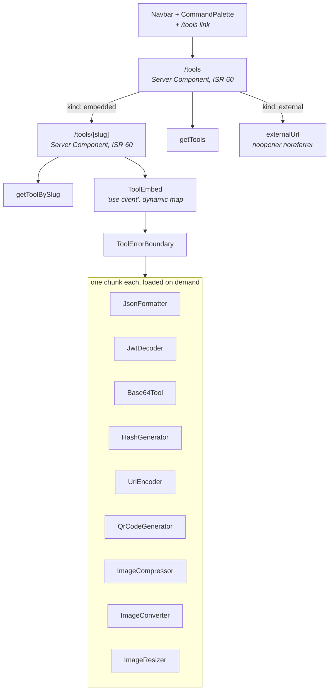

# Design — Embedded Tools Platform

## Overview

Three pieces: a public `/tools` surface, a `ToolEmbed` renderer that
code-splits each tool into its own chunk, and nine browser-only tool
components. The two heavy tools — OCR and background removal — are **deferred**,
for a reason that is a hard technical constraint rather than a scheduling
preference: this project's enforcing CSP blocks both the CDN fetches and the
`blob:` workers they need.

## Architecture



## Key design decisions

### D1 — Defer OCR and background removal; the CSP forbids them

**Decision.** `ocr` and `background-remover` are **not** implemented. Their
Registry entries are removed and `tesseract.js` and
`@imgly/background-removal` are uninstalled.

**Why — this is a constraint, not a judgement call.** The CSP in
`next.config.ts` is enforcing:

```
connect-src 'self' challenges.cloudflare.com *.supabase.co wss://*.supabase.co
            vitals.vercel-insights.com *.google.com *.gstatic.com *.googleapis.com
```

There is **no `worker-src` directive**, so it falls back to
`default-src 'self'`.

| Tool | Needs | Blocked by |
|------|-------|------------|
| `ocr` (`tesseract.js`) | fetch core WASM + `*.traineddata` language data from a CDN; spawn a worker | `connect-src` excludes the CDN; `blob:` worker excluded by `default-src 'self'` |
| `background-remover` (`@imgly/background-removal`) | fetch ONNX model assets, tens of MB, from a CDN; worker | same two directives |

Making them work requires **all** of: self-hosting the WASM runtimes, language
data, and ONNX models under `'self'` or the Supabase `media` bucket; adding
`worker-src 'self' blob:` to the CSP; and accepting a multi-tens-of-megabyte
asset payload. That is a spec of its own, and it weakens the policy
[ADR-010](../../steering/decisions.md#adr-010--enforcing-csp-with-unsafe-inline-and-unsafe-eval)
deliberately tightened.

**Rejected: ship them pointing at a CDN.** They would work in `next dev` —
where the CSP header is still applied but easier to miss — and fail in
production with a console-only error and no visible symptom beyond a tool that
never finishes. That is the worst failure mode available.

**Rejected: relax `connect-src` to allow the CDNs.** It permits arbitrary
outbound fetches to third-party origins for the benefit of two utilities, on a
site whose CSP already concedes `unsafe-inline`.

Satisfies Requirement 5.1, 5.2, 5.3, 5.5, 1.6.

### D2 — `useWebWorker: false` for image compression

**Decision.** `browser-image-compression` is configured with
`useWebWorker: false`.

**Why.** The same `worker-src` gap as D1. The library defaults to a `blob:`
worker and falls back to the main thread when worker creation fails — so the
tool would appear to work while logging a CSP violation on every use. Set it
explicitly and the behaviour is intentional rather than accidental.

**A second reason, found while implementing (2026-11-01).** The library also
takes a `libURL` option, which defaults to
`https://cdn.jsdelivr.net/npm/browser-image-compression/dist/browser-image-compression.js`
— the script it fetches *for the worker*. So the default path needs **both** a
`blob:` worker and a `connect-src` host, and the enforcing policy refuses each
independently. `useWebWorker: false` removes both at once.

**Cost.** Compression runs on the main thread. For the image sizes a portfolio
tool handles, acceptable, and the tool says so. A test asserts the option is
passed, since a silent revert to the default would work in development and fail
only under the production CSP.

Satisfies Requirement 4.11.

### D3 — Static import map, not a template-string import

**Decision.**

```typescript
// src/components/tools/ToolEmbed.tsx
"use client";

import dynamic from "next/dynamic";

const LOADING = <div className="h-64 animate-pulse rounded-2xl bg-black/5 dark:bg-white/5" />;

const TOOL_MAP = {
  "json-formatter":    dynamic(() => import("./JsonFormatter"),    { ssr: false, loading: () => LOADING }),
  "jwt-decoder":       dynamic(() => import("./JwtDecoder"),       { ssr: false, loading: () => LOADING }),
  "base64":            dynamic(() => import("./Base64Tool"),       { ssr: false, loading: () => LOADING }),
  "hash-generator":    dynamic(() => import("./HashGenerator"),    { ssr: false, loading: () => LOADING }),
  "url-encoder":       dynamic(() => import("./UrlEncoder"),       { ssr: false, loading: () => LOADING }),
  "qr-code-generator": dynamic(() => import("./QrCodeGenerator"),  { ssr: false, loading: () => LOADING }),
  "image-compressor":  dynamic(() => import("./ImageCompressor"),  { ssr: false, loading: () => LOADING }),
  "image-converter":   dynamic(() => import("./ImageConverter"),   { ssr: false, loading: () => LOADING }),
  "image-resizer":     dynamic(() => import("./ImageResizer"),     { ssr: false, loading: () => LOADING }),
} as const satisfies Record<string, React.ComponentType>;

export type ToolComponentKey = keyof typeof TOOL_MAP;
```

**Why a literal and not `import(\`./${key}\`)`.** A template-string import
forces the bundler to include every possible match in one chunk, which defeats
the entire purpose. The literal map also gives `ToolComponentKey` as a real
union type, so the registry-completeness test in Requirement 1.2 becomes a
compile-time **and** runtime check.

`ssr: false` requires `ToolEmbed` to be a Client Component — in a Server
Component it is a hard error in Next.js 16.

Satisfies Requirement 2.1, 2.2, 2.6, 1.1.

### D4 — Registry completeness is a test, not a comment

**Decision.**

```typescript
// src/components/tools/ToolEmbed.test.tsx
it("registry and embed map are in exact correspondence", () => {
  const registryKeys = TOOL_COMPONENTS.map((c) => c.key).sort();
  const embedKeys = Object.keys(TOOL_MAP).sort();
  expect(embedKeys).toEqual(registryKeys);
});
```

**Why.** The current drift — 11 registry entries, zero implementations — is
exactly what a one-line test prevents. Adding a registry entry without an
implementation now fails CI.

Satisfies Requirement 1.2.

### D5 — External tools never get a detail page

**Decision.** `/tools` links `kind: "external"` rows straight to `externalUrl`.
`generateStaticParams` emits only embedded slugs, and `/tools/[slug]` calls
`notFound()` for an external row.

**Why.** A detail page whose only content is an outbound link is a pointless
hop and a thin-content SEO liability.

Satisfies Requirement 3.4, 3.8.

### D6 — Error boundary per tool, not per page

**Decision.** `ToolEmbed` wraps each component in a class error boundary.

**Why.** These tools parse untrusted user input — arbitrary JSON, arbitrary
JWTs, arbitrary image files. A throw inside one must not blank the route. React
error boundaries still require a class component; there is no hook equivalent.

Satisfies Requirement 2.5.

## Components and interfaces

### New files

| File | Purpose |
|------|---------|
| `src/app/tools/page.tsx` | Tools_Index, ISR 60 |
| `src/app/tools/[slug]/page.tsx` | Tool_Detail, ISR 60, `generateMetadata`, `generateStaticParams` |
| `src/components/tools/ToolEmbed.tsx` | Static dynamic-import map + unknown-key state |
| `src/components/tools/ToolErrorBoundary.tsx` | Class error boundary |
| `src/components/tools/ToolEmbed.test.tsx` | Registry correspondence + unknown key |
| `src/components/tools/JsonFormatter.tsx` | + `.test.tsx` |
| `src/components/tools/JwtDecoder.tsx` | + `.test.tsx` |
| `src/components/tools/Base64Tool.tsx` | + `.test.tsx` |
| `src/components/tools/HashGenerator.tsx` | + `.test.tsx` |
| `src/components/tools/UrlEncoder.tsx` | + `.test.tsx` |
| `src/components/tools/QrCodeGenerator.tsx` | + `.test.tsx` |
| `src/components/tools/ImageCompressor.tsx` | + `.test.tsx` |
| `src/components/tools/ImageConverter.tsx` | + `.test.tsx` |
| `src/components/tools/ImageResizer.tsx` | + `.test.tsx` |
| `src/components/Layouts/ToolsGrid/index.tsx` | Index card grid |

`src/components/tools/` is a **fourth** top-level component directory,
alongside `Elements/`, `Fragments/`, and `Layouts/`. That is deliberate: the
registry's header comment already specifies this path, and these components are
self-contained applications rather than pieces of the design system. Record it
in [structure.md](../../steering/structure.md) when the spec lands.

### Modified files

| File | Change |
|------|--------|
| `src/lib/tools/registry.ts` | Remove `ocr` and `background-remover`; fix the header comment paths |
| `src/components/Layouts/Navbar/index.tsx` | Add the `/tools` link |
| `src/components/Elements/CommandPalette/index.tsx` | Add the `/tools` navigation entry |
| `package.json` | Remove `tesseract.js`, `@imgly/background-removal`, and the Requirement 6.2/6.3 decisions |
| `next.config.ts` | **No change.** D1 exists precisely so the CSP stays as it is. |

### Interfaces

```typescript
// src/components/tools/ToolEmbed.tsx
export interface ToolEmbedProps {
  /** Validated by isToolComponentKey() before being passed in. */
  componentKey: string | null;
  /** Shown in the unavailable and error states. */
  toolName: string;
}
export function ToolEmbed(props: ToolEmbedProps): React.JSX.Element;

// src/components/tools/ToolErrorBoundary.tsx
export class ToolErrorBoundary extends React.Component<{
  toolName: string;
  children: React.ReactNode;
}, { hasError: boolean }> {}
```

```typescript
// src/app/tools/[slug]/page.tsx
export const revalidate = 60;

export async function generateStaticParams() {
  const tools = await getTools();
  return tools
    .filter((t) => t.kind === "embedded")
    .map((t) => ({ slug: t.slug }));
}

export async function generateMetadata(
  { params }: { params: Promise<{ slug: string }> }
): Promise<Metadata> {
  const { slug } = await params;              // Next.js 16: params is a Promise
  const tool = await getToolBySlug(slug);
  if (!tool) return {};
  return {
    title: tool.name,
    description: tool.tagline,
    alternates: { canonical: `/tools/${tool.slug}` },
  };
}
```

`getToolBySlug` is wrapped in `React.cache()`, so calling it in both
`generateMetadata` and the page costs one round-trip.

## Data models

No schema change, no migration. `tools` already has `kind`, `component_key`, and
`external_url`, and `mapToolRow` already maps them.

One behavioural note: `getTools()` returns `[]` when Supabase is unconfigured —
**no seed fallback**, unlike projects and testimonials. `/tools` must therefore
render a real empty state, not assume at least one row (Requirement 3.10).

## CSP compliance matrix

Every shipped tool, against the enforcing policy. This table is the reason D1
exists.

| Tool | Network fetch | Worker | WASM | CSP verdict |
|------|---------------|--------|------|-------------|
| `json-formatter` | none | no | no | ✅ |
| `jwt-decoder` | none | no | no | ✅ |
| `base64` | none | no | no | ✅ |
| `hash-generator` | none | no | no | ✅ — Web Crypto is not CSP-governed |
| `url-encoder` | none | no | no | ✅ |
| `qr-code-generator` | none | no | no | ✅ — `qrcode` is pure JS |
| `image-compressor` | none | **disabled** per D2 | no | ✅ |
| `image-converter` | none | no | no | ✅ — Canvas `toBlob` |
| `image-resizer` | none | no | no | ✅ — Canvas |
| ~~`ocr`~~ | CDN WASM + traineddata | blob | yes | ❌ **deferred** |
| ~~`background-remover`~~ | CDN ONNX models | blob | yes | ❌ **deferred** |

`unsafe-eval` is present in `script-src`, so WASM *compilation* would be
permitted — it is the fetch and the worker that block, not the WASM itself.

**Verification is mandatory and must be done on a production build.**
`npm run build && npm run start`, then exercise every tool with the console
open. `next dev` is not sufficient evidence (Requirement 7.5).

## Correctness properties

**P1 — Registry and map correspond exactly.** `Object.keys(TOOL_MAP)` equals
the Registry's `key` set. Covers Requirement 1.1, 1.2.

**P2 — Unknown keys degrade.** For any string not in `TOOL_MAP`, including
`null` and `""`, `ToolEmbed` renders the unavailable state and throws nothing.
Covers Requirement 1.3, 7.3.

**P3 — Base64 round-trips UTF-8.** For any Unicode string `s`,
`decode(encode(s)) === s`. Generate with `fc.fullUnicodeString()` — ASCII-only
generation would miss the multi-byte bug this property exists to catch. Covers
Requirement 4.6.

**P4 — URL encoding round-trips.** For any string, component-encode then decode
is the identity, and likewise for URI-encode.

**P5 — JSON formatter is idempotent on valid input.** For any valid JSON,
`format(format(x)) === format(x)`, and `JSON.parse(minify(x))` deep-equals
`JSON.parse(x)`.

**P6 — No tool throws on malformed input.** For any arbitrary string fed to
`json-formatter`, `jwt-decoder`, `base64` decode, and `url-encoder` decode, the
component renders without throwing. Covers Requirement 4.14, 7.2.

**P7 — Index bundle excludes tool code.** No Tool_Component chunk appears in
the `/tools` index route's module graph. Verified against build output, not by
unit test. Covers Requirement 5.7.

## Error handling

| Failure | Behaviour | Requirement |
|---------|-----------|-------------|
| `component_key` not in map | "Tool unavailable" state | 1.3, 2.4 |
| `component_key` null on an embedded row | Same unavailable state | 1.5 |
| Dynamic import rejects | Error state naming the tool; page intact | 2.4 |
| Throw inside a tool | `ToolErrorBoundary` catches; rest of page intact | 2.5 |
| Malformed user input | Inline message; no throw | 4.14 |
| `crypto.subtle` absent | Stated explicitly as a secure-context requirement | 4.7 |
| Unsupported image type | Inline message naming the accepted types | 4.10 |
| Slug does not resolve | `notFound()` | 3.3 |
| Supabase unconfigured | `/tools` empty state | 3.10 |

No tool sends user input anywhere (Requirement 4.2), so there is no network
failure mode to handle in any of the nine.
