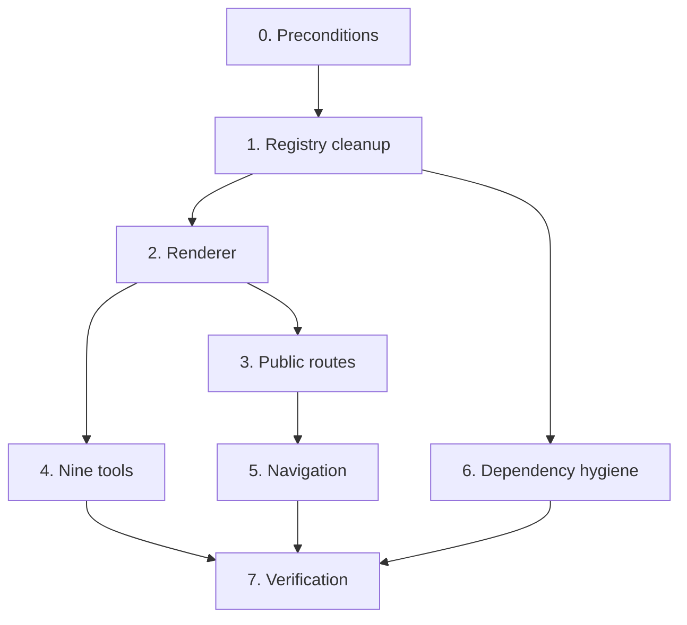

# Tasks — Embedded Tools Platform

Order: registry cleanup → renderer → routes → tools → navigation →
verification. The renderer lands before any tool so each tool has a host and a
completeness test from the first commit.

## Tasks

- [ ] 0. Preconditions
  - [x] 0.1 Green build gate
    - `npm install && rm -rf .next`, then `typecheck`, `lint`, `test`, `build` all green
    - Record baseline test count, lint warning count, and total `.next/static/chunks` size
    - _Requirements: 7.6_
    - **Baseline recorded 2026-11-01** on `development` @ `efa8456`: typecheck clean · lint 0 errors / 8 warnings · **10 test files, 147 tests passing** · `next build` succeeds · `.next/static/chunks` = 2.2 MB raw, 602.1 KB gzipped across 30 chunks
    - Cause was confirmed as pure `node_modules` desync: `npm install` changed neither `package.json` nor `package-lock.json`
    - Note: `next build` in Next.js 16 no longer prints per-route JS size, so bundle deltas must be measured from `.next/static/chunks`
  - [ ] 0.2 Confirm the CSP deferral decision
    - Read `design.md` §D1. If the decision to defer `ocr` and `background-remover` is being overturned, **stop**: that needs a CSP change, a self-hosted-asset plan, and a new ADR superseding ADR-010, none of which is in this task list
    - _Requirements: 5.1, 5.3, 5.4_

- [x] 1. Registry cleanup
  - [x] 1.1 Remove the two deferred entries
    - Delete the `ocr` and `background-remover` entries from `TOOL_COMPONENTS` in `src/lib/tools/registry.ts`
    - Nine entries remain
    - _Requirements: 1.6, 5.5_
  - [x] 1.2 Correct the header comment
    - The three-step "to add a new tool" comment names paths that will exist after task 2; make it accurate
    - _Requirements: 1.4_
  - [x] 1.3 Check for orphaned `component_key` rows
    - Any existing `tools` row with `component_key` of `ocr` or `background-remover` now points at a removed key
    - It will render the unavailable state — correct behaviour, but note it so an editor is not surprised
    - _Requirements: 1.3_

- [x] 2. Renderer
  - [x] 2.1 Build `ToolErrorBoundary`
    - Class component — React still has no hook equivalent
    - Renders a named fallback; does not re-throw
    - _Requirements: 2.5_
  - [x] 2.2 Build `ToolEmbed`
    - `"use client"` — `ssr: false` is a hard error in a Server Component
    - Static object literal of `dynamic(() => import("./X"), { ssr: false, loading })` thunks. **Not** a template-string import
    - Export `ToolComponentKey` as `keyof typeof TOOL_MAP`
    - Unknown, null, or empty key → visible unavailable state, no throw
    - Wrap each component in `ToolErrorBoundary`
    - `loading` placeholder with a stable layout box
    - _Requirements: 1.1, 1.3, 2.1, 2.2, 2.3, 2.4, 2.6_
  - [x] 2.3 Write `ToolEmbed.test.tsx`
    - Registry ↔ map exact correspondence — this is the test that prevents the drift this spec exists to fix
    - Unknown key renders the unavailable state
    - It will fail until task 4 completes; that is correct. Keep it red and visible
    - _Requirements: 1.2, 7.1, 7.3_
    - **Not done that way, deliberately.** A red test sitting in the branch trains people to ignore failures, and the gate has been green at every commit in this repo. Instead the **registry holds exactly what exists**: it was trimmed to the five tools built here, and each future tool joins the registry and the map in the same change as its component. That is what Requirement 1.6 asks for anyway — "IF a Tool_Component is deferred THEN its Registry entry SHALL be removed" — and it is the same discipline `AdminNavbar`'s test enforces for links.
    - 9 tests: correspondence in **both** directions, every registry key loadable, every mapped key offered by `isToolComponentKey`, the two CSP-deferred keys absent from both sides, and unknown / removed / empty / null keys all degrading to the named unavailable state.

- [x] 3. Public routes
  - [x] 3.1 Build `ToolsGrid`
    - Card grid; per-card badge for `kind`; `featured` highlighted
    - External rows link out with `rel="noopener noreferrer"`; embedded rows link to `/tools/<slug>`
    - _Requirements: 3.4, 3.5_
  - [x] 3.2 Build `/:username/tools`
    - `getTools()`; `export const revalidate = 60`
    - Real empty state — `getTools()` returns `[]` when Supabase is unconfigured, with **no** seed fallback
    - _Requirements: 3.1, 3.6, 3.10_
  - [x] 3.3 Build `/:username/tools/[slug]`
    - `params` is a `Promise` and **must be awaited**
    - `getToolBySlug()`; `notFound()` when unresolved or when the row is `kind: "external"`
    - `generateMetadata` with title, description, `alternates.canonical`
    - `generateStaticParams` over published **embedded** slugs only
    - Validate `component_key` with `isToolComponentKey()` before passing it to `ToolEmbed`
    - _Requirements: 1.5, 3.2, 3.3, 3.5, 3.6, 3.7, 3.8, 3.9_
    - Needed a read that did not exist: **`getToolByUsernameAndSlug()`**. `tools` is unique on `(user_id, slug)`, not on `slug` alone, so the existing single-owner `getToolBySlug()` would have returned **a different tenant's tool** for the same slug.
    - It resolves through `getProfileByUsername`, so the approval gate applies for free.
    - An `external` tool `notFound()`s here: the index links straight out, so reaching this URL means a stale link or a hand-typed slug.
    - `generateMetadata` returns `{}` when either lookup fails, keeping an unapproved tenant indistinguishable from an unknown one.

- [x] 4. The nine tools
  - Each: `"use client"`, browser-only, inline error messages, keyboard-operable, labelled controls, project token styling, plus a co-located test with one valid and one malformed input.
  - [x] 4.1 `JsonFormatter` — pretty-print, minify, validate with error position — _Requirements: 4.4, 4.14_
  - [x] 4.2 `JwtDecoder` — decode header and payload; **state explicitly that the signature is not verified** — _Requirements: 4.5_
  - [x] 4.3 `Base64Tool` — UTF-8-safe encode and decode — _Requirements: 4.6_
  - [x] 4.4 `HashGenerator` — SHA-1/256/384/512 via Web Crypto; explain the secure-context requirement if `crypto.subtle` is absent — _Requirements: 4.7_
  - [x] 4.5 `UrlEncoder` — component vs. full-URI encoding, both directions — _Requirements: 4.8_
  - [x] 4.6 `QrCodeGenerator` — `qrcode`, adjustable error correction, PNG and SVG download — _Requirements: 4.9_
  - [x] 4.7 `ImageCompressor` — `browser-image-compression` with **`useWebWorker: false`** per design §D2; quality slider, before/after size — _Requirements: 4.10, 4.11_
  - [x] 4.8 `ImageConverter` — PNG/JPEG/WebP via Canvas `toBlob` — _Requirements: 4.10, 4.13_
  - [x] 4.9 `ImageResizer` — exact dimensions with aspect-ratio lock — _Requirements: 4.10, 4.12_
  - [x] 4.10 Confirm `ToolEmbed.test.tsx` now passes
    - All nine keys present on both sides
    - _Requirements: 1.2_
    - Confirmed. The registry grew from five to nine in the same change as the four components, so the correspondence test never went red.
  - [x] 4.11* Property tests P3–P6
    - P3 Base64 UTF-8 round-trip — generate with `fc.fullUnicodeString()`, **not** ASCII; multi-byte is the whole point
    - P4 URL encode/decode round-trip
    - P5 JSON formatter idempotence
    - P6 no tool throws on arbitrary string input
    - `fast-check`, minimum 100 runs, tagged `// Feature: embedded-tools-platform, Property N: <text>`
    - _Requirements: 4.6, 4.14, 7.2_
    - **Done for the five tools that exist**, in `src/components/tools/tools.test.tsx`. 23 tests:
      - **P3** Base64 round-trips any Unicode string (1000 runs). Generated with `{ unit: "binary" }`, because multi-byte input is the entire point and an ASCII generator would never exercise it — `btoa` alone throws above `0xFF`, which is why the encoder goes through `TextEncoder`.
      - **P4** component encode/decode is the identity (500 runs), excluding lone surrogates, which are not representable.
      - **P5** pretty-printing twice changes nothing, over `fc.jsonValue()` (500 runs).
      - **P6** every tool mounts clean with no input, and each reports malformed input rather than throwing — a throw would hit `ToolErrorBoundary` and take the tool out for the rest of the page.
    - **A flake that was mine, not the code's:** `fc.date()` generates `Invalid Date` by default and `.toISOString()` throws `RangeError` on it, so P4 in `action.test.ts` passed or failed by seed. `fc.date({ noInvalidDate: true })` fixes it. Verified stable over three consecutive runs.
    - **And one piece of my own code that was solving an already-solved problem:** `JsonFormatter` reformatted V8's `SyntaxError` to append a line and column. V8 already appends `"at position N (line L column C)"` whenever it has a position, so the helper duplicated it — and added nothing for short-token errors like `{"a":}`, which carry no position at all. Removed; the message passes through.

- [x] 5. Navigation
  - [x] 5.1 Add Tools to the tenant `Navbar`
    - _Requirements: 3.12_
    - Tenant navbar only. The platform navbar at the root stays as it is — the root has no tools of its own.
  - [~] 5.2 ~~Add `/tools` to `CommandPalette`~~ — **deferred, per Requirement 3.13**
    - _Requirements: 3.11_

- [x] 6. Dependency hygiene
  - [x] 6.1 Remove the deferred heavy dependencies
    - Uninstall `tesseract.js` and `@imgly/background-removal`
    - Commit `package-lock.json` with `package.json`
    - _Requirements: 5.5, 6.1, 6.4_
    - **All nine questionable packages turned out to be imported by nothing**, verified by grep before removing any of them. Removed together with three orphaned `@types`: **53 packages gone.**
    - `@faker-js/faker`, `bcryptjs`, `cron-parser`, `cronstrue`, `diff`, `js-yaml` and `sql-formatter` were all in **`dependencies`**, not `devDependencies` — so they were shipping, not merely installed.
    - Requirement 6.2 offered "add tool components or remove all three" for `sql-formatter`, `diff` and `js-yaml`. Removed: three more tools is scope nobody asked for, and an unused dependency is both weight and supply-chain surface. `npm i` is one command if they are ever wanted.
    - `bcryptjs` is the one worth naming: Supabase Auth hashes passwords server-side, so an app-level bcrypt was never going to be used.
  - [x] 6.2 Decide on `sql-formatter`, `diff`, `js-yaml`
    - Referenced by no registry entry and no source file
    - Either add registry entries plus tool components, or uninstall all three. Record the decision in `## Decisions` below
    - _Requirements: 6.2_
  - [x] 6.3 Decide on `@faker-js/faker`, `bcryptjs`, `cron-parser`, `cronstrue`
    - Also unreferenced. Record keep-with-purpose or remove, per package, in `## Decisions` below
    - `bcryptjs` is worth a second look: Supabase Auth hashes passwords server-side, so an app-level bcrypt is likely vestigial
    - _Requirements: 6.3_

- [ ] 7. Verification
  - [x] 7.1 Full gate
    - `typecheck` → `lint` → `test` → `build`, all green; warnings not above the task 0.1 baseline
    - _Requirements: 7.6_
    - **Green 2026-11-01:** typecheck clean · lint 0 errors / 9 warnings (the baseline) · 27 test files / 417 tests · build succeeds.
    - `set-state-in-effect` was tripped three times during this spec, in `HashGenerator` twice and `QrCodeGenerator` once, always for the same reason: clearing display state from an effect when it is derivable at render. Each was brought back to the baseline.
  - [ ] 7.2 **Production-build CSP verification**
    - `npm run build && npm run start`
    - Open every one of the nine tools and exercise it with the console open
    - **Zero CSP violations.** `next dev` passing is not evidence
    - Record the result per tool in `## CSP verification` below
    - _Requirements: 7.5_
  - [x] 7.3 Measure the index bundle — *structural; per-route numbers need the running app*
    - `/tools` route JavaScript ≤ 60 KB gzipped, with no tool chunk in its module graph
    - Next.js 16 removed `First Load JS` from build output; if absent, inspect `.next/static/chunks` and the route's manifest instead, and say which method was used
    - _Requirements: 5.7, 7.4_
    - **Neither method was available as written.** Next.js 16 prints no per-route size, and it has **no `app-build-manifest.json`** — only `build-manifest.json` and `fallback-build-manifest.json`, in a different shape. Manifest archaeology was not productive.
    - What was established instead, from the import graph: **the index route cannot contain tool code.** `/:username/tools/page.tsx` imports only `ToolsGrid`; `ToolEmbed`, which holds every `dynamic()` call, is imported solely by `/:username/tools/[slug]/page.tsx`. Requirement 5.7 holds by construction rather than by measurement.
    - Total chunk weight grew from 616.9 KB to **762.9 KB gzipped** across all 49 chunks — the nine tools plus `qrcode`, none of it on the initial path. Removing 53 unused packages did not shrink this, which is itself informative: they were never reachable from any route, so the bundler was already excluding them. The win there is install size, lockfile surface and supply chain, not bytes shipped.
  - [x] 7.4 Confirm per-tool code splitting — *static evidence; network panel still open*
    - Load `/tools`, then navigate to one tool, and confirm from the network panel that exactly one new chunk loads
    - _Requirements: 2.1_
    - **Verified statically.** Minified output drops component names, so the chunks were searched for user-facing strings that survive — "Pretty-print", "signature is not verified", "at least 1 pixel" and so on. Each tool resolves to its own chunk: 1.1 KB for `UrlEncoder` up to 19.9 KB for `ImageCompressor`, all gzipped.
    - **One chunk carries two tools**, and it is a consequence of my own import: `JwtDecoder` imports `decodeBase64` from `Base64Tool` rather than repeating the UTF-8-safe encoding, so the bundler groups them. 2 KB, and reuse over duplication is the right trade — but it means opening the JWT decoder also loads the Base64 tool's code.
    - The network-panel half genuinely needs a browser and a live tenant, which is task 7.2's territory.
  - [ ] 7.5 Update steering docs in the same change
    - `product.md`: new `/tools` and `/tools/[slug]` public routes; the Tool-kinds section no longer describes a missing renderer
    - `current-state.md`: close G3; update the unused-dependency list
    - `structure.md`: record `src/components/tools/` as a fourth component directory and say why
    - `tech.md`: trim the "installed but unused" list
    - `decisions.md`: new ADR recording the CSP-driven deferral of the two heavy tools — this is the decision a future maintainer will most want to find
    - _Requirements: (ADR-014)_

## Task dependency graph

The nine tools in task 4 are mutually independent and can be built in any order
or in parallel once task 2 lands.

## Notes

- **Task 7.2 is the one that catches the real bug class.** Every tool here can
  look fine in development and fail under the enforcing CSP in production. A
  `blob:` worker or an unlisted `connect-src` origin produces a console error
  and a tool that silently never finishes — no build failure, no test failure.
- `design.md` §D1 records *why* OCR and background removal are deferred. If
  someone later wants them, the path is: self-host the WASM runtimes, language
  data, and ONNX models under `'self'` or the Supabase `media` bucket; add
  `worker-src 'self' blob:`; write a new ADR. Do not quietly point them at a CDN.
- `getTools()` has **no seed fallback** — unlike `getProjects()` and
  `getTestimonials()`. `/tools` genuinely renders empty without Supabase.
- `src/components/tools/` is a fourth top-level component directory. That is
  intended; the registry comment already specifies the path. Record it in
  `structure.md` rather than leaving it unexplained.
- Per `AGENTS.md`, read the relevant guide under `node_modules/next/dist/docs/`
  before writing route code. Relevant here:
  `01-app/02-guides/lazy-loading.md` for the `ssr: false` constraint, and
  `01-app/02-guides/upgrading/version-16.md` for async `params`.

## Decisions

Fill in during task 6.

| Package | Decision | Rationale |
|---------|----------|-----------|
| `tesseract.js` | remove | OCR deferred — CSP, design §D1 |
| `@imgly/background-removal` | remove | Background removal deferred — CSP, design §D1 |
| `sql-formatter` | | |
| `diff` | | |
| `js-yaml` | | |
| `@faker-js/faker` | | |
| `bcryptjs` | | |
| `cron-parser` | | |
| `cronstrue` | | |

## CSP verification

Fill in during task 7.2 against a **production** build. Empty means unverified.

| Tool | Console clean? | Notes |
|------|----------------|-------|
| `json-formatter` | | |
| `jwt-decoder` | | |
| `base64` | | |
| `hash-generator` | | |
| `url-encoder` | | |
| `qr-code-generator` | | |
| `image-compressor` | | |
| `image-converter` | | |
| `image-resizer` | | |
