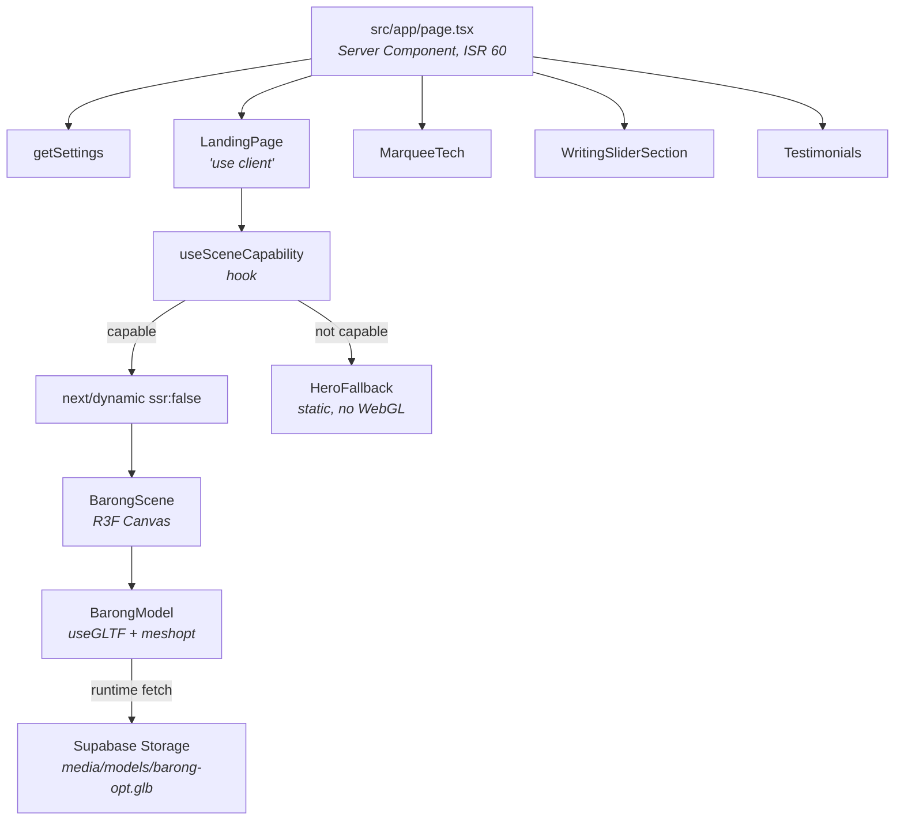

# Design — 3D Landing Experience

## Overview

`LandingPage` becomes the hero section of `/`, replacing the existing WebGL
fluid-reveal hero. A React Three Fiber `<Canvas>` renders a meshopt-compressed
Barong model, mounted only on devices that pass a capability gate. Everything
below the hero — tech marquee, writing slider, testimonials — is untouched.

The two hard problems are the 78 MB asset and the fact that this project's
Content-Security-Policy makes the conventional Draco decoder path unusable. Both
are solved below rather than deferred.

## Architecture



Removed in the same change: `HeroSection`, `MaskReveal`, `HeroOverlay`,
`MobileHero`, `FluidSimulation`, and the two hero texture `<link rel="preload">`
tags.

## Key design decisions

### D1 — LandingPage replaces the hero section, not the whole page

**Decision.** `src/app/page.tsx` keeps its structure and swaps `<HeroSection/>`
for `<LandingPage {...}/>`. `MarqueeTech`, `WritingSliderSection`, and
`Testimonials` stay.

**Rejected: LandingPage replaces the entire page**, as the interrupted work did.
That drops three content sections, the `ProfilePage` JSON-LD, and the testimonial
and tools reads — a content and SEO regression traded for a hero change.

**Rejected: a separate route** such as `/landing`. Two heroes to maintain, split
analytics, and the decision merely postponed.

Satisfies Requirement 5.1, 5.6, 5.7.

### D2 — Delete the fluid-simulation hero

**Decision.** `MaskReveal` (512 lines), `FluidSimulation` (409 lines),
`HeroOverlay`, `MobileHero`, and `HeroSection` are deleted. Their texture
preloads go with them.

**Why.** Requirement 5.2 permits one WebGL context on `/`. Keeping both means
two Three.js render paths in one bundle, and `MaskReveal` is already the most
expensive thing on the critical path.

**Cost, stated plainly.** ~1 400 lines of working, polished code is removed,
including the separate mobile editorial hero. `HeroOverlay`'s animated role
typewriter and social rail must be re-created inside `LandingPage` or genuinely
dropped — decide during task 6, do not let it vanish by omission.

**Mitigation.** The deletion is its own commit, so it can be reverted
independently of the new hero.

Satisfies Requirement 5.3, 5.5.

### D3 — meshopt, not Draco, because of this project's CSP

**Decision.** Compress geometry with **meshopt** via `gltf-transform`, and
register `MeshoptDecoder` from `three`'s own bundled module.

**Why.** This is a CSP constraint, not a preference. `drei`'s `useGLTF(url, true)`
enables Draco by pulling the decoder from `https://www.gstatic.com/draco/...`.
Two things in `next.config.ts` break that:

1. `script-src` is `'self' 'unsafe-inline' 'unsafe-eval' challenges.cloudflare.com`
   — `*.gstatic.com` is allowed for `connect-src`, `img-src`, and `font-src`,
   but **not** `script-src`.
2. `DRACOLoader` instantiates a Worker from a `blob:` URL. There is no
   `worker-src` directive, so it falls back to `default-src 'self'`, and
   `blob:` is not permitted.

Making Draco work would require self-hosting the decoder under `public/draco/`
**and** adding `worker-src 'self' blob:` to the CSP — weakening the policy for a
compression format with no advantage here.

`MeshoptDecoder` ships inside the `three` package
(`three/examples/jsm/libs/meshopt_decoder.module.js`), is bundled by Turbopack,
and needs no network fetch and no blob worker. Compression ratios on a model of
this kind are comparable.

```typescript
// src/components/Fragments/BarongScene/decoder.ts
import { MeshoptDecoder } from "three/examples/jsm/libs/meshopt_decoder.module.js";
import { useGLTF } from "@react-three/drei";

// Registered once at module scope — the loader is a singleton inside drei.
useGLTF.setDecoderPath?.(undefined as never); // not used; meshopt needs no path
export function registerMeshopt(loader: { setMeshoptDecoder: (d: unknown) => void }) {
  loader.setMeshoptDecoder(MeshoptDecoder);
}
```

> Verify the exact `drei` v10 extension API against the installed package before
> implementing — `useGLTF(url, draco?, meshopt?, extendLoader?)` has changed
> shape across versions. The *constraint* above is what matters; the call
> signature is an implementation detail to confirm, not guess.

Satisfies Requirement 2.4, 2.6.

### D4 — Asset pipeline is a documented command, not a one-off

**Decision.** The transform is recorded here and re-runnable.

```bash
# One-off tool, not a project dependency:
npx --yes @gltf-transform/cli@4 optimize \
  public/models/barong.glb \
  /tmp/barong-opt.glb \
  --compress meshopt \
  --texture-compress webp \
  --texture-size 2048 \
  --simplify \
  --simplify-error 0.001

ls -lh /tmp/barong-opt.glb   # must be <= 8 MB (Requirement 2.2)
```

Then upload to the `media` bucket at `models/barong-opt.glb` and record the
public URL in `NEXT_PUBLIC_BARONG_MODEL_URL`.

**Rejected: committing the optimised file to `public/`.** Even at 8 MB it
exceeds the 2 MB asset budget in
[structure.md](../../steering/structure.md#asset-budget), and `public/` is served
uncompressed as part of the deployment bundle.

**Rejected: `git lfs`.** Adds a clone-time dependency for one asset, and Vercel
still has to ship it.

`public/models/barong.glb` is deleted once the optimised derivative is uploaded.
It is currently untracked, so no history rewrite is needed — **this is the only
window in which that is true. Do not commit it.**

Satisfies Requirement 2.1, 2.2, 2.3, 2.5, 2.7.

### D5 — Capability gate runs before the Canvas mounts

**Decision.** A `useSceneCapability()` hook returns `"capable" | "fallback" |
"pending"`. `<Canvas>` is behind `next/dynamic` and only rendered on
`"capable"`, so an incapable device never downloads the R3F chunk or the model.

**Rejected: render the Canvas and let R3F's `fallback` handle failure.** The
bundle and the model are fetched first, which is exactly the cost we are trying
to avoid on weak devices.

**Rejected: server-side user-agent detection.** Unreliable, and it would make
`/` dynamic, losing `revalidate = 60`.

`"pending"` exists because the checks are client-only: the first render returns
`"pending"` and shows the fallback, avoiding a hydration mismatch.

Satisfies Requirement 4.1, 4.5, 4.6, 4.7.

### D6 — Migrate LandingPage to the project token system

**Decision.** Replace the component's hardcoded `bg-slate-950`, `text-slate-100`,
`border-slate-800`, `text-cyan-400` with `rgb(var(--bg))`, `rgb(var(--fg))`,
`rgb(var(--border))`, and `rgb(var(--accent))`.

**Why.** The component as written is dark-only and ignores `next-themes`
entirely. The project's accent is **emerald** (`16 185 129` light / `52 211 153`
dark), so the cyan/indigo gradient is also off-brand. See
[tech.md](../../steering/tech.md#styling) — and note that
`.kiro/steering/design.md` is wrong about the accent being violet.

Satisfies Requirement 7.7.

## Components and interfaces

### New files

| File | Purpose |
|------|---------|
| `src/components/Fragments/BarongScene/index.tsx` | `<Canvas>` + lighting + model. Client component. |
| `src/components/Fragments/BarongScene/BarongModel.tsx` | `useGLTF` load, bounded pointer rotation, disposal. |
| `src/components/Fragments/HeroFallback/index.tsx` | Static, WebGL-free hero visual. |
| `src/hooks/useSceneCapability.ts` | Capability gate. |
| `src/hooks/useSceneCapability.test.ts` | Tests for Requirement 8.2, 8.3. |

### Modified files

| File | Change |
|------|--------|
| `src/app/page.tsx` | `<HeroSection/>` → `<LandingPage/>`; remove hero texture preloads; keep `revalidate`, keep `ProfilePage` JSON-LD |
| `src/components/Layouts/LandingPage/index.tsx` | Commit it; mount Scene/Fallback; token migration; stable keys; reduced-motion guard |
| `package.json` | add `@react-three/fiber`, `@react-three/drei` |
| `.env.local.example` | add `NEXT_PUBLIC_BARONG_MODEL_URL` |

### Deleted files

`src/components/Layouts/HeroSection/`, `src/components/Fragments/MaskReveal/`,
`src/components/Fragments/HeroOverlay/`, `src/components/Fragments/HeroMobile/`,
`src/lib/fluid-simulation/`, `public/models/barong.glb`. Remove the matching
`vitest.config.ts` coverage-exclude entries.

### Interfaces

```typescript
// src/hooks/useSceneCapability.ts
export type SceneCapability = "pending" | "capable" | "fallback";

/**
 * Client-only capability gate. Returns "pending" on the first render so the
 * server and client agree, then resolves in an effect.
 *
 * "fallback" when any of:
 *   - prefers-reduced-motion: reduce
 *   - WebGL2 context creation fails
 *   - navigator.hardwareConcurrency <= 4
 *   - navigator.deviceMemory is present and < 4
 */
export function useSceneCapability(): SceneCapability;
```

```typescript
// src/components/Fragments/BarongScene/index.tsx
export interface BarongSceneProps {
  /** Public URL of the optimised GLB. */
  modelUrl: string;
  /** Rendered while the model streams in. Must match the Canvas layout box. */
  placeholder?: React.ReactNode;
  /** Called once if loading fails, so LandingPage can swap in the fallback. */
  onError?: () => void;
  className?: string;
}
export function BarongScene(props: BarongSceneProps): React.JSX.Element;
```

```typescript
// src/components/Layouts/LandingPage/index.tsx — unchanged public shape
export interface TenantData { /* …as it exists today… */ }
export type HeroSectionProps = { tenant?: TenantData } & TenantData;
export const LandingPage: React.FC<HeroSectionProps>;
export default LandingPage;
```

`TenantData` field names are frozen by Requirement 6.6.

### Canvas configuration

```tsx
<Canvas
  aria-hidden="true"                    // R7.2 — decorative
  dpr={[1, 2]}                          // R4.9 — cap DPR at 2
  frameloop="demand"                    // R3.7 — see note
  gl={{ powerPreference: "high-performance", antialias: false, alpha: true }}
  camera={{ position: [0, 0, 4], fov: 35 }}
>
  <Suspense fallback={null}>
    <BarongModel url={modelUrl} />
  </Suspense>
</Canvas>
```

`frameloop="demand"` plus an `invalidate()` on pointer move satisfies
Requirement 3.7 for the idle case. For off-screen pausing, wrap in an
`IntersectionObserver` and switch `frameloop` to `"never"` — R3F re-reads the
prop, so this is a state flip, not a remount.

## Data models

No schema change. No new table, no migration.

One new environment variable:

```
# Public URL of the optimised Barong GLB in the Supabase media bucket.
NEXT_PUBLIC_BARONG_MODEL_URL=https://<project>.supabase.co/storage/v1/object/public/media/models/barong-opt.glb
```

`NEXT_PUBLIC_` is correct: the browser fetches the model directly, and the URL is
public by design. The `media` bucket already has an anon-read policy.

### CSP verification

No change to `next.config.ts` is required, **provided D3 is followed**:

| Need | Directive | Already allows it? |
|------|-----------|--------------------|
| `fetch` the GLB from Supabase | `connect-src` | ✅ `*.supabase.co` |
| meshopt decoder | — | ✅ bundled, no network |
| WebGL2 context | — | ✅ not CSP-governed |
| Draco decoder from gstatic | `script-src` | ❌ **not allowed — do not use** |
| Blob worker | `worker-src` → `default-src 'self'` | ❌ **not allowed — do not use** |

If an implementer reaches for Draco anyway, the CSP must change and
[ADR-010](../../steering/decisions.md#adr-010--enforcing-csp-with-unsafe-inline-and-unsafe-eval)
needs a successor ADR. Prefer meshopt.

## Correctness properties

Phrased for `fast-check` where a generator makes sense.

**P1 — Capability gate is conservative.** For any combination of
`prefers-reduced-motion`, WebGL2 availability, `hardwareConcurrency`, and
`deviceMemory`, `useSceneCapability()` returns `"capable"` **only if** reduced
motion is not requested AND WebGL2 succeeds AND `hardwareConcurrency > 4` AND
(`deviceMemory` is absent OR `>= 4`). Generate the full boolean/numeric space;
assert no false `"capable"`.

**P2 — First render never mismatches.** On the first render, for every input
combination, the hook returns `"pending"`. Guarantees hydration safety.

**P3 — Props never produce an empty element.** For any `TenantData` with
arbitrary missing or empty-string fields, `LandingPage` renders a non-empty
`<h1>` and at least one CTA. Covers Requirement 6.4.

**P4 — Exactly one `<h1>`.** For any props, the rendered output contains exactly
one `<h1>`. Covers Requirement 7.1.

**P5 — Stable keys.** For any `skills` and `stats` arrays, reordering the input
reorders the rendered nodes without remounting surviving items. Covers
Requirement 7.5; today the component keys by index.

**P6 — Fallback is total.** For any error thrown by the model loader,
`LandingPage` renders the Fallback_Visual and no error text reaches the DOM.
Covers Requirement 3.5.

## Error handling

| Failure | Behaviour | Requirement |
|---------|-----------|-------------|
| Model URL unset | Fallback_Visual; `console.warn` once | 3.5 |
| Model fetch 404 / network error | `onError` → Fallback_Visual; nothing user-visible | 3.5 |
| WebGL2 unavailable | Gate returns `"fallback"`; Canvas never mounts | 4.6 |
| Reduced motion | Gate returns `"fallback"`; GSAP timeline skipped | 4.5, 7.4 |
| Weak device | Gate returns `"fallback"` | 4.7 |
| Context lost at runtime | `webglcontextlost` listener → Fallback_Visual | 3.5 |
| `getSettings()` fails | `defaultSettings`, per ADR-002/ADR-003 — unchanged | 6.5 |

Consistent with [ADR-003](../../steering/decisions.md#adr-003--queries-never-throw):
nothing in this path throws to a user, and no error string is rendered.

## Measuring the budget

Requirement 8.1 needs recorded numbers, not assertions.

| Criterion | Method |
|-----------|--------|
| R4.2 — ≤250 KB gzipped delta | `npm run build`, record the `/` route's First Load JS before and after. Note that Next.js 16 **removed** `size` and `First Load JS` from build output as inaccurate for RSC — if absent, measure the gzipped chunk sizes under `.next/static/chunks` attributable to R3F instead, and say so. |
| R4.3 — ≥30 fps at 4× CPU | Chrome DevTools Performance, CPU 4× throttle, 10 s recording, read the FPS chart. |
| R4.4 — LCP ≤2.5 s | Lighthouse mobile preset, Fast 3G + 4× CPU. Confirm the LCP element is text or a 2D image, never the Canvas. |

Record device, browser version, and date alongside each number.
