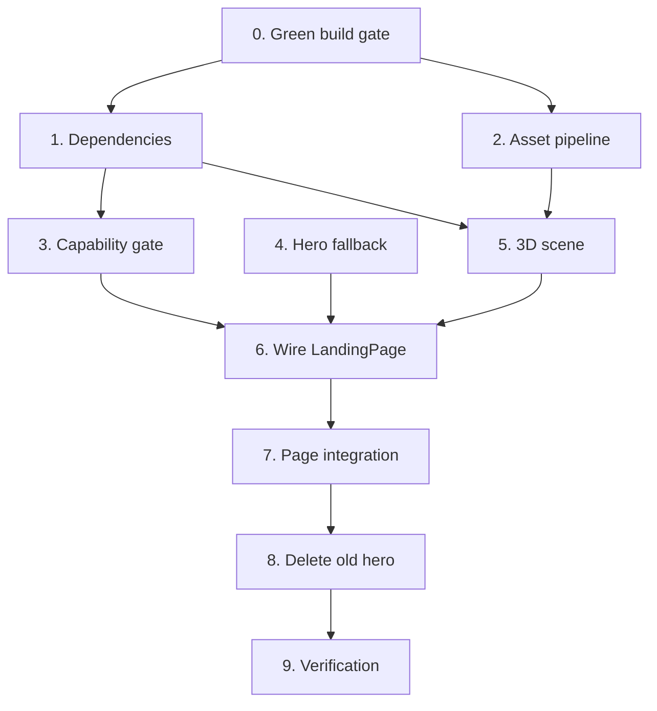

# Tasks — 3D Landing Experience

Dependency order is strict: build gate → asset → gate hook → scene → wiring →
deletion → verification. Do not reorder; the deletion step is only safe once the
replacement renders.

## Tasks

- [x] 0. Green build gate
  - [x] 0.1 Restore `node_modules` and clear stale build output
    - `npm install` — fixes the missing `@testing-library/dom`
    - `rm -rf .next` — clears the `admin/settings/page.js` validator reference left by a build on branch `0010`
    - Confirm all four of `typecheck`, `lint`, `test`, `build` pass **before** changing any source
    - Record the baseline: test count, lint warning count, `/` route JS size
    - _Requirements: 1.4, 8.1_

- [ ] 1. Dependencies and version compatibility
    - **Baseline recorded 2026-11-01** on `development` @ `efa8456`: typecheck clean · lint 0 errors / 8 warnings · **10 test files, 147 tests passing** · `next build` succeeds · `.next/static/chunks` = 2.2 MB raw, 602.1 KB gzipped across 30 chunks
    - Cause was confirmed as pure `node_modules` desync: `npm install` changed neither `package.json` nor `package-lock.json`
    - Note: `next build` in Next.js 16 no longer prints per-route JS size, so bundle deltas must be measured from `.next/static/chunks`
  - [ ] 1.1 Install `@react-three/fiber` and `@react-three/drei`
    - `npm install @react-three/fiber @react-three/drei`
    - Confirm the resolved `@react-three/fiber` major supports React 19 and the installed `three` version
    - Commit `package.json` **and** `package-lock.json` together
    - _Requirements: 1.1, 1.2_
  - [ ] 1.2 Commit the existing `LandingPage` component unchanged
    - `src/components/Layouts/LandingPage/index.tsx` is currently untracked; commit it as-is first so later edits show as a readable diff
    - _Requirements: 1.3_
  - [ ] 1.3 Re-run the gate
    - All four commands green. R3F brings peer-dependency churn; catch it here, not in task 5
    - _Requirements: 1.4_

- [ ] 2. Model asset pipeline
  - [ ] 2.1 Produce the optimised model
    - Run the `@gltf-transform/cli` command recorded in `design.md` §D4
    - **Hard gate: output ≤ 8 MB.** If not met, drop `--texture-size` to 1024 and raise `--simplify-error`, then re-measure
    - Record the final size and the exact command used
    - _Requirements: 2.2, 2.3, 2.4_
  - [ ] 2.2 Visually verify the optimised model
    - Open in any GLB viewer; confirm geometry and textures survived simplification
    - A model that is small but visibly broken fails this task
    - _Requirements: 2.3_
  - [ ] 2.3 Upload to Supabase Storage
    - Upload to the `media` bucket at `models/barong-opt.glb`
    - Verify the public URL is anonymously fetchable
    - Add `NEXT_PUBLIC_BARONG_MODEL_URL` to `.env.local.example` and to the local `.env.local`
    - _Requirements: 2.5, 2.6_
  - [ ] 2.4 Delete the source model
    - `rm public/models/barong.glb` and remove the now-empty `public/models/`
    - It is untracked today, so this leaves no git history. **This is the only window in which that is true.**
    - _Requirements: 2.1, 2.7_

- [ ] 3. Capability gate
  - [ ] 3.1 Implement `src/hooks/useSceneCapability.ts`
    - Return `"pending"` on first render; resolve in an effect
    - `"fallback"` if reduced motion, OR WebGL2 context creation fails, OR `hardwareConcurrency <= 4`, OR `deviceMemory` present and `< 4`
    - Wrap every browser-API read in `try`/`catch`; a throwing probe means `"fallback"`, never `"capable"`
    - _Requirements: 4.5, 4.6, 4.7_
  - [ ] 3.2 Write `src/hooks/useSceneCapability.test.ts`
    - Reduced-motion case renders the fallback — _Requirements: 8.2_
    - WebGL2 failure case renders the fallback — _Requirements: 8.3_
    - _Requirements: 8.2, 8.3_
  - [ ] 3.3* Property test P1 and P2
    - P1: gate is conservative across the full input space
    - P2: first render is always `"pending"`
    - `fast-check`, minimum 100 runs, tagged `// Feature: landing-3d-experience, Property N: <text>`
    - _Requirements: 4.5, 4.6, 4.7_

- [ ] 4. Hero fallback
  - [ ] 4.1 Build `src/components/Fragments/HeroFallback/index.tsx`
    - Static image or CSS composition. No WebGL, no new JS beyond what `LandingPage` already loads
    - Must occupy the same layout box as the Canvas so switching introduces no shift
    - Use the project tokens, not `slate-*`
    - _Requirements: 4.8, 3.3_

- [ ] 5. The 3D scene
  - [ ] 5.1 Build `BarongModel.tsx`
    - `useGLTF` with meshopt registered per `design.md` §D3 — **not Draco**; the CSP forbids the gstatic decoder and blob workers
    - Confirm the `drei` v10 loader-extension signature against the installed package before writing the call
    - Bounded pointer rotation; no free zoom or pan
    - Dispose geometries, materials, and textures on unmount
    - _Requirements: 3.1, 3.4, 3.6, 2.4, 2.6_
  - [ ] 5.2 Build `BarongScene/index.tsx`
    - `<Canvas>` with `aria-hidden="true"`, `dpr={[1, 2]}`, `frameloop="demand"`, `antialias: false`
    - `IntersectionObserver` flips `frameloop` to `"never"` while off-screen
    - `webglcontextlost` listener calls `onError`
    - `<Suspense>` boundary; loader failure calls `onError` rather than throwing
    - _Requirements: 3.1, 3.5, 3.7, 4.9, 7.2_
  - [ ] 5.3 Verify disposal
    - Mount, unmount, and confirm no WebGL context is retained — check `WEBGL_lose_context` or a renderer-count probe in a browser, since jsdom cannot observe this
    - _Requirements: 3.6_

- [ ] 6. Wire LandingPage
  - [ ] 6.1 Mount scene or fallback behind the gate
    - `next/dynamic` with `ssr: false`, imported inside the client component — `ssr: false` is a hard error in a Server Component in Next.js 16
    - `loading` placeholder matching the Canvas layout box
    - Render `HeroFallback` on `"pending"` and `"fallback"`
    - _Requirements: 3.2, 3.3, 4.1_
  - [ ] 6.2 Guard the GSAP timeline on reduced motion
    - Timeline does not run; content is immediately visible at `opacity: 1` and natural transform. **Not** a faster animation
    - _Requirements: 7.3, 7.4_
  - [ ] 6.3 Migrate to the project token system
    - Replace `bg-slate-950`, `text-slate-100`, `border-slate-800`, `text-cyan-400` with `rgb(var(--bg))`, `rgb(var(--fg))`, `rgb(var(--border))`, `rgb(var(--accent))`
    - Note the project accent is **emerald**, not violet — `.kiro/steering/design.md` is wrong on this
    - Verify in both light and dark themes
    - _Requirements: 7.7_
  - [ ] 6.4 Fix keys and heading structure
    - Key skills and stats by a stable identifier, not array index
    - Exactly one `<h1>`; CTAs keyboard-reachable with a visible focus ring
    - _Requirements: 7.1, 7.5, 7.6_
  - [ ] 6.5 Decide the fate of `HeroOverlay`'s content
    - The animated role typewriter and social rail live in the component being deleted
    - **Explicitly** re-create them in `LandingPage` or record the decision to drop them in `## Notes` below
    - Do not let this disappear by omission
    - _Requirements: 5.3_

- [ ] 7. Page integration
  - [ ] 7.1 Swap the hero in `src/app/page.tsx`
    - `<HeroSection/>` → `<LandingPage {...}/>`, content from `getSettings()`
    - Remove the hardcoded `'Devina Studio'` placeholder object entirely
    - Keep `export const revalidate = 60` and the `ProfilePage` JSON-LD
    - Keep `MarqueeTech`, `WritingSliderSection`, `Testimonials` untouched
    - _Requirements: 5.1, 5.6, 5.7, 6.1, 6.2, 6.3_
  - [ ] 7.2 Remove the hero texture preloads
    - Both `<link rel="preload">` tags go with the hero they fed
    - _Requirements: 5.5_
  - [ ] 7.3 Verify unconfigured-Supabase rendering
    - Unset the Supabase env vars; `/` renders from `defaultSettings`
    - _Requirements: 6.5_

- [ ] 8. Delete the fluid-simulation hero
  - [ ] 8.1 Remove the old hero in a standalone commit
    - Delete `src/components/Layouts/HeroSection/`, `src/components/Fragments/MaskReveal/`, `src/components/Fragments/HeroOverlay/`, `src/components/Fragments/HeroMobile/`, `src/lib/fluid-simulation/`
    - Remove the matching `vitest.config.ts` coverage-exclude entries, including the duplicated `MaskReveal` / `HeroMobile` / `HeroOverlay` lines
    - Own commit, so it reverts independently of the new hero
    - _Requirements: 5.2, 5.3_
  - [ ] 8.2 Clean `tsconfig.json`
    - Drop `src/components/Elements/ScrollSmooth/index.tsx.bak` from `include` and delete the `.bak` file
    - _Requirements: (repo hygiene, G6)_

- [ ] 9. Verification
  - [ ] 9.1 Run the full gate
    - `typecheck` → `lint` → `test` → `build`, all green
    - Lint warning count must not exceed the task 0.1 baseline
    - _Requirements: 1.4_
  - [ ] 9.2 Measure and record the performance budget
    - R4.2 bundle delta ≤250 KB gzipped — note that Next.js 16 removed `First Load JS` from build output; if absent, measure R3F-attributable chunks under `.next/static/chunks` and say so
    - R4.3 ≥30 fps at 4× CPU throttle over 10 s
    - R4.4 LCP ≤2.5 s on Lighthouse mobile, Fast 3G + 4× CPU, with the LCP element being text or a 2D image
    - Record each number with tool, device, browser version, and date, in `## Measurements` below
    - **A failed budget is a failed task.** Reduce `--texture-size`, raise `--simplify-error`, or drop the model — do not record the number and continue
    - _Requirements: 4.2, 4.3, 4.4, 8.1_
  - [ ] 9.3* Property tests P3–P6
    - P3 props never produce an empty element, P4 exactly one `<h1>`, P5 stable keys, P6 fallback is total
    - _Requirements: 6.4, 7.1, 7.5, 3.5_
  - [ ] 9.4 Update steering docs in the same change
    - `product.md`: `/` composition changed
    - `architecture.md`: the WebGL subsystem L4 section and the hero flow diagram
    - `current-state.md`: close G4; note the lost-work item as resolved
    - `decisions.md`: new ADR recording the hero replacement and the meshopt-over-Draco CSP decision
    - _Requirements: (ADR-014)_

## Task dependency graph

Tasks 2, 3, and 4 are independent of each other and can run in parallel once
task 1 lands.

## Notes

- **Task 2.1 is the gate for the whole spec.** If the model cannot be brought
  under 8 MB while still looking right, stop and reconsider the asset — a
  different model, or a 2D rendered sequence. Do not proceed with a 78 MB or even
  a 30 MB download.
- **Do not commit `public/models/barong.glb`.** It is untracked right now. Once
  committed, it is in history permanently and removing it needs a rewrite.
- **Task 8 is deliberately last and deliberately separate.** Deleting ~1 400
  lines of working hero code before the replacement is measured and green is how
  this becomes unrevertable.
- The CSP forbids the conventional Draco path. If an implementer reaches for
  `useGLTF(url, true)`, it will fail at runtime with a CSP violation, not a
  build error. `design.md` §D3 explains why and what to use instead.
- Per `AGENTS.md`, read the relevant guide under `node_modules/next/dist/docs/`
  before touching router, caching, image, or metadata code. The relevant ones
  here are `01-app/02-guides/lazy-loading.md` for `ssr: false` and
  `01-app/02-guides/upgrading/version-16.md` for the `next/image` default changes.

## Measurements

Fill in during task 9.2. Empty means unverified, not passing.

| Criterion | Target | Measured | Tool / profile | Date |
|-----------|--------|----------|----------------|------|
| Optimised model size | ≤ 8 MB | | `ls -lh` | |
| Bundle delta | ≤ 250 KB gz | | | |
| Frame rate | ≥ 30 fps | | DevTools, 4× CPU, 10 s | |
| LCP | ≤ 2.5 s | | Lighthouse mobile, Fast 3G + 4× CPU | |
