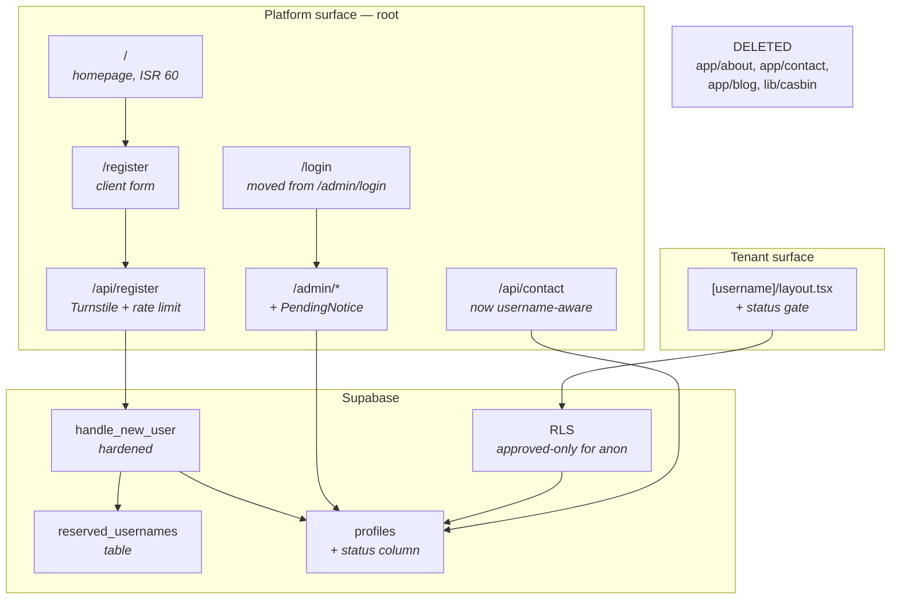

# Design — Platform Homepage & Signup

## Overview

Four changes that together turn a single-tenant portfolio into a platform: the
root becomes the product's own surface, registration exists and is gated by
approval, username allocation stops producing unreachable tenants, and the
contact form delivers to the right person.

The riskiest part is not the UI. It is that **username safety and approval
gating must be enforced in the database**, because the Next.js router resolves
static segments before dynamic ones and will never report a collision, and
because an `anon` Supabase client has no `auth.uid()` for RLS to compare
against.

## Architecture



## Key design decisions

### D1 — Reserved usernames live in a table, not two lists

**Decision.** A `reserved_usernames` table, read by `handle_new_user()` and
exposed to the app through a small server query.

```sql
create table if not exists public.reserved_usernames (
  name text primary key
);

insert into public.reserved_usernames (name) values
  ('admin'), ('api'), ('register'), ('login'), ('_next'),
  ('favicon.ico'), ('opengraph-image'), ('robots.txt'), ('sitemap.xml'),
  ('about'), ('contact'), ('blog'), ('tools'), ('settings'), ('dashboard'),
  ('pricing'), ('terms'), ('privacy'), ('docs'), ('help'), ('support'),
  ('new'), ('edit'), ('static'), ('assets'), ('public'), ('www'), ('mail')
on conflict (name) do nothing;
```

**Why a table rather than a constant array in both places.** Requirement 3.4
demands one source of truth. A TypeScript constant cannot be read by a
`plpgsql` trigger, and duplicating the list guarantees eventual divergence —
the failure mode being a username that passes the form and is then silently
renamed by the trigger, or worse, accepted and unreachable. A table is readable
by both, and adding a reserved word is a one-row insert rather than a deploy.

**Rejected: hardcode the list in the trigger only.** The form could then not
give a fast error, so every reserved attempt would cost a round-trip through
`signUp` and surface as a trigger exception.

Satisfies Requirement 3.3, 3.4.

### D2 — The trigger is the authority; the form is a courtesy

**Decision.** `handle_new_user()` sanitises, lowercases, rejects reserved
names, and resolves collisions. The form performs the same checks client-side
purely for error quality.

**Why.** The router cannot report a collision — static beats dynamic silently —
so there is no runtime signal that something went wrong. The only place that can
refuse is the write path, and the only write path is the trigger.

The asymmetry in Requirement 3.5 vs 3.6 is deliberate:

| Username origin | On conflict |
|-----------------|-------------|
| Derived from email, user never chose it | allocate a safe alternative silently |
| Explicitly submitted by the user | **reject with a reason** |

Silently renaming a username someone deliberately typed is worse than an error.
Silently allocating one they never saw is fine.

```sql
-- sanitise: lowercase, strip disallowed chars, collapse hyphens, trim them
v_base := regexp_replace(lower(v_username), '[^a-z0-9-]+', '-', 'g');
v_base := regexp_replace(v_base, '-{2,}', '-', 'g');
v_base := trim(both '-' from v_base);
if length(v_base) < 3 then
  v_base := 'user';
end if;

-- reserved or taken, case-insensitive
while exists (select 1 from public.reserved_usernames where name = v_candidate)
   or exists (select 1 from public.profiles where lower(username) = v_candidate)
loop
  v_candidate := v_base || '-' || v_suffix::text;
  v_suffix := v_suffix + 1;
end loop;
```

Case-insensitive uniqueness also needs the index changed:

```sql
-- Name confirmed in 0005_multi_tenant.sql:37 (task 0.4).
drop index if exists profiles_username_idx;
create unique index if not exists profiles_username_lower_idx
  on public.profiles (lower(username));
```

Satisfies Requirement 3.1, 3.2, 3.5, 3.6, 3.7, 3.8, 3.9.

### D3 — Approval is enforced in RLS, by replacing the existing policies

**Decision.** Migration 0006 **replaces** the select policies that `0005`
created, adding an approved-check to their anonymous branch while preserving
their owner branch.

> **Names and shapes verified against `0005_multi_tenant.sql` on branch `0010`
> (task 0.4), not assumed.** Three things an earlier draft of this design got
> wrong, each of which would have failed *silently*:
>
> 1. The content policies are named `projects_select`, `testimonials_select`,
>    `about_scenes_select`, `blogs_select` — **not** `*_anon_select`. A
>    `drop policy if exists "blogs_anon_select"` is a no-op that leaves the
>    permissive policy in place.
> 2. They are **not role-restricted**. There is no `to anon`; one policy serves
>    every role via `using (published = true or user_id = <own profile>)`.
>    Adding a separate `to anon` policy would not gate anything, because RLS
>    policies are OR-ed and the original stays permissive.
> 3. Because the owner branch lives in that same policy, replacing it carelessly
>    **removes a tenant's access to their own unpublished rows**.

```sql
-- profiles: 0005 has `for select using (true)` with no role restriction.
-- Narrowing it is safe: a tenant still reads their own row through the separate
-- profiles_auth_select policy, and RLS policies are OR-ed.
drop policy if exists "profiles_anon_select" on public.profiles;
create policy "profiles_anon_select" on public.profiles
  for select using (status = 'approved');

-- Content tables: replace the combined policy, keeping the owner branch intact.
drop policy if exists "blogs_select" on public.blogs;
create policy "blogs_select" on public.blogs
  for select using (
    (
      published = true
      and exists (
        select 1 from public.profiles p
        where p.id = blogs.user_id and p.status = 'approved'
      )
    )
    or user_id = (select id from public.profiles where id = auth.uid())
  );
```

Repeat verbatim for `projects_select`, `testimonials_select`,
`about_scenes_select`, and `tools_select` — substituting the table name in the
`exists` subquery. **`tools` is included**: `0005` gives it `user_id` and the
same policy shape as the other content tables.

**Why in RLS and not just a `status` check in the tenant layout.** A page-level
check protects only the paths that remember to perform it. There are five tenant
routes plus five `generateMetadata` functions; one omission leaks an unapproved
portfolio. RLS makes the data unreachable regardless of which query runs.

`getProfileByUsername()` then returns `null` for an unapproved tenant with no
application change, and the existing `notFound()` path handles it — which is
what makes Requirement 5.4 free: the response is already identical to a
non-existent username.

**Cost.** An `exists` subquery on every anonymous content read.
`profiles_id_idx` covers it.

Satisfies Requirement 5.3, 5.4, 5.5, 5.6.

### D4 — Registration goes through a route handler, not straight to Supabase

**Decision.** The form posts to `POST /api/register`, which verifies Turnstile
and rate-limits, then calls `signUp` using the server client.

**Why.** `TURNSTILE_SECRET_KEY` is server-only, so the token cannot be verified
from the browser. Calling `signUp` directly from the client — as
`/admin/login` does for sign-in — would mean an unprotected account-creation
endpoint, which on a public-signup product is an open invitation to mass
registration and username squatting.

The handler reuses the exact layering already proven in
`src/app/api/contact/route.ts`: honeypot, in-memory per-IP rate limit,
server-side validation, Turnstile, then the action.

**Known limitation, inherited:** the rate limit is per-instance and resets on
cold start — see
[ADR-011](../../steering/decisions.md#adr-011--in-memory-per-ip-rate-limiting).
Turnstile is the real control. Acceptable because approval gating
([ADR-016](../../steering/decisions.md#adr-016--waitlist-with-manual-approval))
means a mass-registered account still cannot publish anything.

Satisfies Requirement 4.2, 4.4, 4.5.

### D5 — Contact recipient is the verified auth email, never a tenant-editable field

**Decision.** `POST /api/contact` accepts `username`, resolves the profile id on
the anon client, then reads **`auth.users.email`** with the service-role client.

```typescript
const username = toString(payload.username).trim().toLowerCase();
if (!username) return bad("Missing recipient.", 400);

// anon client → D3's RLS already restricts this to approved profiles
const profile = await getProfileByUsername(username);
if (!profile) return bad("This portfolio cannot receive messages.", 404);

// auth.users is not readable by anon; service role is required
const admin = createSupabaseClient(SUPABASE_URL, SUPABASE_SERVICE_ROLE_KEY, {
  auth: { persistSession: false, autoRefreshToken: false },
});
const { data, error } = await admin.auth.admin.getUserById(profile.id);
const to = data?.user?.email;
if (error || !to) return bad("This portfolio cannot receive messages.", 404);
```

**Why not `profiles.email`.** Three reasons, each independently sufficient:

1. **It is tenant-editable free text.** `src/components/Layouts/AdminSettings/index.tsx:126`
   is a plain `<input type="email">` the tenant controls, and the column is
   `text not null default ''`. Nothing verifies it.
2. **It is empty for every new tenant.** `handle_new_user()` inserts only
   `id`, `username`, `name`. The `0005` data migration populates `email` for the
   pre-existing owner row alone. Every registration therefore starts with
   `email = ''`.
3. **It is an abuse vector.** A tenant could set it to a third party's address.
   The platform would then deliver visitor-composed HTML to that victim **from
   the platform's own verified domain** — spending the platform's sender
   reputation on content and a recipient the attacker chose. It requires an
   account, so it is not a true open relay, but it is close enough to matter.

`auth.users.email` is confirmed by Supabase Auth, and changing it requires
confirming the new address. That is the property the delivery target needs.

`profiles.email` stays as it is: a public display value on the tenant's contact
page. Display and delivery are different concerns and should not share a field.

**Rejected: accept a recipient address in the payload.** That is a literal open
relay — anyone could make the platform send arbitrary HTML email to any address
from a verified domain.

**Rejected: mirror the auth email into a `profiles.auth_email` column.** It adds
a value that can drift from its source, and keeping it correct means a second
trigger on `auth.users` update. One authoritative read is simpler.

**Consequence worth noting.** This gives `SUPABASE_SERVICE_ROLE_KEY` a new
legitimate consumer, so it is **retained** even though
[D6](#d6--casbin-is-deleted-not-disabled) removes its previous one. It is
server-only and must never gain a `NEXT_PUBLIC_` prefix.

Satisfies Requirement 8.1, 8.2, 8.3, 8.8, 8.10, and amends 7.8.

### D5a — Resend requires a verified sender domain for this to work at all

**Decision.** A verified platform domain is a hard prerequisite.
`CONTACT_FROM_EMAIL` must be an address on it, and the
`onboarding@resend.dev` fallback currently in
`src/app/api/contact/route.ts` must be removed.

**Why.** Resend restricts `onboarding@resend.dev` to the account owner's own
address and returns **403** for any other recipient. With the current fallback
in place, multi-tenant delivery fails for every tenant except whoever owns the
Resend account — which is precisely the defect being fixed, with a different
error.

The working shape:

| Field | Value | Note |
|-------|-------|------|
| `from` | `Portfolio <noreply@yourdomain>` | must be a **verified** domain; recipients are otherwise rejected |
| `to` | the tenant's `auth.users.email` | arbitrary recipients are fine once the domain is verified |
| `replyTo` | the visitor's address | unchanged from today |

**`from` cannot be the tenant's own email address.** Resend verifies the sending
domain, and a tenant's `gmail.com` address is not a domain the platform owns.
Every message therefore leaves on the platform's domain, which means the
platform's sender reputation is shared across all tenants — one tenant
attracting spam complaints affects everyone's deliverability. That is the
structural cost of this design, and it is why Requirement 8.13 adds a per-tenant
rate limit on top of the per-IP one.

Satisfies Requirement 8.11, 8.12, 8.13.

### D6 — Casbin is deleted, not disabled

**Decision.** Remove the files, the table, the seed, and the dependency.

**Why.** Per [ADR-018](../../steering/decisions.md#adr-018--remove-casbin): it
governs navbar visibility only; `src/proxy.ts` and `requireAdmin()` are the
actual guards; and with one kind of user it computes the same answer for
everyone. It is also currently harmful — a new tenant with no `g` row gets
`["dashboard"]` and cannot edit their own portfolio.

**Why delete rather than leave it inert.** Unused authorization code gives
false assurance to the next reader and rots against the schema.

Note this amends a **completed** part of `.kiro/specs/multi-tenant-portfolio/`.
Doing it during the `0010` merge is cheaper than after.

Satisfies Requirement 7.1–7.8.

## Components and interfaces

### New files

| File | Purpose |
|------|---------|
| `src/app/register/page.tsx` | Registration page shell |
| `src/components/Fragments/RegisterForm/index.tsx` | Client form, Username_Policy checks, Turnstile widget |
| `src/app/login/page.tsx` | Sign-in, moved from `/admin/login` |
| `src/app/api/register/route.ts` | Turnstile + rate limit + `signUp` |
| `src/components/Layouts/PlatformHome/index.tsx` | Homepage composition |
| `src/components/Fragments/PendingNotice/index.tsx` | Approval-state banner for `/admin` |
| `src/lib/username.ts` | Shared format validation + reserved-name query |
| `src/lib/username.test.ts` | Requirement 9.1, 9.3 |
| `supabase/migrations/0006_platform_signup.sql` | status column, reserved table, hardened trigger, RLS |

### Modified files

| File | Change |
|------|--------|
| `src/app/page.tsx` | Renders `PlatformHome`; drops all `getSettings`/`getTestimonials`/`getTools` reads |
| `src/app/layout.tsx` | Platform metadata; `WebSite` JSON-LD only; `keywords` and `Person` removed |
| `src/app/admin/layout.tsx` | Drops `getVisibleNavItems`; renders `PendingNotice` when status ≠ `approved` |
| `src/app/admin/login/page.tsx` | Becomes a permanent redirect to `/login` |
| `src/components/Layouts/AdminNavbar/index.tsx` | Drops `visibleItems`; fixed list |
| `src/app/api/contact/route.ts` | Resolves recipient from `profiles.email` |
| `src/hooks/useContactForm.ts` | Sends `username` |
| `src/components/Fragments/ContactForm/index.tsx` | Accepts and forwards `username` |
| `src/app/(portfolio)/[username]/layout.tsx` | Defensive `status` check in addition to RLS |
| `src/proxy.ts` / `src/lib/supabase/middleware.ts` | `/login` instead of `/admin/login`; redirect authenticated users away from `/register` |
| `src/components/Layouts/Navbar/index.tsx` | Remove links to deleted routes; add `/login`, `/register` |
| `src/components/Elements/CommandPalette/index.tsx` | Same |
| `package.json` | Remove `casbin` |

### Deleted

`src/app/about/`, `src/app/contact/`, `src/app/blog/`, `src/lib/casbin/`,
and the `casbin_rule` section of `0005_multi_tenant.sql`.

### Interfaces

```typescript
// src/lib/username.ts
export const USERNAME_MIN = 3;
export const USERNAME_MAX = 40;

/**
 * Lowercase alphanumeric groups joined by SINGLE hyphens. Deliberately
 * stricter than `^[a-z0-9][a-z0-9-]{1,38}[a-z0-9]$`, which admits `a--b` —
 * a value the trigger rejects, so accepting it here would mean the form
 * passes something the database refuses.
 */
export const USERNAME_PATTERN = /^[a-z0-9]+(?:-[a-z0-9]+)*$/;

export type UsernameError = "format" | "reserved" | "taken";

/** Trim and lowercase, matching what the trigger compares against. */
export function normalizeUsername(value: string): string;

/** Format only. Synchronous and pure, so the form can call it per keystroke. */
export function isValidUsernameFormat(value: string): boolean;

/** Reserved-table lookup via the anon client; fails closed. */
export function isReservedUsername(value: string): Promise<boolean>;

/**
 * Full check: format, then reserved, then taken. **Server-only** — the taken
 * check needs the service-role key, because D3 narrows anonymous reads on
 * `profiles` to `status = 'approved'`, so an anon lookup would report a name
 * held by a *pending* tenant as free.
 */
export function checkUsername(value: string): Promise<UsernameError | null>;

/** Copy the form shows per rejection. */
export const USERNAME_ERROR_MESSAGE: Record<UsernameError, string>;
```

```typescript
// src/app/api/register/route.ts
// POST { username, email, password, turnstileToken, company }
// → { ok: true } | { ok: false, error: string }
// 400 bad JSON / captcha · 409 username taken or reserved
// 422 validation · 429 rate limited · 500 unconfigured
```

```typescript
// src/components/Fragments/PendingNotice/index.tsx
export function PendingNotice({
  status,
  username,
}: {
  status: "pending" | "rejected";
  username: string;
}): React.JSX.Element;
```

## Data models

### Migration `0006_platform_signup.sql`

Idempotent throughout, matching the existing migration style —
`if not exists`, and `drop policy` before `create policy`.

```sql
-- 1. status column
alter table public.profiles
  add column if not exists status text not null default 'pending';

alter table public.profiles
  drop constraint if exists profiles_status_check;
alter table public.profiles
  add constraint profiles_status_check
  check (status in ('pending', 'approved', 'rejected'));

-- 2. existing profiles are already live — do not hide them
update public.profiles set status = 'approved' where status = 'pending';

create index if not exists profiles_status_idx on public.profiles (status);

-- 3. reserved_usernames table + seed   (see D1)
-- 4. case-insensitive unique index     (see D2)
-- 5. hardened handle_new_user           (see D2)
-- 6. approved-only anon RLS             (see D3)
-- 7. drop casbin_rule
drop table if exists public.casbin_rule;
```

Step 2 is load-bearing: without it, the one existing portfolio vanishes the
moment the migration runs. Note it runs **before** the RLS narrowing in step 6,
so there is no window in which the owner's portfolio 404s.

### Domain type change

```typescript
// src/lib/types.ts
export type ProfileStatus = "pending" | "approved" | "rejected";

export interface Profile {
  // …existing fields…
  status: ProfileStatus;
}
```

`ProfileRow` in `src/lib/queries-by-user.ts` gains `status: string`, and
`mapProfileRow` maps it with a total default of `"pending"` — the conservative
direction, consistent with the mapper convention in
[architecture.md](../../steering/architecture.md#row-mapping).

## Correctness properties

**P1 — Reserved names are never allocated.** For every row in
`reserved_usernames`, and for any case variation of it, `checkUsername()`
returns `"reserved"`. Covers Requirement 3.3, 9.1.

**P2 — Sanitisation always yields a valid username.** For any arbitrary string,
including empty and all-punctuation inputs, the trigger's sanitisation produces
a value matching `USERNAME_PATTERN`. Generate with `fc.fullUnicodeString()`.
Covers Requirement 3.1, 3.2.

**P3 — Uniqueness is case-insensitive.** For any username `u`, after `u` exists,
no case variation of `u` can be inserted. Covers Requirement 3.8, 9.3.

**P4 — Unapproved profiles are invisible to anon.** For any profile with status
`pending` or `rejected`, every anonymous query returns no rows for it, and its
portfolio routes return `notFound()` with no metadata. Covers Requirement 5.3,
5.4, 5.5, 9.2.

**P5 — Contact delivery is tenant-exact.** For any two distinct approved
tenants A and B, a submission carrying A's username delivers only to A's
`auth.users.email`, never to B's, never to any value of `profiles.email`, and
never to `CONTACT_TO_EMAIL`. Covers Requirement 8.2, 8.9, 8.10.

**P6 — No static root path is shadowed.** For every static root segment, the
platform page resolves even when a profile with a similar username exists.
Covers Requirement 9.6.

**P7 — Registration is inert without a valid captcha.** For any payload, if
Turnstile verification fails, no `auth.users` row is created. Covers
Requirement 4.4.

## Error handling

| Failure | Behaviour | Requirement |
|---------|-----------|-------------|
| Username malformed | Inline form error naming the rule | 3.6, 4.3 |
| Username reserved | Inline error; **no silent substitution** | 3.6 |
| Username taken | Inline error; 409 from the handler | 3.6 |
| Trigger raises | Readable message, not raw Postgres text | 4.7 |
| Turnstile fails | 400, no account created | 4.4, P7 |
| Rate limited | 429 | 4.5 |
| Supabase unconfigured | `/register` and `/login` state that signup is unavailable | 4.8 |
| Unapproved tenant portfolio | `notFound()`, no metadata | 5.3, 5.4 |
| Unapproved tenant opens `/admin` | `PendingNotice`; CMS still usable | 5.7, 5.8, 5.9 |
| Contact username unresolved | Error; **never** falls back to `CONTACT_TO_EMAIL` | 8.3 |
| Tenant has no auth email | Error stating the portfolio cannot receive messages | 8.3 |
| No verified sender domain configured | Configuration error; no delivery attempted | 8.12 |
| Per-tenant send limit exceeded | 429 | 8.13 |

Public surfaces still never show a database error string
([ADR-003](../../steering/decisions.md#adr-003--queries-never-throw)). The
registration form is the one place where a *validation* reason must be specific,
because the user has to act on it.
