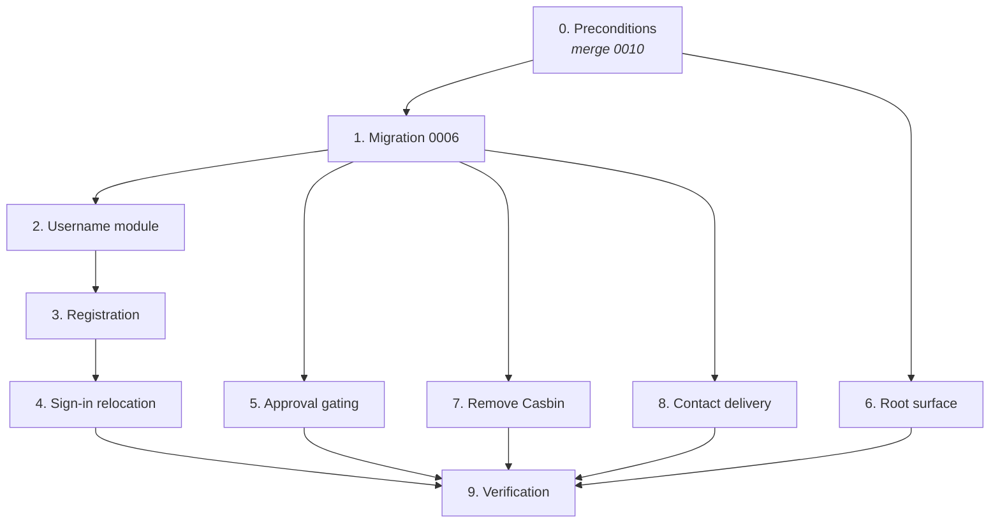

# Tasks — Platform Homepage & Signup

Strict order: merge `0010` → database → shared username module → registration →
approval gating → root surface → Casbin removal → contact → verification.

The database lands first because every later task depends on `profiles.status`
and the hardened trigger. The root deletion lands late because it is
irreversible in effect — the owner's content must already be reachable at
`/dimasyudhana` before `/about` disappears.

## Tasks

- [ ] 0. Preconditions
  - [x] 0.1 Merge `feature/release-awesome/0010`
    - This spec edits `profiles`, `handle_new_user()`, `0005_multi_tenant.sql`, and the `(portfolio)/[username]` route group — none exist on `development`
    - Resolve the 45-file divergence before writing any code here
    - _Requirements: (baseline)_
    - **Done 2026-11-01**, commit `2abae0c`, merged into `development`. Zero conflicts: `git merge-tree` was verified clean both before and after the three preparatory commits, and none of the 45 incoming files overlapped the uncommitted work.
    - `development` was a strict ancestor of `0010`, so this *would* have been a fast-forward; committing first made it a merge commit instead, which is the better record anyway.
    - `getListTestimonials` is byte-identical on both branches, so the task-1 work and its 11 tests survived the merge untouched — verified after merging.
  - [x] 0.2 Green build gate
    - `npm install && rm -rf .next`, then `typecheck`, `lint`, `test`, `build` all green
    - Record baseline test count and lint warning count
    - **Done 2026-11-01, post-merge baseline on `2abae0c`:** typecheck clean · lint 0 errors / **9** warnings · 12 test files / 158 tests · build succeeds, 12 static pages · `.next/static/chunks` 2.3 MB raw, **613.8 KB gzipped**, 33 chunks
    - **`npm install` is required again after the merge.** `0010` brings `casbin` into `package.json`, and typecheck fails with `TS2307: Cannot find module 'casbin'` until it is installed — even though task 7 deletes it. This is the second time a `node_modules` desync has looked like a code defect; re-run `npm install` after any branch operation
    - The ninth lint warning arrives with `0010`: `@next/next/no-img-element` at `src/app/(portfolio)/[username]/blog/page.tsx:77`. Pre-existing in merged code, not introduced here
    - _Requirements: 9.7_
  - [ ] 0.3 Verify `/dimasyudhana` serves the owner's portfolio
    - Run `0005_multi_tenant.sql` against a real Supabase project and confirm the `site_settings` → `profiles` migration populated the owner row
    - **This is the precondition for task 6.** Deleting `/about` before the tenant route works means the content is simply gone
    - _Requirements: 2.6_
  - [x] 0.4 Confirm existing object names before writing the migration
    - The index to drop in D2, and the exact anon policy names on `profiles`, `projects`, `testimonials`, `about_scenes`, `blogs`
    - `0006` drops and recreates them; a wrong name means a silently-surviving permissive policy
    - Record the real names here
    - _Requirements: 5.5, 5.6_
    - **Done 2026-11-01**, read from `0005_multi_tenant.sql` on branch `0010` without merging. Findings are in `## Verified object names` below — **three of them would have made 0006 fail silently**, and design D3 has been corrected.
    - Index to drop: `profiles_username_idx` — `0005_multi_tenant.sql:37`, `create unique index ... (username)`. Confirmed.
    - **`tools` already has `user_id`** and the same per-tenant policy shape as the other content tables. It must be included in the 0006 narrowing, and this also answers the question blocking [`embedded-tools-platform`](../embedded-tools-platform/requirements.md).

- [ ] 1. Migration `0006_platform_signup.sql` — *written; 1.7 awaiting a real database*
  - [x] 1.1 Add `profiles.status`
    - `text not null default 'pending'`; check constraint for the three values; index
    - _Requirements: 5.1_
  - [x] 1.2 Approve pre-existing profiles
    - `update public.profiles set status = 'approved' where status = 'pending'`
    - **Must run before task 1.5.** Without it the owner's live portfolio 404s the moment RLS narrows
    - _Requirements: 5.11_
  - [x] 1.3 Create and seed `reserved_usernames`
    - All 28 names from `design.md` §D1; `on conflict do nothing`
    - _Requirements: 3.3, 3.4_
  - [x] 1.4 Harden `handle_new_user()`
    - Sanitise: lowercase, replace disallowed chars with `-`, collapse repeats, trim hyphens, floor to `'user'` below 3 chars
    - Collision loop checks `reserved_usernames` **and** `lower(username)` in `profiles`
    - Insert with `status = 'pending'`
    - Replace the unique index with one on `lower(username)`
    - _Requirements: 3.1, 3.2, 3.5, 3.7, 3.8, 5.2_
  - [x] 1.5 Narrow anonymous RLS to approved profiles
    - `profiles`: anon select `using (status = 'approved')`
    - `projects`, `testimonials`, `about_scenes`, `blogs`: anon select requires `published = true` **and** an `exists` join proving the owner is approved
    - Use the real policy names from task 0.4
    - _Requirements: 5.5, 5.6_
  - [x] 1.6 Drop `casbin_rule`
    - And remove its section from `0005_multi_tenant.sql` so a fresh install never creates it
    - _Requirements: 7.2_
  - [ ] 1.7 Verify idempotency
    - Run the whole migration twice against the same database. Second run must succeed and change nothing
    - _Requirements: (migration convention)_
    - **Still open — needs a real Postgres.** No `psql`, `postgres` or Supabase CLI is installed on this machine, and the Docker daemon is not running, so `0006` has had **static** validation only:
      - balanced parens and `$$`; no `VALUES` tuple missing a comma
      - every `create policy` is preceded by its own `drop policy if exists`
      - **every policy `0006` drops was verified to exist in `0005` by name** — 6 of 6. This is the check that matters: a drop naming a policy that does not exist is a silent no-op, and the permissive policy survives
      - `profiles_username_idx` exists before being dropped
      - every table and `published` column referenced exists
      - every `create` DDL carries an `if not exists` guard
    - Two apparent failures in that run were artifacts of the checker, not the SQL: the last `VALUES` tuple correctly has no comma, and `handle_new_user` matched as a table name from the substring in `functi`**`on public.`**`handle_new_user`.
    - To close this properly, either start Docker — a throwaway Postgres with `auth`/`storage` stubs can apply `0001`–`0006` twice and exercise the trigger against hostile email local parts, closing task 9.2 at the same time — or apply it to a Supabase branch.

- [x] 2. Shared username module
  - [x] 2.1 Build `src/lib/username.ts`
    - `USERNAME_PATTERN`, `isValidUsernameFormat()`, `checkUsername()`
    - `checkUsername` reads `reserved_usernames` and does a case-insensitive `profiles` lookup — never a second hardcoded list
    - _Requirements: 3.1, 3.4, 3.9_
    - **The documented pattern was wrong and has been corrected.** `^[a-z0-9][a-z0-9-]{1,38}[a-z0-9]$` admits `a--b`, which the trigger rejects after collapsing `-{2,}` — so the form would have accepted a value the database refuses. Now `^[a-z0-9]+(?:-[a-z0-9]+)*$`; Requirement 3.1 and the design interface are updated.
    - `checkUsername` is **server-only**: the taken check needs the service-role key, because section 6 of `0006` narrows anon reads on `profiles` to `approved`, so an anon lookup would report a name held by a *pending* tenant as free.
    - Without the service-role key the taken check is **skipped with a warning** rather than failing closed, so local development works; `handle_new_user()` stays authoritative. The reserved lookup does the opposite and **fails closed**, since refusing an unverifiable name is the safe direction.
  - [x] 2.2 Add `status` to the domain type and mapper
    - `ProfileStatus` in `src/lib/types.ts`; `status` on `Profile`
    - `ProfileRow.status` and `mapProfileRow` with a total default of `"pending"` — the conservative direction
    - _Requirements: 5.1_
    - `ProfileRow.status` is optional (`string | null`), because a database still at `0005` has no such column; `toProfileStatus()` maps anything unrecognised to `"pending"` so an unreadable row is never published by accident.
    - Adding a required field to `Profile` broke no call site, which confirms nothing constructs that type outside the mapper — the row-mapper boundary is intact.
  - [x] 2.3 Tests
    - Every reserved name, in several cases, returns `"reserved"`
    - Format rules: length bounds, leading/trailing hyphen, uppercase, non-ASCII
    - Case-insensitive uniqueness
    - _Requirements: 9.1, 9.3_
  - [x] 2.4* Property tests P1–P3
    - P1 reserved names never allocated, P2 sanitisation always yields a valid username, P3 uniqueness case-insensitive
    - P2 generates with `fc.fullUnicodeString()` — ASCII-only generation misses the inputs this property exists to catch
    - `fast-check`, minimum 100 runs, tagged `// Feature: platform-homepage-signup, Property N: <text>`
    - _Requirements: 3.1, 3.2, 3.3, 3.8_
    - **Done 2026-11-01**, 35 tests in `src/lib/username.test.ts`. Two API notes for whoever writes the next property test:
      - `fc.fullUnicodeString()` **does not exist in fast-check 4.9**. The equivalent is `fc.string({ unit: "binary" })`; `{ unit: "grapheme" }` is the other useful mode
      - the reserved list is **parsed out of the migration at test time**, not restated, so the test and the SQL cannot drift
    - **P2 and P3 as written in `design.md` are database-level claims** — sanitisation inside `handle_new_user()`, and uniqueness enforced by `profiles_username_lower_idx`. Neither can be falsified from vitest, and both wait on task 1.7. What is implemented instead, at the TypeScript boundary:
      - P1 — every reserved name, in any case variation, is rejected (200 runs)
      - P2 — anything `isValidUsernameFormat` accepts satisfies every stated rule: length, charset, no leading/trailing hyphen, no doubled hyphen (500 runs)
      - P3 — `normalizeUsername` is idempotent and valid values are fixed points (500 runs)
    - An earlier draft of the mocking used `vi.doMock` plus `vi.resetModules` for the fail-closed case. That left the failing mock registered for every later dynamic import and broke two unrelated tests. The mock is now a single factory reading mutable state — **worth copying rather than rediscovering**.

- [x] 3. Registration
  - [x] 3.1 Build `POST /api/register`
    - Layer in the same order as `api/contact/route.ts`: honeypot → per-IP rate limit → validation → Turnstile → `signUp`
    - `signUp` passes the username in `raw_user_meta_data.username`
    - Status codes per `design.md`: 400, 409, 422, 429, 500
    - Translate a trigger exception into a readable message
    - _Requirements: 4.2, 4.4, 4.5, 4.7_
    - **Done 2026-11-01.** Rate limit is **3 per 15 minutes**, tighter than the contact form's 5 per 10: a flood of accounts is worse than a flood of email, because every one of them squats a username.
    - **`checkUsername` runs before `signUp`, and that is the point.** Supabase Auth generally reports a trigger exception as a generic "Database error saving new user", so the trigger's own `USERNAME_*` message usually does not survive the round trip. The pre-check makes the error readable; the trigger makes it correct. `fromTriggerError()` maps the prefixes anyway, for the cases where they do arrive.
    - Handles email confirmations being enabled in Supabase: `signUp` then returns a user with no session, so the route replies `{ ok: true, confirmEmail: true }` rather than sending the caller to an admin panel they cannot open.
    - **Two shared helpers were extracted rather than copied**, since duplicating a security control is how the two copies drift:
      - `src/lib/rate-limit.ts` — `createRateLimiter({ windowMs, max })` and `clientIp()`, each limiter with its own map so endpoints do not share a budget
      - `src/lib/turnstile.ts` — `verifyTurnstile()`, including the fail-closed rule for production-with-a-site-key-but-no-secret
      `src/app/api/contact/route.ts` was migrated to both and its 13 existing tests — which do cover the 429 path and `x-forwarded-for` extraction — still pass, which is what made the refactor safe to do at all.
  - [x] 3.2 Build `RegisterForm`
    - Username, email, password; inline Username_Policy errors before submit
    - Reuse the existing `Turnstile` element
    - Reserved or taken → named error, **never** a silent substitution
    - Keyboard-operable, labelled, visible focus
    - Link to `/login`
    - _Requirements: 4.1, 4.3, 4.10, 3.6, 6.6_
    - Inline username feedback is **format only and only after blur**; reserved and taken come back from the server, which is the only side that can know. Shows the resulting URL as you type, so the thing being chosen is visible.
    - Honeypot is positioned off-screen **and** `aria-hidden` **and** `tabIndex={-1}`, so it is hidden from assistive technology and the tab order, not just from sight.
  - [x] 3.3 Build `/register` page
    - Unconfigured Supabase → state that registration is unavailable; do not render a dead form
    - _Requirements: 4.8_
  - [x] 3.4 Redirect to `/admin` on success
    - _Requirements: 4.6_
  - [x] 3.5* Property test P7
    - No `auth.users` row is created when Turnstile verification fails
    - _Requirements: 4.4_
    - 22 tests in `src/__tests__/api/register/route.test.ts`. P7 asserts both that `signUp` is never called **and** that `checkUsername` is never reached, so a failed captcha costs no database work either.
    - Note for the next route test: `vi.mock` factories are **hoisted above every top-level `const`**, so the doubles must be created inside `vi.hoisted()` or the factory captures them before initialisation. A mutable `cfg` object behind a getter is what makes the unconfigured-Supabase path reachable without module resets.
    - One test expectation of mine was wrong and the code was right: `"ADMIN"` normalises to a well-formed `admin`, so format is not the objection — being reserved is. The trigger agrees, comparing the sanitised value against `lower(requested)`. There is now an explicit test for that.

- [x] 4. Sign-in relocation
  - [x] 4.1 Move the sign-in page to `/login`
    - Preserve the open-redirect guard: follow `redirect` only when it starts with `/` and not `//`
    - Link to `/register`
    - _Requirements: 6.1, 6.3, 6.6_
    - **The existing guard had a bypass.** It was `raw.startsWith("/") && !raw.startsWith("//")`, which **accepts `/\evil.com`** — browsers normalise a backslash to a slash, so that resolves protocol-relative to another origin. Now `src/lib/safe-redirect.ts`, which also rejects C0 control characters, since `\n`, `\r` and `\t` are stripped inconsistently and are enough to smuggle a different target. 19 tests, including Property 8: whatever the guard returns is always same-site (1000 runs).
    - Rebuilt on `Field` and `inputClasses` instead of the hand-rolled inputs it had, so it matches every other form in the project.
  - [x] 4.2 Redirect `/admin/login` → `/login`
    - Permanent, preserving the `redirect` query parameter
    - _Requirements: 6.2_
    - `permanentRedirect` from `next/navigation`. `searchParams` is a Promise in Next.js 16 and is awaited; the `redirect` value is sanitised **before** being reflected into the new URL, and omitted entirely when it is just the default.
  - [x] 4.3 Update the proxy
    - Unauthenticated `/admin` → `/login?redirect=<path>`
    - Authenticated on `/login` or `/register` → `/admin`
    - Keep the `createServerClient` / `getUser()` adjacency — inserting work between them desynchronises the cookie refresh
    - _Requirements: 6.4, 6.5_
    - **`/admin/login` is deliberately excluded from the auth gate.** Without that exclusion the gate bounces the request before the stub's own redirect can run, costing an extra hop and producing `?redirect=/admin/login`.
    - The redirect target now carries the **query string** too, not just the pathname, so a signed-out user returns to exactly the view they were on.
    - **Also fixed, found by grepping for stragglers:** `signOut()` in `src/app/admin/action.ts` still redirected to `/admin/login`, which worked only via the stub — one needless hop on every sign-out. It points at `/login` now.
    - 10 tests in `src/lib/supabase/middleware.test.ts` pin the exact targets, including that an anonymous `/admin/login` passes through, that no extra parameter leaks into the login URL, and that the auth server is never called when Supabase is unconfigured.
    - **`SiteFrame` now renders `/login` and `/register` bare**, as it already did for `/admin`. They are self-contained pages that link only to each other, so the public navbar, footer, custom cursor, smooth scroll and command palette would all have been weight with nothing to do.

- [x] 5. Approval gating
  - [x] 5.1 Build `PendingNotice`
    - States the current status and what happens next; does not block the CMS
    - _Requirements: 5.8, 5.9_
  - [x] 5.2 Render it in the admin layout
    - Shown when the signed-in tenant's status is `pending` or `rejected`
    - _Requirements: 5.7, 5.8_
    - Needed a read that did not exist: `getOwnProfile()` in `src/lib/admin/queries.ts`, returning the signed-in tenant's username and status.
    - It selects `*` rather than naming `status`, so it still works against a database that has not had `0006` applied — the column is simply absent there, the status reads as `null`, and the layout shows nothing rather than failing.
  - [x] 5.3 Defensive status check in the tenant layout
    - `notFound()` when status ≠ `approved`, in addition to RLS
    - RLS is the control; this is belt-and-braces for a future authenticated read path
    - _Requirements: 5.3_
    - **Implemented more completely than specified.** A layout-only check leaves each page's `generateMetadata` to remember the rule on its own. `getProfileByUsername` has **twelve call sites across six files**, every one a public tenant read, and none needs an unapproved profile — so the gate went *inside that function*. One place, impossible to forget, covers every route and every metadata function. The layout keeps its own check as the second reading of the same fact.
    - **A pre-`0006` database was a trap here.** `mapProfileRow` defaults an unreadable status to `"pending"`, so gating on status would have made **every** portfolio 404 on a database still at `0005` — including the one that was legitimately live. The gate stays conservative rather than publishing by default (silently disabling the only control against username squatting is worse than an outage), but it now logs the exact missing migration, because "every portfolio 404s" is otherwise a baffling symptom.
    - **Known consequence:** a pending tenant **cannot preview their own portfolio**. `getProfileByUsername` uses the cookieless anon client, so the owner is gated along with everyone else. Requirement 5.7 only promises CMS access, so this is within spec — but it is a real product limitation and the obvious thing a tenant will ask for.
  - [x] 5.4 Verify the 404 is indistinguishable
    - Unapproved tenant and non-existent username produce identical responses: no title, no OpenGraph, no canonical
    - _Requirements: 5.4_
    - **`generateMetadata` was leaking a distinguishable response**: it returned `{ title: "Profile Not Found" }`. Now `{}` — a 404 should not advertise a title, and more to the point both cases must look identical or approval status becomes enumerable by probing usernames.
    - Verified at the code level by a test asserting both paths return `null` identically. The end-to-end check against a migrated database is task 9.4.
  - [x] 5.5 Document the approval SQL
    - Record the exact statement an Operator runs, in `## Verified object names

Read from `0005_multi_tenant.sql` on branch `feature/release-awesome/0010`
during task 0.4. **Do not re-derive these from memory when writing 0006.**

| Object | Real name | Shape |
|--------|-----------|-------|
| profiles unique index | `profiles_username_idx` | `unique (username)` — case-sensitive, line 37 |
| profiles id index | `profiles_id_idx` | line 38 |
| profiles anon read | `profiles_anon_select` | `for select using (true)` — **no role restriction** |
| profiles own read | `profiles_auth_select` | `to authenticated using (auth.uid() = id)` |
| projects read | **`projects_select`** | combined, no role restriction |
| testimonials read | **`testimonials_select`** | combined |
| about_scenes read | **`about_scenes_select`** | combined |
| blogs read | **`blogs_select`** | combined |
| tools read | **`tools_select`** | combined — `tools` has `user_id` on `0010` |
| storage write | `media_auth_insert` / `media_auth_update` / `media_auth_delete` | prefix-scoped |

Three traps, all confirmed:

1. **The content policies are not called `*_anon_select`.** They are
   `<table>_select`. Dropping a name that does not exist is a silent no-op, and
   the permissive policy survives.
2. **They carry no `to anon`.** A single policy serves every role:
   `using (published = true or user_id = (select id from public.profiles where id = auth.uid()))`.
   Adding a new `to anon` policy gates nothing, because RLS policies are OR-ed
   and the original keeps granting access.
3. **The owner branch lives inside that same policy.** Replacing it without
   carrying `or user_id = ...` forward strips a tenant's access to their own
   unpublished rows.

Also worth knowing before editing the file:

- `0005` has **no `status` column** — confirmed absent.
- **Correction to an earlier reading of this file.** The two `tools` blocks look
  duplicated but are **complementary, and both are needed**:
  - the first `create table if not exists public.tools (...)` with `user_id` — the
    **fresh-install** path;
  - the second `alter table ... add column if not exists user_id`, backfill,
    `drop constraint tools_slug_key`, `add constraint tools_user_slug_unique`,
    swap indexes — the **upgrade** path for an existing single-owner table.

  On a fresh database the second block's `alter`s are no-ops; on an existing one
  the first block's `create` is. Deleting either would break one of the two
  install paths. Section headers have been renumbered to say which is which.
- **A SQL syntax error made this entire migration unrunnable.** In the
  `casbin_rule` seed, the tuple `('p', 'admin', 'testimonials', 'read')` was
  missing its trailing comma while another tuple followed it, so
  `insert ... values (...) (...)` failed to parse. Postgres aborts the file at
  that point, which means **`0005` had never been applied anywhere**. Removing
  the `casbin_rule` section in task 1.6 removes the error along with it.

## Operator runbook` below
    - _Requirements: 5.10_
  - [x] 5.6* Property test P4
    - Unapproved profiles invisible to anon across every query and route
    - _Requirements: 5.3, 5.5, 5.6, 9.2_
    - 15 tests in `src/lib/queries-by-user.test.ts`. P4 generates arbitrary status values — including `"Approved"`, `"APPROVED"`, `""`, `null` and random binary strings — and asserts a profile comes back **only** for exactly `"approved"` (300 runs).
    - As with P2 and P3, the RLS half of this claim is database-level and waits on task 1.7. What is proven here is that the application layer refuses everything but `approved`, which is the half that survives a misconfigured policy.
    - React.cache memoises per argument, so each case uses a fresh username; reusing one silently returns the first result.

- [ ] 6. Root surface — *6.1–6.3 and 6.5 done; **6.4 held on task 0.3***
  - [x] 6.1 Build `PlatformHome`
    - Value proposition, primary CTA to `/register`, secondary to `/login`, at least one concrete example of a produced portfolio
    - One `<h1>`; CSS custom properties, not hardcoded colours; light and dark verified
    - _Requirements: 1.2, 1.3, 1.7, 1.8_
    - The "concrete example" of Requirement 1.3 is a **live showcase**, not a hardcoded link: `getApprovedProfiles(6)` in `queries-by-user.ts` lists real approved tenants, newest first. The section is omitted entirely when the list is empty, so the page still reads correctly on day one and with no database at all.
    - **No 3D scene here, deliberately.** Per [ADR-019](../../steering/decisions.md#adr-019--the-3d-hero-belongs-to-the-platform-homepage-only) the hero belongs to this page, but it is owned by [`specs/landing-3d-experience`](../landing-3d-experience/requirements.md). This component owns the structure, copy and conversion path so that spec has somewhere to drop a scene into rather than a blank page to invent.
  - [x] 6.2 Rewrite `src/app/page.tsx`
    - Renders `PlatformHome`; **drops** `getSettings`, `getTestimonials`, `getTools`, both hero preloads, and the `ProfilePage` JSON-LD
    - Keep `export const revalidate = 60`
    - _Requirements: 1.1, 1.4, 1.5, 1.6_
    - **`/` no longer serves the owner's portfolio.** `/about` and `/contact` still do and are untouched, but the root navbar no longer links to them — they are orphaned-but-live until task 6.4 removes them. That intermediate state is intended, not an oversight.
  - [x] 6.3 De-personalise the root layout
    - Title template, `description`, `openGraph`, `twitter` describe the platform
    - Remove the `keywords` array and the `Person` JSON-LD; keep `WebSite`
    - `Person` / `ProfilePage` belong on tenant pages only
    - _Requirements: 2.2, 2.3, 2.4, 2.5_
    - ⚠️ **Needs a product decision: the platform has no name.** `PLATFORM` in `src/lib/utils.ts` carries the placeholder `"Portfolio Platform"` for the title template, description, OpenGraph, Twitter and the `WebSite` JSON-LD. Every string in that constant is meant to be replaced; naming the product is not an implementation detail.
    - `SITE` stays as the primary owner's identity, still used by seed data and the owner's own pages. Removing `personLd` left it unused *in the layout*, which surfaced as a lint warning — the import is gone.
    - The `WebSite` block lives in the layout only. An earlier draft also emitted one from `page.tsx`, which would have been duplicate structured data under the same `@id`.
  - [ ] 6.4 Delete the owner's root routes
    - `src/app/about/`, `src/app/contact/`, `src/app/blog/`, `src/app/blog/[slug]/`
    - **Only after task 0.3 confirmed `/dimasyudhana/*` serves that content**
    - Do **not** delete `opengraph-image.tsx`, `not-found.tsx`, or `api/contact/route.ts`
    - _Requirements: 2.1, 2.6, 2.8_
    - **Deliberately not done.** Its own precondition is unmet: task 0.3 has not confirmed that `/dimasyudhana/*` serves this content, and [G17](../../steering/current-state.md#g1--apinotify-does-not-exist) means the migrations have never been applied, so the tenant surface is currently dark. Deleting these routes now would simply remove the owner's about and contact pages from the site.
    - Unblock by applying `0005` then `0006` and confirming `/dimasyudhana/about` and `/dimasyudhana/contact` render. Then this is a one-commit deletion.
  - [x] 6.5 Update navigation
    - `Navbar` and `CommandPalette`: remove entries for deleted routes; add `/login` and `/register`
    - _Requirements: 2.7_
    - The navbar is context-aware: under `/:username` it keeps Home / About / Blog and the "Let's talk" CTA; at the root it has **nothing to navigate between**, so the links go and the right cluster becomes Sign in + Create portfolio. The mobile hamburger hides itself when there is nothing to open.
    - **Found a latent bug while doing this.** The navbar decided "is this segment a username?" from a hardcoded `staticRoutes = ["about", "blog", "contact", "admin", "api"]` — which did **not** include `login` or `register`. Nothing broke only because `SiteFrame` renders those two bare, so the navbar never mounts there. That list is now `ROOT_STATIC_SEGMENTS` in `src/lib/routes.ts`, and `src/lib/routes.test.ts` **asserts every entry is present in `reserved_usernames`** — so adding a root route without reserving the name fails CI instead of quietly costing one tenant a reachable portfolio.

- [x] 7. Remove Casbin — *7.5 awaiting a database*
  - [x] 7.1 Delete the enforcer and model
    - `src/lib/casbin/enforcer.ts`, `src/lib/casbin/model.conf`
    - _Requirements: 7.1_
  - [x] 7.2 Simplify `AdminNavbar` and the admin layout
    - Drop the `visibleItems` prop; fixed list. Drop `getVisibleNavItems` from `src/app/admin/layout.tsx`
    - _Requirements: 7.4, 7.5_
    - **Removing Casbin exposed four dead links, not two.** Because an unmatched subject fell back to `["dashboard"]`, the filter was incidentally hiding every entry whose page had never been built — and there were more than [G2](../../steering/current-state.md#g2--admin-navbar-links-to-pages-that-do-not-exist---mostly-fixed-2026-11-01) recorded: `/admin/projects`, `/admin/blog`, **and** the About group's two children `/admin/about/section1` and `/admin/about/section2`. Four links, three sections.
    - So the list was **pruned to routes that exist**: Dashboard, Tools, Testimonials, Settings. The rest return with [`specs/admin-content-crud`](../admin-content-crud/tasks.md) tasks 5.1–5.5. Leaving them in would have handed every signed-in tenant four 404s that Casbin had been quietly covering.
    - `src/components/Layouts/AdminNavbar/index.test.ts` now checks every href against the filesystem, so re-adding a link before its page exists fails CI. 7 tests.
    - `NavGroup` and the `children` field are **kept** although nothing uses them: the About section returns with that spec, and deleting the group machinery only to rebuild it is churn.
  - [x] 7.3 Remove the dependency
    - Uninstall `casbin`; commit `package-lock.json`
    - _Requirements: 7.3_
  - [x] 7.4 Retain `SUPABASE_SERVICE_ROLE_KEY`
    - The enforcer was its only consumer, but task 8.1 introduces a new one: reading `auth.users.email`, which the anon client cannot access
    - **Do not remove it.** Confirm it stays server-only and never gains a `NEXT_PUBLIC_` prefix
    - _Requirements: 7.8_
    - Confirmed: its only consumer is now `serviceRoleKey()` in `src/lib/username.ts`, for the taken check, which needs to see `pending` profiles that the narrowed anon policy hides. Server-only, no `NEXT_PUBLIC_` prefix anywhere.
  - [ ] 7.5 Verify a new tenant can edit their own portfolio
    - Register, approve, confirm every nav item is reachable and edits apply to that tenant's rows only
    - This is the regression that motivated the removal
    - _Requirements: 7.6, 7.7_
    - **Open — needs a migrated database.** The code side is done and provable: `AdminNavbar` takes no props and renders a fixed list, so there is no longer any mechanism by which a new tenant could see less. Confirming it end to end means registering, approving, and checking that edits land on that tenant's rows only, which is task 9.4's job.

- [x] 8. Tenant-correct contact delivery — *8.0 is yours*
  - [ ] 8.0 Verify a Resend sender domain
    - **Prerequisite for the whole task.** Resend restricts `onboarding@resend.dev` to the account owner's own address and returns 403 for anyone else, so tenant delivery cannot work without a verified domain
    - Verify the domain in Resend, set `CONTACT_FROM_EMAIL` to an address on it, and **delete** the `onboarding@resend.dev` fallback from `src/app/api/contact/route.ts`
    - _Requirements: 8.11, 8.12_
  - [x] 8.1 Make the handler username-aware
    - Accept `username`; resolve the profile id via `getProfileByUsername` on the anon client, so D3's RLS restricts it to approved profiles
    - Read the recipient from **`auth.users.email`** using the service-role client — **not** `profiles.email`, which is tenant-editable free text, empty for every new tenant, and an abuse vector
    - Unresolved, unapproved, or no auth email → error. **Never** fall back to `CONTACT_TO_EMAIL`
    - Recipient never from the payload and never from a field a tenant can edit
    - Keep all five security layers and the HTML escaping
    - Add a per-tenant send limit alongside the per-IP one
    - _Requirements: 8.1, 8.2, 8.3, 8.4, 8.5, 8.6, 8.8, 8.10, 8.13_
    - **An absent `username` and an unusable one are different things.** No username means the platform-level form at `/contact`, which still goes to `CONTACT_TO_EMAIL`. A username that is *present but unresolvable* is a 404 and never falls back — routing a tenant's correspondence to the operator's inbox is the defect being fixed. Requirement 8.3's three conditions all presuppose a username was supplied.
    - `resolveRecipient()` reads the profile with the **anon** client, so `0006`'s narrowed policy makes an unapproved tenant resolve to `null` without a second status check, then reads the verified address from `auth.users` with the service-role client.
    - Per-recipient budget is **20 per hour**, separate from the per-sender 5 per 10 minutes. Every tenant's mail leaves on one shared verified domain, so without it a single tenant can be flooded from many addresses and the complaints cost everyone's deliverability.
    - The `onboarding@resend.dev` fallback sender is **gone**. `CONTACT_FROM_EMAIL` is now required and its absence is a 500, because that sender 403s for every recipient but the Resend account owner — a silent failure for all but one tenant.
  - [x] 8.2 Thread `username` through the form
    - `ContactForm` accepts it; `useContactForm` sends it
    - _Requirements: 8.7_
    - Two render sites, and the distinction is the whole design: `(portfolio)/[username]/contact/page.tsx` passes `profile.username`; `Layouts/Contact` (the root `/contact`) passes nothing and is therefore the platform form.
    - **Lint caught a real bug here**, not noise: the `submit` callback's `useCallback` was missing `username` from its dependencies, so it would have captured a stale value. Fixed.
  - [x] 8.3 Cross-tenant delivery test
    - A submission for tenant A delivers to A only — not to B, not to `CONTACT_TO_EMAIL`
    - _Requirements: 8.9_
  - [x] 8.4* Property test P5
    - Tenant-exact delivery across arbitrary tenant pairs
    - _Requirements: 8.2, 8.9_
    - 12 new tests in `src/__tests__/api/contact/route.test.ts`, all 13 originals still passing. P5 runs 200 pairs.
    - **Three test-isolation traps worth not rediscovering:**
      - the new `describe` is a **sibling**, so the original's `vi.clearAllMocks()` and env stubs do not apply — `mockSend` accumulated across tests until the block got its own setup;
      - `vi.stubEnv` is **not** undone between tests by default, so stubs leak from one block into the next and can make a test pass for the wrong reason;
      - the per-recipient limiter is **module-scoped and survives between tests**. The flood test needs a tenant nobody else touches, and P5 had to generate a *fresh* tenant per iteration — otherwise after 20 runs it was measuring the rate limiter rather than delivery.

- [ ] 9. Verification
  - [x] 9.1 Full gate
    - `typecheck` → `lint` → `test` → `build`; warnings not above the task 0.2 baseline
    - _Requirements: 9.7_
    - **Green from a clean `.next` on 2026-11-01:** typecheck clean · lint 0 errors / 9 warnings (the 0.2 baseline) · 19 test files / 290 tests · build succeeds across 23 routes · `.next/static/chunks` 2.3 MB raw, 616.9 KB gzipped, 33 chunks.
    - Net since the merge: +7 test files, +132 tests, +3.1 KB gzipped. The warning count is unchanged — it rose to 10 or 11 three times during this work and was brought back each time.
  - [ ] 9.2 Manual: hostile email local parts
    - Register `admin@example.com`, `api@example.com`, `John.Doe+test@example.com`
    - Each must produce a **reachable** portfolio at a safe, lowercase, URL-clean username
    - Record each resulting username in `## Manual verification` below
    - _Requirements: 9.5_
  - [ ] 9.3 Manual: no static path is shadowed — *half already mechanical*
    - With tenants registered, confirm `/`, `/register`, `/login`, `/admin`, `/api/contact` all still resolve to their platform pages
    - _Requirements: 9.6, P6_
    - **The mechanical half is done.** `src/lib/routes.test.ts` asserts every root static segment is present in `reserved_usernames`, so no username that would shadow one can be allocated; the build manifest confirms all 23 routes resolve.
    - What needs a database is the live half: register a tenant, then confirm the platform paths still win. Static-beats-dynamic is documented Next.js behaviour, so this is a confirmation rather than an open question.
  - [ ] 9.4 Manual: approval lifecycle
    - Register → `/admin` shows `PendingNotice`, portfolio 404s → approve → portfolio live → set `rejected` → portfolio 404s again, sign-in still works
    - _Requirements: 5.3, 5.7, 5.8_
  - [x] 9.5 Update steering docs in the same change
    - `product.md`: route tables flip from 🚧/❌ to ✅; the G11 warning on the contact form is removed
    - `current-state.md`: close G11, G12, G13, G14, G15; update the branch section now that `0010` is merged
    - `architecture.md`: the target-architecture section becomes the current architecture; fold it into L1/L2/L3 and mark invariant 20 enforced
    - `tech.md`: remove `casbin` from the stack table and the unused list
    - `decisions.md`: mark ADR-002 and the seed-data discussion for review — most of `src/lib/default.ts` no longer has a purpose
    - _Requirements: (ADR-014)_
    - **Done, with one deliberate departure.** Every doc now separates *code written* from *verified against a database*, because conflating the two would be the most misleading thing this tree could say: `0005` and `0006` have never been applied, so the tenant surface is dark in production regardless of what the code does. `product.md`'s status table gained a second column for exactly that.
    - G12 is marked **mostly** fixed, not fixed: the root is the platform homepage, but `/about`, `/contact` and `/blog` still exist and the platform has no name. G13 is **fixed in code** and G14 **fixed in the migration**, both explicitly unverified.
    - `architecture.md`'s target section was **not** folded into L1–L3 as the task text suggested. Rewriting those diagrams now would bake in claims that have never run against a database; it became a status table instead, and the fold belongs in the change that closes task 0.3. Invariant 20 is marked enforced, pointing at `resolveRecipient()`.
    - **A maintenance trap hit four times in this spec:** renaming a `### G<n>` heading breaks every cross-reference to it. Remap by **G-number** rather than by text, and include `_` in the slug character class or `handle_new_user` truncates mid-anchor.

## Task dependency graph



Tasks 5, 6, 7, and 8 are independent of one another once task 1 lands.

## Notes

- **Task 1.2 before task 1.5, always.** Narrowing anonymous RLS to
  `status = 'approved'` while the only existing profile is still `pending`
  takes the live portfolio offline. The ordering inside the migration file is
  the safeguard.
- **Task 0.4 is not optional.** The migration drops and recreates policies and
  an index by name. A wrong name leaves the old permissive policy in place and
  the gate silently does nothing — RLS failures are invisible from the
  application side.
- **The trigger is the authority.** The form's username checks are for error
  quality only. Static routes beat dynamic ones silently, so the database is the
  only layer that can refuse.
- **Asymmetry is intended:** a username *derived* from an email is silently
  replaced with a safe one; a username a user *typed* is rejected with a reason.
  Renaming something someone deliberately chose is worse than an error.
- **`CONTACT_TO_EMAIL` stops being the tenant fallback.** Falling back to the
  operator's inbox is the defect being fixed, not a safety net.
- **`profiles.email` is not the delivery target.** It is tenant-editable free
  text (`AdminSettings/index.tsx:126`), it is `''` for every newly registered
  tenant because `handle_new_user()` never populates it, and a tenant could
  point it at a third party — making the platform deliver attacker-chosen
  content from its own verified domain. Deliver to `auth.users.email`; keep
  `profiles.email` as the public display value.
- **A verified Resend domain is a hard prerequisite** (task 8.0), not a
  deployment detail. Without it every tenant's form fails with a 403.
- Removing Casbin amends a *completed* part of
  `.kiro/specs/multi-tenant-portfolio/`. Cheaper during the `0010` merge than
  after.
- Per `AGENTS.md`, read the relevant guide under `node_modules/next/dist/docs/`
  before touching router or metadata code. Relevant here: async `params` and the
  metadata API, both in `01-app/02-guides/upgrading/version-16.md`.

## Operator runbook

Fill in and verify during task 5.5.

```sql
-- Approve a tenant
update public.profiles set status = 'approved' where username = '<username>';

-- Reject
update public.profiles set status = 'rejected' where username = '<username>';

-- Review the queue
select username, name, email, created_at
from public.profiles
where status = 'pending'
order by created_at asc;
```

There is no notification. Someone has to look — that is the accepted cost of
[ADR-016](../../steering/decisions.md#adr-016--waitlist-with-manual-approval).

## Manual verification

Fill in during task 9.2. Empty means unverified.

| Registered email | Resulting username | Portfolio reachable? |
|------------------|--------------------|----------------------|
| `admin@example.com` | | |
| `api@example.com` | | |
| `John.Doe+test@example.com` | | |
| `ab@example.com` (2 chars) | | |
