# Architecture

Baseline: branch `development`, HEAD `efa8456`. Diagrams follow the
[C4 model](https://c4model.com): Context → Container → Component → Code, then
runtime flows and the invariants that hold across all of them.

Rendered as Mermaid flowcharts rather than `C4Context` blocks, because flowchart
support is universal across GitHub, VS Code, and most viewers.

---

## L1 — System Context

Who uses the system and what it depends on.

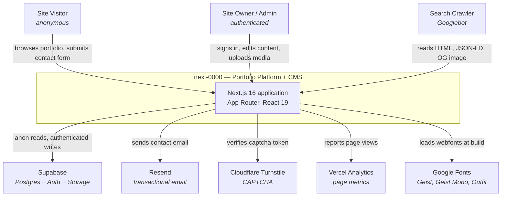

**Notable absences.** No payment provider, no third-party CMS, no queue, no
cache layer beyond Next.js ISR, no error-reporting service. The Telegram
notification channel is documented in `.env.local.example` but **not wired on
`development`**.

---

## L2 — Containers

The deployable/runtime units and the boundaries between them.

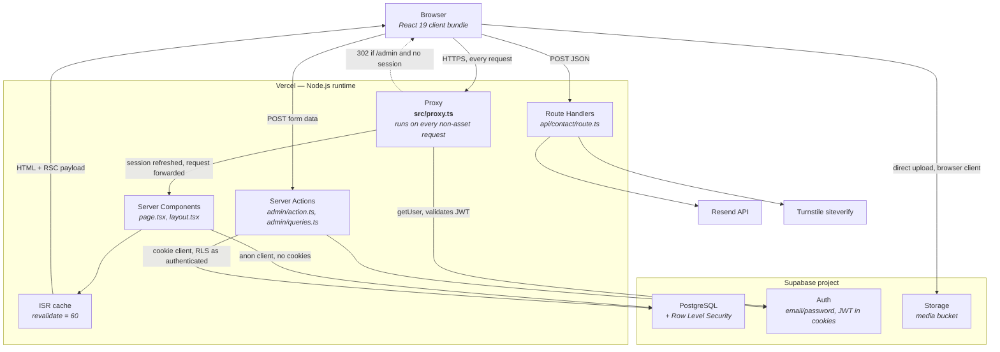

### Why `proxy.ts` and not `middleware.ts`

Next.js 16 **renamed** the convention. `middleware.ts` is deprecated; the file is
`proxy.ts` and the named export is `proxy`. Consequences that bind this codebase:

- The runtime is **`nodejs` and cannot be configured**. The `edge` runtime is not
  supported in `proxy`. Anything needing edge must stay on `middleware`.
- Config flags renamed: `skipMiddlewareUrlNormalize` → `skipProxyUrlNormalize`.

Source: `node_modules/next/dist/docs/01-app/02-guides/upgrading/version-16.md`,
section *`middleware` to `proxy`*.

### The four Supabase client modes

Picking the wrong one is the most common way to break this codebase. There is
exactly one correct client per context:

| Client | Factory | Cookies | RLS role | Use in |
|--------|---------|---------|----------|--------|
| Anon | inline `anon()` in `src/lib/queries.ts:250` | none | `anon` | Public reads. **No cookies is the point** — it keeps pages ISR-cacheable. |
| Server | `createClient()` in `src/lib/supabase/server.ts` | read + write | `authenticated` | Server Components, Server Actions, Route Handlers |
| Browser | `createClient()` in `src/lib/supabase/client.ts` | browser-managed | `authenticated` | Admin client components: login, media upload |
| Proxy | `updateSession()` in `src/lib/supabase/middleware.ts` | read + write on the response | `authenticated` | Session refresh on every request |

Two different functions are both named `createClient`. **Always check which
module an import came from.**

> `src/lib/supabase/middleware.ts` carries the comment *"do not run code between
> `createServerClient` and `getUser()`"*. This is a real constraint from
> `@supabase/ssr`, not stylistic. Inserting work there desynchronises the cookie
> refresh.

---

## L3 — Components inside the Next.js application

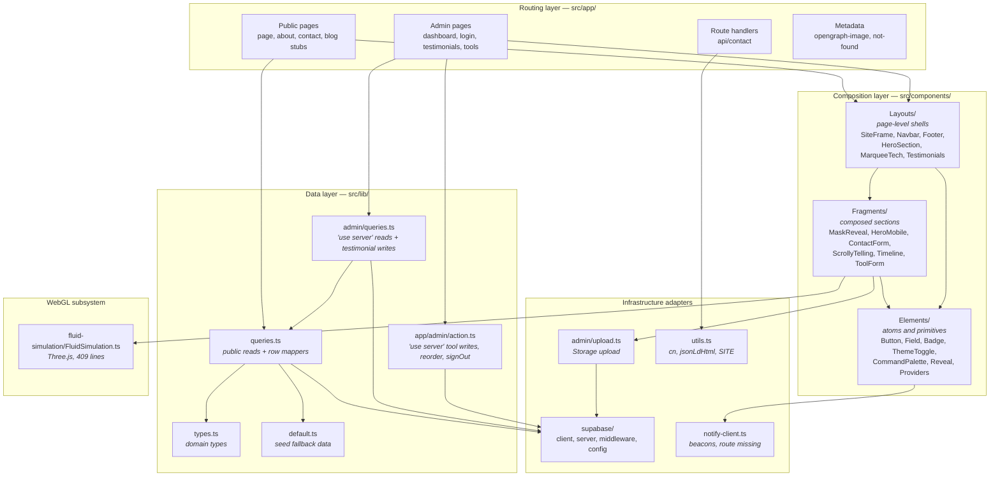

### Layer contract

The three-tier component split is a **dependency rule, not a naming scheme**:

```
Layouts  →  Fragments  →  Elements
```

Imports flow downward only. An `Element` importing a `Layout` is a defect. Each
tier is a folder containing `index.tsx`:

| Tier | Owns | Knows about data? |
|------|------|-------------------|
| `Elements/` | One interaction or visual primitive | No. Props only. |
| `Fragments/` | A composed section with internal state | Props only, except `MediaUpload` which calls `uploadFile` |
| `Layouts/` | Page-level arrangement and chrome | Receives server-fetched props; does not fetch |

**Nothing in `src/components/` calls a query function.** Data enters through
`page.tsx` and descends as props. The single exception is `SettingsProvider`,
which distributes already-fetched settings through context.

### Read path vs. write path

They are deliberately asymmetric:

| | Read (public) | Write (admin) |
|---|---|---|
| Entry | `src/lib/queries.ts` | `src/lib/admin/queries.ts`, `src/app/admin/action.ts` |
| Directive | none — plain module | `"use server"` |
| Client | anon, cookieless | cookie-aware server client |
| Auth check | none; RLS filters `published` | `requireAdmin()` → `auth.getUser()` **then** RLS |
| On failure | returns fallback, never throws | returns `{ ok: false, error }` |
| Cache | `React.cache()` + ISR | `revalidatePath()` after mutation |

`admin/queries.ts` imports the **mappers** from `queries.ts` and reuses them. It
does not re-implement row mapping. This is why mappers are exported.

> **Defense in depth, stated in the code.** `requireAdmin()` in
> `src/lib/admin/queries.ts:29` uses `auth.getUser()` — which validates the JWT
> — and never `getSession()`, which is spoofable. Server Actions compile to
> public POST endpoints, so RLS alone is not accepted as the only control.

---

## L4 — Code-level patterns

Four patterns carry most of the codebase. Match them exactly.

### Row mapping

Every table has a snake_case `*Row` interface and a `map*Row()` function
returning the camelCase domain type. Raw rows never leave the data layer.

```typescript
// src/lib/queries.ts
export interface TestimonialRow {
  id: string;
  quote: string;
  name: string;
  role?: string;
  avatar_url?: string | null;
  published?: boolean;
  sort_order?: number;
}

export function mapTestimonialRow(r: TestimonialRow): Testimonial {
  return {
    id: r.id,
    quote: r.quote,
    name: r.name,
    role: r.role ?? "",
    avatarURL: r.avatar_url ?? null,
    published: Boolean(r.published),
    sortOrder: r.sort_order ?? 0,
  };
}
```

Rules, all observable in the existing mappers:

- Optional columns get a **total** default — `?? ""`, `?? null`, `?? 0`,
  `?? []`, `Boolean(...)`. The domain type has no optional fields.
- Naming is inconsistent by precedent and must be preserved per type:
  `avatar_url` → `avatarURL` on `Testimonial`, but `cover_url` → `coverUrl` on
  `Post`. **Copy the existing field name; do not normalise it.**
- `gradient` defaults to `"from-brand-violet via-brand-fuchsia to-brand-rose"`.

### Public query

```typescript
export const getTestimonials = cache(async (): Promise<Testimonial[]> => {
  const fallback = seedTestimonials.filter((t) => t.published);
  if (!isSupabaseConfigured) return fallback;
  try {
    const { data, error } = await anon()
      .from("testimonials")
      .select("*")
      .eq("published", true)
      .order("sort_order", { ascending: true });
    if (error || !data) return fallback;
    return data.map(mapTestimonialRow);
  } catch {
    return fallback;
  }
});
```

Five invariants, in order:

1. Wrapped in `React.cache()` so layout + page + `generateMetadata` in one
   render pass share a single round-trip.
2. Fallback computed **before** the config check, so both exits return the same
   shape.
3. `if (!isSupabaseConfigured) return fallback;` is the first statement.
4. `.eq("published", true)` is applied **in the query**, not after. RLS is the
   second layer, not the only one.
5. `try`/`catch` returning the fallback. **Never throws.**

### Server Action

```typescript
export async function createTestimonial(input: TestimonialInput): Promise<ActionResult> {
  const { supabase, user } = await requireAdmin();
  if (!user) return { ok: false, error: NOT_AUTHORIZED };
  const { error } = await supabase.from("testimonials").insert({ /* snake_case */ });
  if (error) return { ok: false, error: error.message };
  revalidateTestimonials();
  return { ok: true };
}
```

`ActionResult = { ok: boolean; error?: string }`. Auth first, mutate second,
`revalidatePath()` third, return the result — never throw across the boundary.

### WebGL hero

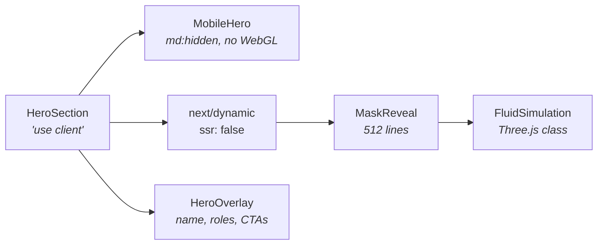

`HeroSection` is a Client Component, and that is **required**: `ssr: false` is
not supported in Server Components — Next.js errors out. The import must live
inside a Client Component for client code-splitting to work.

Source: `node_modules/next/dist/docs/01-app/02-guides/lazy-loading.md`.

Mobile and desktop are **separate components behind CSS breakpoints**, not one
responsive component. Phones never download the WebGL path.

---

## Runtime flows

### Public page render

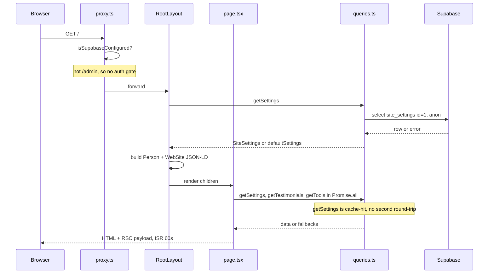

The `React.cache()` wrapper is what makes `getSettings()` free on the second
call. Calling it in both layout and page is intentional, not duplication.

### Admin sign-in

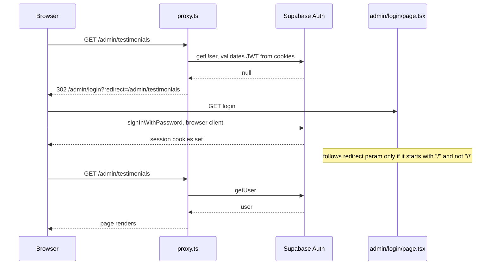

Two guards, both in `src/lib/supabase/middleware.ts`: unauthenticated `/admin`
→ login with a `redirect` param; authenticated `/admin/login` → `/admin`. The
open-redirect check on the `redirect` param lives in the login page.

### Admin mutation

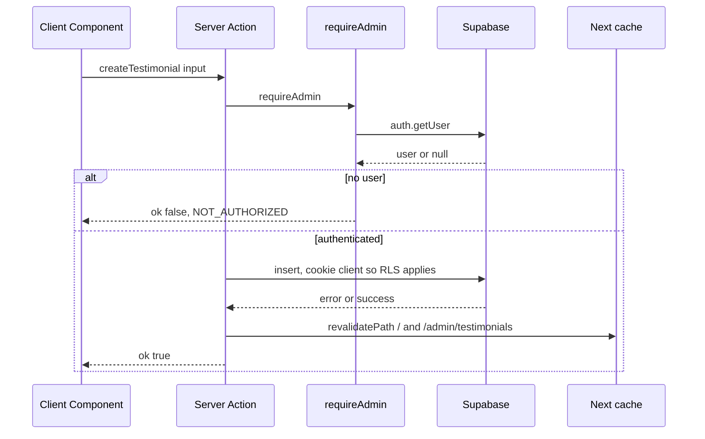

### Contact submission

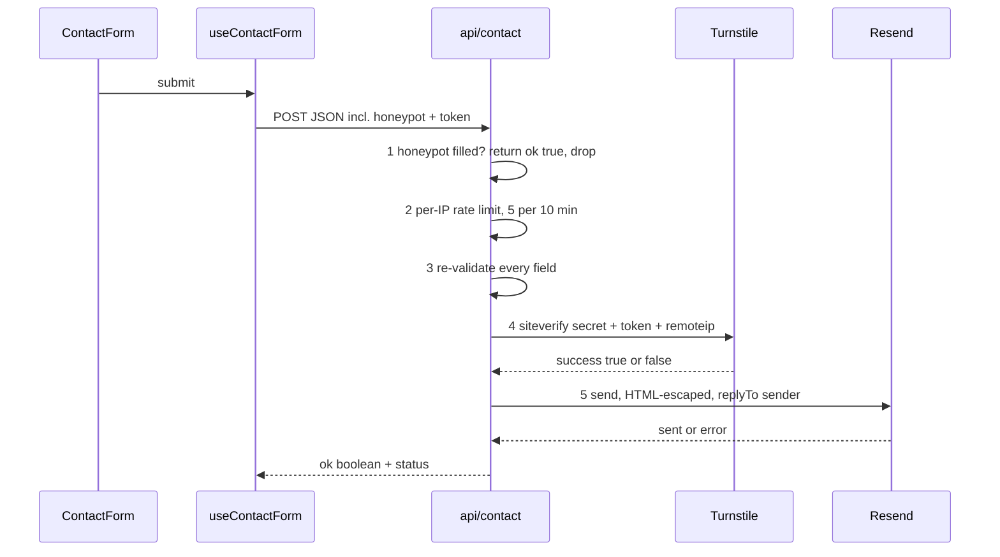

### Media upload

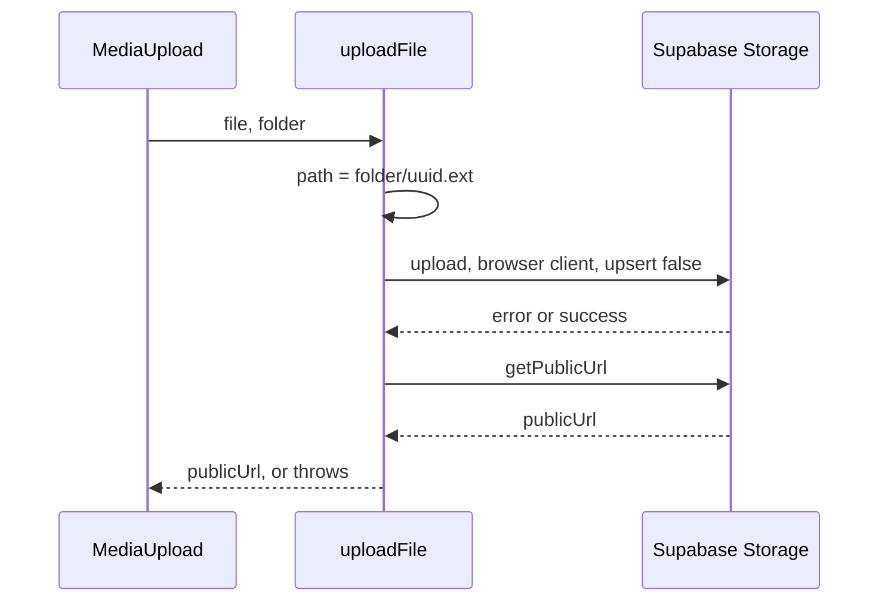

`uploadFile` is the **one function in the data path that throws** rather than
returning a result object. Callers must wrap it. Note the second parameter is a
**folder**, chosen by the caller — on branch `0010` it is a `userId` and the
storage RLS enforces the prefix. On `development` there is no such constraint.

---

## Trust boundaries

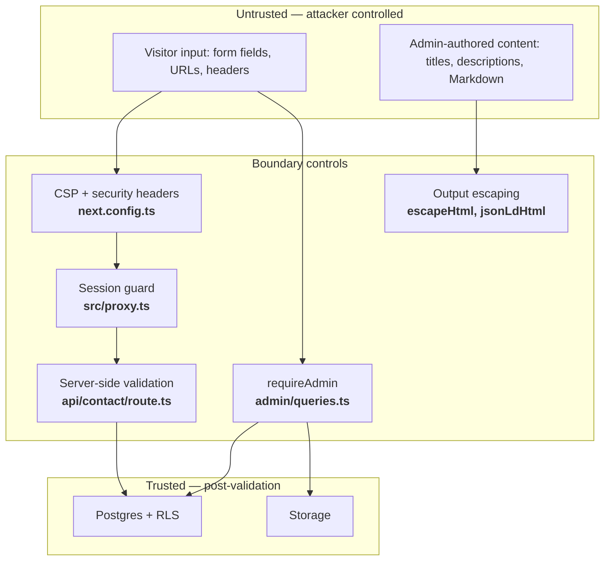

| Control | Where | Protects against |
|---------|-------|------------------|
| CSP, enforcing | `next.config.ts` | XSS, injected script origins |
| HSTS, `X-Frame-Options`, `X-Content-Type-Options`, `Referrer-Policy`, `Permissions-Policy` | `next.config.ts` | Downgrade, clickjacking, MIME sniffing, referrer leakage |
| `poweredByHeader: false` | `next.config.ts` | Fingerprinting |
| Session guard | `src/proxy.ts` → `updateSession` | Unauthenticated `/admin` access |
| Open-redirect check | `src/app/admin/login/page.tsx` | Redirect to attacker host after login |
| `requireAdmin()` | `src/lib/admin/queries.ts` | Server Actions invoked as raw POST endpoints |
| RLS | Supabase | Anything that bypasses the app layer |
| `escapeHtml()` | `src/app/api/contact/route.ts` | HTML injection into the notification email |
| `jsonLdHtml()` | `src/lib/utils.ts` | `</script>` breakout from admin-authored JSON-LD |
| Honeypot + rate limit + Turnstile | `src/app/api/contact/route.ts` | Spam, automated abuse |

**`NEXT_PUBLIC_*` is a public boundary.** Those values are inlined into the
client bundle at build time. `SUPABASE_SERVICE_ROLE_KEY`, `RESEND_API_KEY`, and
`TURNSTILE_SECRET_KEY` must never carry that prefix.

---

## Caching and revalidation

| Surface | Strategy | Declared in |
|---------|----------|-------------|
| `/`, `/about` | ISR, `revalidate = 60` | the page module |
| `/contact` | static by default | — |
| `/admin`, `/admin/tools/[id]` | `dynamic = "force-dynamic"` | the page module |
| `/admin/testimonials` | **nothing declared** — may serve stale after a mutation | see [G10](./current-state.md#g1--apinotify-does-not-exist) |
| Within one render pass | `React.cache()` on every public query | `src/lib/queries.ts` |
| After a mutation | `revalidatePath()` | `src/lib/admin/queries.ts`, `src/app/admin/action.ts` |

### Next.js 16 caching changes that apply here

- **`revalidateTag` now requires a second argument** naming a `cacheLife`
  profile: `revalidateTag("posts", "max")`. The one-argument form is a
  TypeScript error. This codebase uses `revalidatePath` only and is unaffected —
  but any new tag-based invalidation must pass the profile.
- **`updateTag`** is the Server-Action-only API with read-your-writes semantics:
  it expires and refreshes within the same request. Prefer it over
  `revalidateTag` for admin mutations where the editor must immediately see
  their own change.
- **`cacheLife` / `cacheTag` are stable** — drop any `unstable_` prefix.
- **PPR**: `experimental.ppr` and the `experimental_ppr` segment config are
  removed. The Next.js 16 equivalent is `cacheComponents: true`, which behaves
  differently. Do not enable it casually.

---

## Styling architecture

Three layers, in increasing specificity:

1. **CSS custom properties** in `src/app/globals.css` — `--bg`, `--fg`,
   `--muted`, `--border`, `--card`, `--accent`. Swap automatically under `.dark`.
   Consumed as `bg-[rgb(var(--bg))]`.
2. **Tailwind theme tokens** in `tailwind.config.ts` — the `ink-*` neutral scale,
   `accent-*`, `brand-*`, fluid type (`text-fluid-hero` … `text-fluid-h3`),
   eight keyframe animations.
3. **Utility classes** in `globals.css` — `.glass`, `.text-gradient*`, `.noise`,
   `.grid-bg`, `.role-roll`, `.marquee-track`, `.btn-sheen`, `.page-enter`.

Rules:

- **Surfaces use the CSS variables**, not hardcoded `ink-*`, so dark mode is one
  switch. Dark mode is class-based via `next-themes`.
- **Conditional classes always go through `cn()`** from `src/lib/utils.ts`
  (`twMerge(clsx(...))`), so later classes win instead of colliding.
- **Every animation needs a `prefers-reduced-motion` branch.** `SiteFrame`
  additionally wraps the tree in `<MotionConfig reducedMotion="user">`, which
  makes Framer Motion honour the OS setting globally.

### Known Next.js 16 styling trap

Next.js 16 **no longer overrides `scroll-behavior` during navigation** by
default. The root `<html>` carries `data-scroll-behavior="smooth"` to opt back
into the old behaviour. **Do not remove that attribute** — Lenis smooth scroll
plus CSS smooth scrolling would otherwise fight during route transitions.

---

## Architectural invariants

Violating any of these is a defect, not a style disagreement.

| # | Invariant | Enforced by |
|---|-----------|-------------|
| 1 | A public query never throws and never surfaces a DB error | `try`/`catch` + typed fallback in every `src/lib/queries.ts` export |
| 2 | A public query returns its fallback when Supabase is unconfigured | `if (!isSupabaseConfigured)` as the first statement |
| 3 | Raw DB rows never reach a component | `*Row` + `map*Row()` pairs |
| 4 | Components never fetch data | all fetching in `page.tsx` / Server Actions |
| 5 | Public reads use the cookieless anon client | `anon()` is private to the query modules |
| 6 | Every admin write authenticates before touching the DB | `requireAdmin()` as the first call |
| 7 | Server Actions return `ActionResult`, never throw | return-type signature |
| 8 | `Elements` → `Fragments` → `Layouts` imports flow one way | convention; see [structure.md](./structure.md) |
| 9 | Secrets never carry the `NEXT_PUBLIC_` prefix | review |
| 10 | Structured data is serialized with `jsonLdHtml()` | review |
| 11 | `"use client"` only for hooks, browser APIs, or event handlers | review |
| 12 | Every animation has a reduced-motion branch | review |

---

## Where this architecture is under strain

Honest assessment, for whoever extends it next.

1. **`site_settings` is a singleton with 20+ columns**, and `SettingsInput`
   duplicates its shape a third time (after the table and `SiteSettings`). Every
   new setting is a three-file change. `0010` replaces it with `profiles` —
   which is the right direction but multiplies the same shape again.
2. **`src/lib/queries.ts` is 416 lines mixing three concerns**: row interfaces,
   mappers, and query functions for six tables. Splitting per entity would make
   ownership obvious.
3. **Reorder logic is generic over a string union** —
   `ReorderKind = "projects" | "posts" | "tools"` in `src/app/admin/action.ts` —
   while CRUD is hand-written per entity. The abstraction is half-applied.
4. **`MaskReveal` is 512 lines and `FluidSimulation` 409**, excluded from
   coverage, and the single most expensive thing on the critical path. The
   incoming `@react-three/fiber` work in
   [`specs/landing-3d-experience`](../specs/landing-3d-experience/design.md)
   either replaces this subsystem or runs alongside it — **decide explicitly**,
   because shipping both means two WebGL renderers in one bundle.
5. **The write path has no validation layer.** `TestimonialInput` is a TypeScript
   interface, which is erased at runtime; Server Actions accept whatever the
   POST body contains. Public input is validated by hand in
   `api/contact/route.ts`; admin input is not validated at all. A schema
   validator at the Server Action boundary is the obvious missing piece.

---

# Target architecture — multi-tenant platform

Everything above describes branch `development` as it runs today. This section
describes what the product must become — see [product.md](./product.md). Treat
it as the destination, not a description of running code.

## L1 — System context, multi-tenant

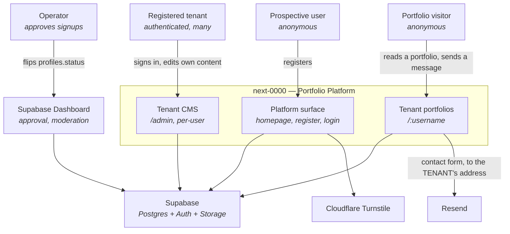

The operator acts **outside the application**, in the Supabase dashboard. That
is deliberate — [ADR-016](./decisions.md#adr-016--waitlist-with-manual-approval)
and [ADR-017](./decisions.md#adr-017--all-users-are-equal-tenants-no-platform-admin-role).

## L2 — Routing topology

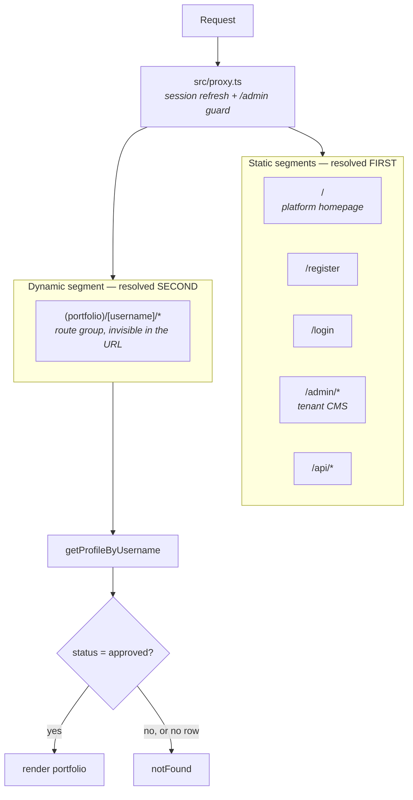

**This precedence is the source of [G14](./current-state.md#g1--apinotify-does-not-exist).**
Static wins, so any username equal to a static segment yields a tenant whose
portfolio can never be served. Reservation must be enforced at signup, in the
database, because the router will never report the conflict.

### Reserved segments

Derived from the routing table, not invented. Every static root path plus the
words a platform is likely to claim later:

```
admin  api  register  login  _next  favicon.ico
opengraph-image  robots.txt  sitemap.xml
about  contact  blog  tools  settings  dashboard
pricing  terms  privacy  docs  help  support
new  edit  static  assets  public  www  mail
```

Enforce in `handle_new_user()` **and** in the registration form, so the user
gets an error instead of a silent rename.

## Tenant resolution

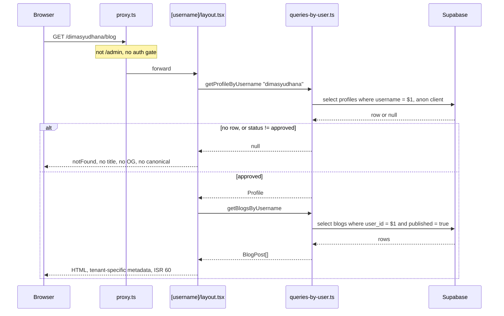

`getProfileByUsername` is wrapped in `React.cache()`, so the layout, the page,
and `generateMetadata` share one lookup. **The `status = approved` check does
not exist yet** — `profiles.status` is added by
[`specs/platform-homepage-signup`](../specs/platform-homepage-signup/design.md).

## Registration

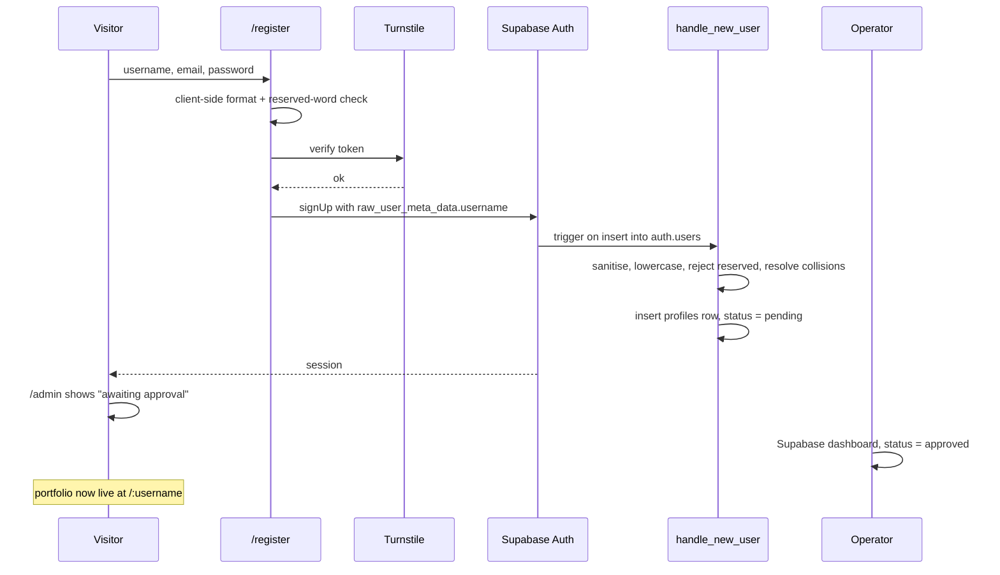

The trigger is the **authoritative** validator; the form's check exists only to
give a fast, readable error. A trigger that rejects must surface a usable
message, because `signUp` will fail with whatever the trigger raises.

## Tenant isolation

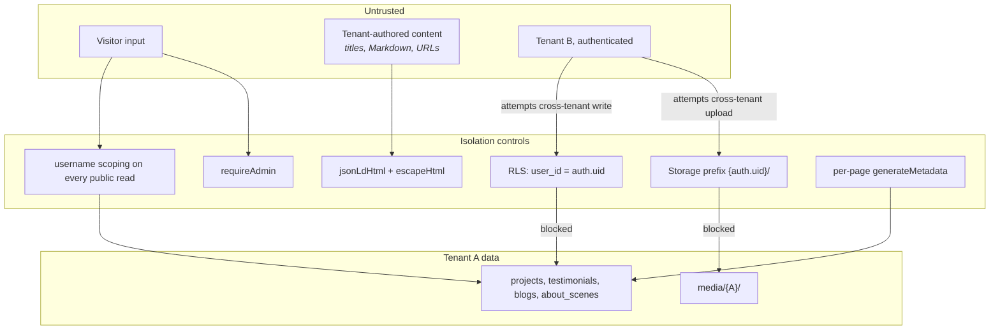

| Risk | Control | Where |
|------|---------|-------|
| Tenant B reads A's drafts | public reads filter `published = true` **and** scope by `user_id`; RLS enforces both | `queries-by-user.ts` + migration |
| Tenant B writes A's rows | RLS `user_id = auth.uid()`, plus `requireAdmin()` | migration + `admin/queries.ts` |
| Tenant B overwrites A's media | storage RLS restricts writes to `{auth.uid()}/` | storage policy |
| A's metadata leaks onto B's page | every tenant page builds its own title, OG, canonical | per-page `generateMetadata` |
| Tenant content breaks out of JSON-LD | `jsonLdHtml()` escapes `<` | `src/lib/utils.ts` |
| A's visitor mail reaches the operator | **no control — open defect** | [G11](./current-state.md#g1--apinotify-does-not-exist) |

**Isolation is a property of the query layer, not of the UI.** A tenant page
that fetches without a `user_id` scope is a leak even if it renders correctly,
because RLS for an `anon` client only filters `published` — it has no
`auth.uid()` to compare against.

## What must change from today

Status as of 2026-11-01. "Done" means the code is written and the gate is
green, **not** that it has run against a database — see
[G17](./current-state.md#g1--apinotify-does-not-exist).

| Area | Was | Target | Status |
|------|-----|--------|--------|
| `/` | Owner's portfolio | Platform homepage | ✅ done; 3D hero still pending |
| `/login` | `/admin/login` | `/login` | ✅ done, with a permanent redirect from the old path |
| `/register` | — | Waitlist form with Turnstile | ✅ done |
| `/:username/*` | — | Tenant portfolio | ✅ merged from `0010` |
| Identity source | `site_settings` singleton | `profiles` row per tenant | ✅ merged |
| Admin scope | one global site | the signed-in tenant's rows only | ✅ merged |
| Contact recipient | one env var | the tenant's **verified `auth.users.email`** | ✅ done |
| Nav authorization | Casbin | fixed list | ✅ removed (ADR-018) |
| Root metadata | one person's name, JSON-LD, keywords | product name, `WebSite` schema | ✅ done; the name is a placeholder |
| Approval gating | — | `profiles.status` | ✅ in `0006`, unapplied |
| `/about`, `/contact`, `/blog` | Owner's pages | **Deleted** (ADR-015) | ❌ task 6.4, blocked on 0.3 |
| Seed data | 607 lines of one portfolio | platform homepage copy only | ❌ still in question |

## Invariants added by multi-tenancy

Extending the [list above](#architectural-invariants):

| # | Invariant | Enforced by |
|---|-----------|-------------|
| 13 | Every public tenant read is scoped by `username` → `user_id` | `queries-by-user.ts` |
| 14 | Every tenant write is scoped by `user_id = auth.uid()` | RLS + `requireAdmin()` |
| 15 | No tenant page shares metadata with another tenant | per-page `generateMetadata` |
| 16 | A username can never equal a static route segment | `handle_new_user()` + the registration form |
| 17 | Usernames are lowercase and URL-safe | `handle_new_user()` sanitisation |
| 18 | An unapproved tenant's portfolio returns `notFound()` | `profiles.status` check in the tenant layout |
| 19 | Uploads land only under `{auth.uid()}/` | storage RLS |
| 20 | A tenant's contact form delivers to that tenant | ✅ `resolveRecipient()` in `api/contact/route.ts`, reading `auth.users.email` |
