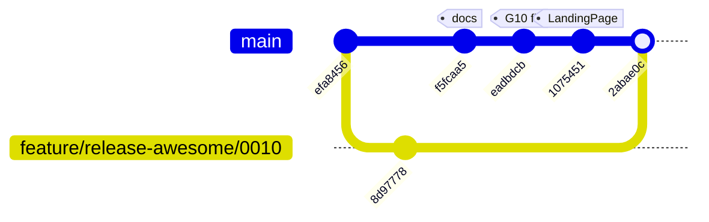

# Current State

Baseline: branch **`development`**, HEAD `2abae0c` — **`0010` is merged**, so
the multi-tenant tenant surface is now live on this branch. Verified 2026-11-01
by reading the tree and running the full gate.

> Re-verify before trusting this file. `git log --oneline -1` should print
> `2abae0c`. If it does not, the gaps below may already be closed.

---

## Build health

**Green as of 2026-11-01**, on `development` @ `efa8456`, after `npm install`
and `rm -rf .next`.

| Command | Result |
|---------|--------|
| `npm run typecheck` | ✅ clean |
| `npm run lint` | ✅ 0 errors, 8 warnings |
| `npm run test` | ✅ **10 files, 147 tests passing** |
| `npm run build` | ✅ succeeds, 13 static pages |

Baseline for measuring regressions:

| Metric | Value |
|--------|-------|
| Test files / tests | 19 / 290 |
| Lint errors / warnings | 0 / 9 |
| `.next/static/chunks` | 2.3 MB raw · 616.9 KB gzipped · 33 chunks |

The ninth lint warning came in with `0010`: `@next/next/no-img-element` at
`src/app/(portfolio)/[username]/blog/page.tsx:77`.

> `next build` in Next.js 16 **no longer prints per-route JS size** — the route
> table shows only Revalidate and Expire. Bundle deltas must be measured from
> `.next/static/chunks`, as above.

### A build flake to recognise, not chase

Observed once on 2026-11-01, immediately after a `vitest` run in the same shell:

```
Error: Turbopack build failed with 12 errors:
Error while looking up import map: next/font/google queries have exactly one entry
```

**Not reproducible.** Three consecutive builds straight afterwards, including
one after `rm -rf .next`, all compiled cleanly, and the only file changed
between the failing and passing runs was a test file the build does not read.
Treat it as a transient Turbopack font-loader cache fault: re-run the build
before investigating. If it ever reproduces, that is new information worth
recording here.

### How it was broken, because it will recur

A fresh clone, or a branch switch after an install on another branch, reproduces
all of this. Both symptoms had the **same single cause** and the same two-command
fix.

`@testing-library/jest-dom` imports `@testing-library/dom`, which was present in
`package-lock.json` but **absent from `node_modules`**. Every suite died at
import time in `src/__tests__/setup.ts`:

```
Error: Cannot find package '@testing-library/dom'
```

That cascaded into typecheck, because `screen` and `fireEvent` are re-exported
from `@testing-library/dom` — so `@testing-library/react` appeared not to export
them, producing `TS2305` plus a run of `TS7006` implicit-`any` errors in
`CommandPalette.test.tsx`.

A second, independent typecheck failure came from a **stale `.next/`**:
`.next/types/validator.ts` referenced `src/app/admin/settings/page.js`, which
exists on branch `feature/release-awesome/0010` but not on `development` — left
behind by a build on that branch.

```bash
npm install     # restores @testing-library/dom
rm -rf .next    # drops the cross-branch validator reference
```

**It recurred immediately after the `0010` merge**, with a different missing
package: `0010` adds `casbin` to `package.json`, and typecheck failed with
`TS2307: Cannot find module 'casbin'` until `npm install` ran again. Treat
`npm install` as part of every branch operation, not an occasional repair.

`npm install` changed neither `package.json` nor `package-lock.json`, which
confirms it was purely a `node_modules` desync and **not** a defect in `src/`.

### Route inventory, from the verified build

The build output confirms the gaps catalogued below:

| Route | Rendering |
|-------|-----------|
| `/` | static, 1m revalidate — **the platform homepage** |
| `/register`, `/login` | static |
| `/about`, `/contact`, `/blog`, `/opengraph-image`, `/_not-found` | static — `/about`, `/contact`, `/blog` are the owner's, pending deletion by task 6.4 |
| `/[username]` | static |
| `/[username]/about`, `/[username]/blog`, `/[username]/blog/[slug]`, `/[username]/contact` | dynamic |
| `/admin`, `/admin/login`, `/admin/settings`, `/admin/testimonials`, `/admin/tools`, `/admin/tools/[id]`, `/admin/tools/new` | dynamic |
| `/blog/[slug]` | dynamic |
| `/api/contact`, `/api/register` | dynamic |
| Proxy (Middleware) | active |

Still no `/admin/projects` or `/admin/blog` — [G2](#g2--admin-navbar-links-to-pages-that-do-not-exist---mostly-fixed-2026-11-01)
is now two pages rather than three, since `0010` brought `/admin/settings`.
`/api/notify` is still absent, so [G1](#g1--apinotify-does-not-exist) stands —
`/api/contact` and `/api/register` are the only route handlers.

Worth a second look: `/[username]` is prerendered **static** while all four of
its child routes are dynamic. Nothing depends on that today, but an inconsistency
at the root of the tenant surface is the kind of thing that surprises someone
later.

### Lint warnings (8, all non-blocking)

- `react-hooks/set-state-in-effect` — `Navbar`, `ScrollSmooth`, and others call
  `setState` synchronously inside `useEffect`. Real smell, low severity.
- `@typescript-eslint/no-unused-vars` — `techMarquee` in `MarqueeTech`, `table`
  in `queries-configured.test.ts`.

---

## Branch history — `0010` is merged

**Merged 2026-11-01**, commit `2abae0c`. `development` now carries the
multi-tenant tenant surface. This section is kept as a record of what arrived,
because the gaps below refer to it.



45 files, +5115 / −713, zero conflicts. What the merge brought in:

| Area | Files |
|------|-------|
| Per-tenant routes | `src/app/(portfolio)/[username]/{page,layout,about,contact,blog}` |
| Per-tenant data layer | `src/lib/queries-by-user.ts` |
| RBAC | `src/lib/casbin/enforcer.ts`, `src/lib/casbin/model.conf` — **slated for deletion**, [ADR-018](./decisions.md#adr-018--remove-casbin) |
| Schema | `supabase/migrations/0005_multi_tenant.sql` |
| Admin settings | `src/app/admin/settings/page.tsx`, `src/components/Layouts/AdminSettings/` |
| Profile context | `src/components/Elements/Providers/ProfileProvider/` |
| Domain types | `Profile`, `BlogPost` in `src/lib/types.ts` |
| Spec + steering | `.kiro/specs/multi-tenant-portfolio/`, rewritten `.kiro/steering/*` |

`AdminNavbar` now takes `visibleItems: NavItemKey[]` and `admin/layout.tsx`
computes it via `getVisibleNavItems(user.email)`. Both are undone by task 7 of
[`specs/platform-homepage-signup`](../specs/platform-homepage-signup/tasks.md).

### Work lost in an earlier branch switch

A `git checkout development` during an earlier session discarded uncommitted
changes:

- `src/app/page.tsx` had been rewritten to render `<LandingPage/>` — **reverted**.
- `package.json` had gained `@react-three/fiber`, `@react-three/drei`, and a
  `lucide-react@1.33` bump — **reverted**.

`src/components/Layouts/LandingPage/index.tsx` survived untracked and is now
committed (`1075451`). Reconstructing the integration is task 1 of
[`specs/landing-3d-experience`](../specs/landing-3d-experience/tasks.md).

### What the merge did not deliver

It delivered the tenant surface. The **platform** surface — homepage,
registration, approval, safe usernames — exists nowhere:

| Missing | Tracked as |
|---------|-----------|
| Platform homepage at `/` | [G12](#g1--apinotify-does-not-exist) |
| Self-service registration | [G13](#g1--apinotify-does-not-exist) |
| Username reservation and sanitisation | [G14](#g1--apinotify-does-not-exist) |
| Tenant-aware contact delivery | [G11](#g1--apinotify-does-not-exist) |

All four are specified in
[`specs/platform-homepage-signup`](../specs/platform-homepage-signup/requirements.md),
whose preconditions (tasks 0.1–0.2, 0.4) are now complete.

---

## Known gaps on `development`

Ordered by blast radius. Each is a candidate spec, not a bug to fix in passing.

### G1 — `/api/notify` does not exist

`src/lib/notify-client.ts` POSTs every page view and CV click to `/api/notify`.
The only route handler in the tree is `src/app/api/contact/route.ts`. **Every
analytics beacon 404s.** Two empty untracked directories, `src/lib/apis/contact/`
and `src/lib/apis/notify/`, hint at an abandoned refactor.

Either implement the route or delete the client. Silent 404s on every page load
are the worst of both.

### G2 — Admin navbar links to pages that do not exist — ✅ MOSTLY FIXED 2026-11-01

`src/components/Layouts/AdminNavbar/index.tsx` renders six links. Reality:

| Link | Page on `development` |
|------|----------------------|
| `/admin` | ✅ `src/app/admin/page.tsx` |
| `/admin/testimonials` | ✅ `src/app/admin/testimonials/page.tsx` |
| `/admin/tools` | ✅ `src/app/admin/tools/{page,new,[id]}` |
| `/admin/settings` | ✅ arrived with the `0010` merge |
| `/admin/projects` | ❌ no page — **link removed** |
| `/admin/blog` | ❌ no page — **link removed** |
| `/admin/about/section1`, `/section2` | ❌ no page — **links removed** |

**Updated 2026-11-01: it was four dead links across three sections, not two.**
Casbin had been hiding them by accident — an unmatched subject fell back to
`["dashboard"]`, which filtered out every entry whose page had never been
built. Removing Casbin would have exposed all four to every signed-in tenant,
so the navbar was pruned to the routes that exist: Dashboard, Tools,
Testimonials, Settings.

`src/components/Layouts/AdminNavbar/index.test.ts` now checks every href
against the filesystem, so this cannot come back silently.

**Projects and Blog were built and relinked on 2026-11-01** —
[`specs/admin-content-crud`](../specs/admin-content-crud/tasks.md) tasks 5.1–5.4.
Six admin routes now exist where there were three: `/admin/projects`,
`/admin/projects/new`, `/admin/projects/[id]`, `/admin/blog`,
`/admin/blog/new`, `/admin/blog/[id]`.

**Still unlinked, because still unbuilt:** `/admin/about/section1` and
`/admin/about/section2`. The test asserts their absence as well as the
others' presence, so neither half can drift.

Covered by [`specs/admin-content-crud`](../specs/admin-content-crud/requirements.md).

### G3 — Embedded tools cannot render

`src/lib/tools/registry.ts` declares 11 tool components and its header comment
points at `src/components/tools/ToolEmbed.tsx`. **`src/components/tools/` does
not exist.** A `Tool` row with `kind: "embedded"` has nothing to render.
Dependencies are already installed and shipping weight for nothing:
`tesseract.js`, `@imgly/background-removal`, `qrcode`, `browser-image-compression`,
`sql-formatter`, `diff`, `js-yaml`.

Covered by [`specs/embedded-tools-platform`](../specs/embedded-tools-platform/requirements.md).

### G4 — `public/models/barong.glb` is 78 MB

Untracked, so not yet in git history. Committing it would permanently bloat the
repo and breach Vercel deployment size limits. Must be compressed
(Draco/meshopt, typically >90% reduction) and/or moved to Supabase Storage
before any commit. Covered by
[`specs/landing-3d-experience`](../specs/landing-3d-experience/requirements.md),
Requirement 2.

### G5 — `/blog` and `/blog/[slug]` are `notFound()` stubs

Both call `notFound()` with no other body. The `posts` table, the `Post` domain
type, `getPosts`/`getPostBySlug`, and `getListPosts`/`getPostById` all exist and
are unreachable from any route.

### G6 — Backup files are inside `tsconfig.json` include

`tsconfig.json` explicitly lists
`src/components/Elements/ScrollSmooth/index.tsx.bak` and
`src/app/(portfolio)/[username]/page.tsx.bak` in `include`. The second does not
exist on `development`. Backup files should be deleted, not type-checked.

### G7 — README is the unmodified `create-next-app` template

Zero project information, while the admin `SetupNotice`
(`src/app/admin/layout.tsx`) tells the operator to find the "full walkthrough in
README.md".

### G8 — `vitest.config.ts` coverage `exclude` list is very wide

All of `src/components/Layouts/**`, `src/lib/admin/**`, `src/lib/supabase/**`,
every `page.tsx`, and ~20 individual components are excluded. Reported coverage
describes a small slice of the codebase. Several entries are duplicated
(`MaskReveal`, `HeroMobile`, `HeroOverlay` appear twice).

### G9 — Contact rate limiting is per-instance in-memory

`src/app/api/contact/route.ts` keeps `hits` in a module-level `Map`. On Vercel
this resets per cold start and is not shared across instances. The code says so
in its own comment and leans on Turnstile as the real control. Acceptable as
designed — documented so nobody mistakes it for a guarantee.

### G10 — Admin testimonials list uses the *public* query — ✅ FIXED 2026-11-01

`src/app/admin/testimonials/page.tsx:1` imports `getTestimonials` from
`@/lib/queries` — the anon-client read that hard-filters `.eq("published", true)`.
The admin table therefore **cannot show unpublished testimonials**, which are
exactly the rows an editor needs to see in order to publish them.

`getListTestimonials()` in `src/lib/admin/queries.ts:62` is the correct function
— cookie-aware client, no `published` filter — and is currently **unreferenced
anywhere in `src/`**.

The page also omits `export const dynamic = "force-dynamic"`, unlike
`src/app/admin/page.tsx` and `src/app/admin/tools/[id]/page.tsx`, so it can be
served from cache after a mutation.

**Resolved.** `src/app/admin/testimonials/page.tsx` now reads through
`getListTestimonials()`, declares `dynamic = "force-dynamic"`, and reports the
draft count; `TestimonialRowWithActions` marks an unpublished row with an amber
border and a "Not published" chip, keyed off the *persisted* `item.published`
rather than the pending toggle, so a draft stays marked mid-edit. Covered by 11
tests across `src/lib/admin/queries.test.ts` and
`src/app/admin/testimonials/page.test.tsx`, verified to fail when the defect is
reintroduced. Task 1 of
[`specs/admin-content-crud`](../specs/admin-content-crud/tasks.md).

---

### G18 — The open-redirect guard accepted a backslash bypass — ✅ FIXED 2026-11-01

`src/app/admin/login/page.tsx` sanitised its `?redirect=` parameter with:

```ts
const redirect = raw.startsWith("/") && !raw.startsWith("//") ? raw : "/admin";
```

That **accepts `/\evil.com`**. Browsers normalise a backslash to a forward
slash, so the value resolves protocol-relative to another origin — exactly what
the `//` check was there to stop. `/\\evil.com` behaves the same way.

**Fixed** in `src/lib/safe-redirect.ts`, which rejects a value that does not
start with `/`, starts with `//`, contains a backslash anywhere, or contains any
C0 control character — `\n`, `\r` and `\t` are stripped or normalised
inconsistently between parsers, which is enough on its own to smuggle a
different target.

19 tests, including a property asserting that whatever the guard returns is
always a same-site path across 1000 generated inputs. The guard is now shared
by `/login` and the `/admin/login` redirect stub rather than restated inline.

### G20 — Admin list reads leaked every other tenant's published rows — ✅ FIXED 2026-11-01

Found while re-baselining [`specs/admin-content-crud`](../specs/admin-content-crud/requirements.md).

`getListProjects`, `getListTestimonials`, `getListTools`, `getProjectById` and
`getToolById` queried with **no `user_id` filter at all**, relying entirely on
RLS. But the select policies read:

```sql
published = true OR user_id = (select id from public.profiles where id = auth.uid())
```

That `OR` is there so anonymous visitors can read published content. For an
*authenticated* admin query it means the caller got their own rows **plus every
approved tenant's published rows**. Tenant A's admin list showed tenant B's
published projects, and `getProjectById` would open one in the editor.

The update policies still blocked the write, so A could not change B's content —
which is exactly why this stayed quiet. A read leak that fails only at save
time looks like a bug in the form, not a boundary violation.

**Fixed** by filtering every admin read on `user_id` explicitly, via an
`ownerId()` helper, and returning `[]` / `null` with no session rather than
querying unscoped. `reorderEntities` is scoped the same way: RLS would have
refused a cross-tenant write anyway, but *per row inside a `Promise.all`*,
leaving some of the caller's own rows renumbered and the rest not. Covered by
8 tests in `src/lib/admin/queries.test.ts`.

> **`posts` cannot be scoped**: migration `0005` made `projects`,
> `testimonials`, `about_scenes`, `blogs` and `tools` per-tenant and left
> `posts` alone as single-owner legacy. `getListPosts` and `getPostById` are
> therefore still unscoped, and `reorderEntities` skips the filter for that
> kind. One more reason the blog admin belongs on `blogs` — see
> [G16](#g1--apinotify-does-not-exist).

### G21 — Admin settings read `profiles` and wrote `site_settings` — ✅ FIXED 2026-11-01

`getSettingsForAdmin()` read the signed-in tenant's row from `profiles`.
`updateSettings()` upserted **`site_settings` with a hardcoded `id: 1`**.

So `/admin/settings` appeared to save and then redisplayed the old values,
because the read never saw the write. On a multi-tenant platform it was worse:
every tenant's save collided into the same global row.

**Fixed.** `updateSettings` now updates `profiles` filtered on `user.id` —
`profiles.id` *equals* `auth.users.id`, so that is the row key. `update` rather
than `upsert`, because the row is created by `handle_new_user` and an upsert
keyed on id could silently insert a profile with no username. Revalidation
targets that tenant's own paths instead of the whole site.

**Four `SettingsInput` fields cannot persist** and are deliberately not written:
`url`, `homeShowTools`, `homeShowBlog` and `stat`. `profiles` has no such
columns, and `getSettingsForAdmin` already returns them hardcoded. The form must
stop offering fields that cannot be saved — part of the
[`specs/admin-content-crud`](../specs/admin-content-crud/requirements.md)
re-baseline.

**Consequence worth knowing:** the owner's legacy `/about` and `/contact` read
`getSettings()`, which still reads `site_settings`. They will no longer reflect
edits made in the admin panel. That is correct for a platform, and both pages
are deleted by task 6.4 of
[`specs/platform-homepage-signup`](../specs/platform-homepage-signup/tasks.md).

### G19 — A pending tenant cannot preview their own portfolio

Consequence of the approval gate, not a defect, but it is the first thing a
tenant will ask for.

`getProfileByUsername` uses the cookieless anon client — deliberately, because
that is what keeps tenant pages ISR-cacheable — so it has no `auth.uid()` to
compare against and the owner is gated along with everyone else. A tenant whose
status is `pending` can use the entire CMS but sees a 404 at their own
`/:username`.

Requirement 5.7 of
[`specs/platform-homepage-signup`](../specs/platform-homepage-signup/requirements.md)
only promises CMS access, so this is within spec. Closing it properly means a
preview path that reads as the authenticated user — a separate route, or a
signed preview token — and that trades away the cacheability the anon client
buys. Worth a spec of its own rather than a quiet exception.

## Multi-tenant product gaps

The gaps above are defects in what exists. These four are **missing
foundations** for the product described in [product.md](./product.md). None is
closed by merging `0010`.

### G11 — The contact form emails the platform owner for every tenant — ✅ FIXED 2026-11-01

`src/app/api/contact/route.ts` resolves its recipient from a single
`CONTACT_TO_EMAIL` environment variable. On branch `0010`,
`src/app/(portfolio)/[username]/contact/page.tsx` renders the **same**
`<ContactForm/>`, and `src/hooks/useContactForm.ts:139` posts to the **same**
`/api/contact`.

Consequence: a visitor filling in the contact form on *any* tenant's portfolio
sends the message to the platform owner's inbox. The tenant never learns anyone
tried to reach them, and the owner receives mail addressed to someone else.

This is a cross-tenant data-flow defect, not a missing feature. Severity: high.
It leaks correspondence between tenants and silently loses every tenant's leads.

Two traps in fixing it, both verified:

- **Do not deliver to `profiles.email`.** It is tenant-editable free text
  (`src/components/Layouts/AdminSettings/index.tsx:126`, column
  `text not null default ''`), `handle_new_user()` never populates it so it is
  `''` for every newly registered tenant, and a tenant could point it at a third
  party — making the platform deliver visitor-composed HTML to that victim from
  its own verified domain. Deliver to **`auth.users.email`**, which Supabase Auth
  confirms; keep `profiles.email` as the public display value.
- **A verified Resend domain is a prerequisite.** The handler's current fallback
  sender, `onboarding@resend.dev`, only delivers to the Resend account owner and
  returns 403 for any other recipient — so without a verified domain the fix
  fails for every tenant but one.

`auth.users` is not readable by the anon client, so this gives
`SUPABASE_SERVICE_ROLE_KEY` a new legitimate consumer and it must be retained
despite [ADR-018](./decisions.md#adr-018--remove-casbin) removing its previous
one.

**Resolved.** `POST /api/contact` now takes a `username`, resolves the profile
with the anon client — so `0006`'s narrowed policy excludes unapproved tenants
for free — and reads the recipient from `auth.users.email` with the service-role
client. An unresolvable username is a 404 and **never** falls back to
`CONTACT_TO_EMAIL`; that address now serves only the platform-level form at
`/contact`, which supplies no username. A second rate limiter caps 20 messages
per tenant per hour, because one shared verified sender domain means one
tenant's spam complaints cost everyone's deliverability. 25 tests, including a
property over 200 tenant pairs.

**Still required before this works in production:** a verified Resend domain.
`CONTACT_FROM_EMAIL` is no longer optional and the `onboarding@resend.dev`
fallback is gone — task 8.0.

### G12 — The root is still one person's portfolio — ⚠️ MOSTLY FIXED 2026-11-01

`/` renders `HeroSection` + `MarqueeTech` + `WritingSliderSection` +
`Testimonials` from `getSettings()` — the primary owner's content. In the target
product the root is the platform homepage: 3D hero, value proposition, and a CTA
to register or sign in.

Also still owner-shaped at the root, and slated for deletion per
[ADR-015](./decisions.md#adr-015--the-root-is-the-platform-not-a-portfolio):
`/about`, `/contact`, `/blog`, `/blog/[slug]`.

Three things in the root layout are wrong for a platform and easy to miss:

- the title template `"%s - Gregorius Dimas A Yudhana"`,
- the `Person` JSON-LD describing the owner,
- the `keywords` array, which is entirely that one person's SEO.

**Mostly resolved.** `/` is now `PlatformHome`: a value proposition, a
three-step explanation, Create portfolio / Sign in, and a live showcase of
approved tenants. The root layout no longer claims to be about a person — the
`Person` JSON-LD and the fourteen owner-specific keywords are gone, and the
title template, description, OpenGraph and Twitter fields come from a
`PLATFORM` constant.

**Two things remain:**

1. `/about`, `/contact` and `/blog` still serve the owner. They are no longer
   linked from the root navbar, but they exist — task 6.4, which is blocked on
   task 0.3 because deleting them before `/dimasyudhana/*` works would simply
   lose the content.
2. `PLATFORM.name` is the placeholder `"Portfolio Platform"`. **The product has
   no name**, and choosing one is a product decision. Every string in that
   constant is meant to be replaced.

The 3D hero for this page is still
[`specs/landing-3d-experience`](../specs/landing-3d-experience/requirements.md).

### G13 — There is no registration anywhere — ✅ FIXED IN CODE 2026-11-01

Verified by grep across the tree: the only auth call in `src/` is
`supabase.auth.signInWithPassword` in `src/app/admin/login/page.tsx`. There is
no `signUp`, no `/register` route, and no approval flow.

`handle_new_user()` creates a `profiles` row on insert into
`auth.users`, so the database side of signup is ready — but nothing can trigger
it except creating a user by hand in the Supabase dashboard. The product
premise, "anyone can register", is entirely unimplemented.

There is still no `profiles.status` column, so the waitlist model in
[product.md](./product.md#registration-and-approval) has nowhere to store state.

**Resolved in code.** `/register` with a `RegisterForm`, `POST /api/register`
layering honeypot → per-IP rate limit → validation → Turnstile → username
availability → `signUp`, `/login` relocated from `/admin/login`, and
`profiles.status` with a `PendingNotice` in the admin shell.

**Unverified against a database.** Nothing here has run against a real Supabase
project, because the migrations have never been applied —
[G17](#g1--apinotify-does-not-exist).
Registration will fail until `0005` and `0006` are applied, and task 9.2 is what
proves it works.

### G14 — `handle_new_user` can mint unreachable usernames — ✅ FIXED IN MIGRATION 2026-11-01

Three defects in the same function in
`supabase/migrations/0005_multi_tenant.sql`:

1. **No reserved-word check.** `/:username` is a top-level dynamic segment and
   Next.js resolves static routes first. A user whose username derives to
   `admin`, `api`, `login`, `register`, `about`, `contact`, `blog`, or `tools`
   registers successfully and their portfolio is **permanently unreachable**,
   with no error surfaced anywhere.
2. **No slug sanitisation.** `split_part(new.email, '@', 1)` passes through
   dots, plus signs, and underscores — `john.doe+test@x.com` yields
   `/john.doe+test`.
3. **No case normalisation**, while `profiles_username_idx` is a plain unique
   index. `John@x.com` and `john@x.com` become two distinct tenants whose URLs
   differ only by case.

The existing collision loop only compares against rows already in `profiles`,
so none of the three is caught.

**Resolved in `supabase/migrations/0006_platform_signup.sql`**, which replaces
the function:

- a `reserved_usernames` table — read by the trigger *and* by the application,
  so the two cannot disagree — seeded with every root static segment plus the
  words a platform is likely to claim;
- sanitisation to `[a-z0-9-]`, hyphen-run collapsing, and a stem capped at 32 so
  a collision suffix cannot breach the 40-character ceiling;
- a unique index on `lower(username)`, replacing the case-sensitive one.

A username the user **typed** is rejected with a parseable
`USERNAME_INVALID` / `_RESERVED` / `_TAKEN` prefix; one **derived** from their
email is silently replaced with a safe alternative. Renaming something somebody
chose is worse than an error; silently allocating one they never saw is fine.

`src/lib/routes.test.ts` asserts every root static segment is present in that
reserved list, so adding a route without reserving the name fails CI.

**Unverified against a database** — the migration has never been applied. Task
9.2 registers `admin@`, `api@` and `John.Doe+test@` and records what each
actually produces.

### G15 — Casbin RBAC is modelled for staff, not tenants — ✅ FIXED 2026-11-01

`casbin_rule` is seeded with `p` rows for roles `admin` and `editor`,
and `g` rows assigning two specific usernames to them. `getVisibleNavItems()`
falls back to `["dashboard"]` when no policy matches.

In a platform where anyone registers, a newly created tenant has no `g` row, so
`getVisibleNavItems()` returns `["dashboard"]` and **the new tenant cannot reach
any page that edits their own portfolio.** The fallback is correct as
least-privilege; the model is simply the wrong shape for open multi-tenancy.

Since all users are equal tenants
([ADR-017](./decisions.md#adr-017--all-users-are-equal-tenants-no-platform-admin-role)),
per-user nav policy buys nothing: every tenant should see every item, scoped by
RLS to their own rows.

**Resolved.** `src/lib/casbin/`, the `casbin_rule` table, its seed in `0005`,
and the `casbin` dependency are all gone per
[ADR-018](./decisions.md#adr-018--remove-casbin). `AdminNavbar` takes no props
and renders a fixed list, so there is no mechanism left by which a newly
registered tenant could see less. `src/proxy.ts` remains the route-level guard
and `requireAdmin()` the mutation-level one — neither was weakened.

Removing it also removed an accident worth knowing about: see
[G2](#g2--admin-navbar-links-to-pages-that-do-not-exist---mostly-fixed-2026-11-01).

### G16 — Single-owner tables have no owner

`posts` and `site_settings` have no `user_id`. In a many-user product their
contents belong to nobody in particular:

- `site_settings` is superseded by `profiles`; stop reading it once `0010` lands.
- `posts` is superseded by `blogs`. Decide: migrate rows with a `user_id`, or drop.
- `tools` — **resolved.** On branch `0010` it already has `user_id`, a
  `tools_user_published_idx` index, and the same four per-tenant RLS policies as
  `projects` and `blogs` (`0005_multi_tenant.sql`, lines 345–403). It is a
  per-tenant table, so tools belong at `/:username/tools`, and
  `getToolsByUsername()` already exists in `queries-by-user.ts`.
  [`specs/embedded-tools-platform`](../specs/embedded-tools-platform/requirements.md)
  is re-baselined accordingly and no longer blocked.

Only `posts` and `site_settings` remain open, and both are superseded rather
than contested.

### G17 — Migration 0005 had a syntax error, so the multi-tenant schema has never been applied

Found 2026-11-01 while writing `0006`. In `0005_multi_tenant.sql`, the
`casbin_rule` seed read:

```sql
  ('p', 'admin', 'testimonials', 'read')   -- no comma
  ('p', 'editor', 'dashboard', 'read'),
```

`insert ... values (...) (...)` does not parse. Postgres aborts the file at that
point, so **`0005` could never be applied to any database** — not the first
time, not partially, not at all.

**Fixed**: the `casbin_rule` section is removed entirely (it was going away per
[ADR-018](./decisions.md#adr-018--remove-casbin) regardless), which takes the
syntax error with it. Section headers were renumbered, and a note at the top of
the file explains the gap in the sequence.

**The operational consequence is the part that matters.** If `0005` never ran,
then the live Supabase project still has the **single-tenant** schema: no
`profiles`, no `user_id` on content tables, no `blogs`. Yet the merge has
already shipped code that depends on all three. Expect, until the migrations are
applied:

| Surface | Behaviour against the un-migrated database |
|---------|--------------------------------------------|
| `/:username/*` | `getProfileByUsername` returns `null` → `notFound()` for every username |
| `/admin/settings` | reads `profiles`; fails or renders empty |
| `/`, `/about`, `/contact` | unaffected — still on `site_settings` |
| `/admin/testimonials`, `/admin/tools` | unaffected |

So the public site does not break, but **the entire tenant surface is dark**.
Verify this against the real project before concluding anything from a 404 at
`/dimasyudhana`: the cause is most likely a missing schema, not a missing
profile.

This is what task 0.3 of
[`specs/platform-homepage-signup`](../specs/platform-homepage-signup/tasks.md)
exists to establish, and it now has a second job: apply `0005` and `0006`, in
that order, and confirm both succeed.

Also worth recording, since an earlier reading of this file got it wrong: the
two `tools` blocks in `0005` are **not** duplicates. The first creates the table
on a fresh install; the second upgrades an existing single-owner `tools` table
by adding `user_id`, backfilling it, and swapping the global unique constraint
on `slug` for a composite one on `(user_id, slug)`. Both paths are needed, and
each is a no-op in the situation the other handles.
