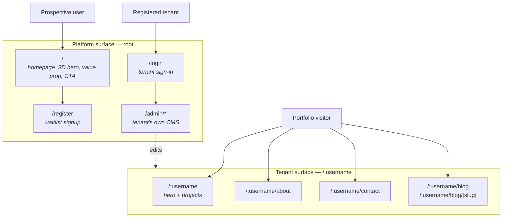
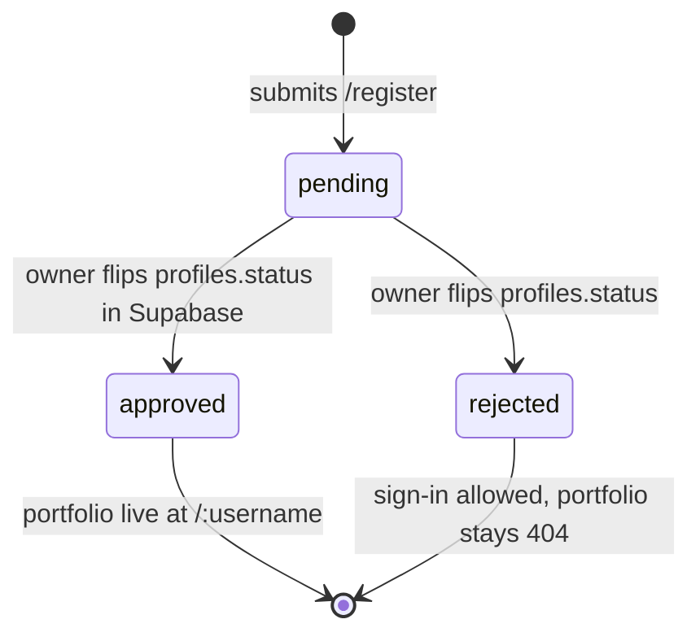
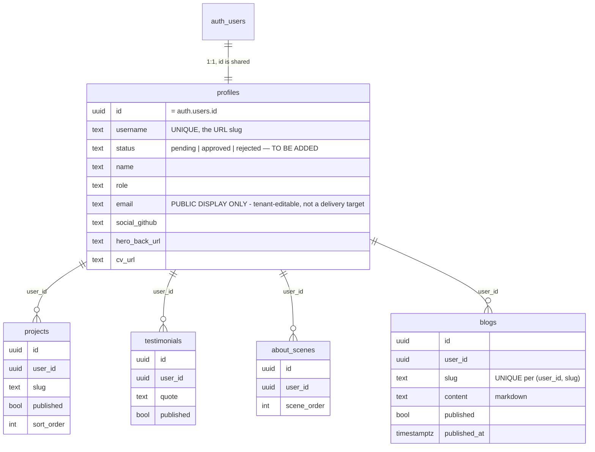

# Product

**next-0000 is a multi-tenant portfolio platform.** Anyone can register; each
approved user gets their own public portfolio at `/:username` and their own
admin panel to customise it. There can be many users.

This document describes the **target product** and marks precisely how far the
code is from it. Both matter: the target is what you are building toward, and
the gap is what you will trip over.

| | Target | Code on `development` | Running against the live database |
|---|---|---|---|
| Tenancy | many users | ✅ | ❌ schema not applied |
| `/:username` | tenant portfolio | ✅ | ❌ |
| Admin scope | per-user content | ✅ | ❌ |
| `/` | platform homepage | ✅ | ✅ needs no database |
| Registration | waitlist + approval | ✅ | ❌ |
| Approval gating | `profiles.status` | ✅ in `0006` | ❌ migration unapplied |
| Contact delivery | to each tenant | ✅ | ❌ also needs a verified Resend domain |
| Root portfolio pages removed | `/about`, `/contact`, `/blog` gone | ❌ task 6.4, blocked on 0.3 | — |

**The right-hand column is the one that matters.** Migrations `0005` and `0006`
have never been applied to any database
([G17](./current-state.md#g1--apinotify-does-not-exist)),
so the entire tenant surface is dark in production no matter what the code says.

`feature/release-awesome/0010` was **merged on 2026-11-01**, so the tenant
surface is real. The **platform** surface is not. See
[current-state.md](./current-state.md#branch-history--0010-is-merged).

---

## Two audiences, two surfaces



The root is **the product**. The `/:username` tree is **what the product
produces**. Nothing at the root serves one particular person's portfolio.

---

## Routes

### Platform surface

| Route | Purpose | Status |
|-------|---------|--------|
| `/` | Platform homepage: value proposition, register/login CTA, live tenant showcase | ✅ Built. The 3D hero is still [`specs/landing-3d-experience`](../specs/landing-3d-experience/requirements.md) |
| `/register` | Waitlist registration | ✅ Built — honeypot, rate limit, Turnstile, username policy |
| `/login` | Tenant sign-in | ✅ Built. `/admin/login` is a permanent redirect to it |
| `/admin` | The signed-in tenant's dashboard | ✅ Exists and user-scoped; shows `PendingNotice` until approved |
| `/admin/*` | The tenant's own content CRUD | ✅ `projects`, `blog`, `tools`, `testimonials`, `settings`, all owner-scoped. The About pair is still unbuilt and deliberately unlinked |
| `/api/contact` | Contact form handler | ✅ Resolves each tenant's own verified address; the platform form at `/contact` still uses `CONTACT_TO_EMAIL` |
| `/api/register` | Registration handler | ✅ Built |

### Tenant surface

All live, under the invisible route group `src/app/(portfolio)/[username]/`.

| Route | Content |
|-------|---------|
| `/:username` | Profile hero + published projects |
| `/:username/about` | ScrollyTelling scenes + timeline |
| `/:username/contact` | Profile socials + contact form |
| `/:username/blog` | Published posts from `blogs`, newest first |
| `/:username/blog/[slug]` | One post, Markdown rendered |

Unknown username → `notFound()`, with no title, OpenGraph, or canonical.

### Deleted from the root

`/about`, `/contact`, `/blog`, and `/blog/[slug]` currently serve the primary
owner. **In the target product they are removed.** The root belongs to the
platform; portfolio content lives only under `/:username/*`.

This is a deliberate decision — see
[ADR-015](./decisions.md#adr-015--the-root-is-the-platform-not-a-portfolio). It
also keeps the reserved-username list short, which matters because of the
collision risk below.

---

## Username reservation — a correctness problem, not a nicety

`/:username` is a **top-level dynamic segment**. Next.js resolves static routes
before dynamic ones, so any username matching a static route produces a tenant
whose portfolio is permanently unreachable.

Signing up with `admin@example.com` derives the username `admin`. `/admin` is a
static route. That user's registration succeeds and their portfolio **can never
be served** — with no error anywhere.

The reserved list must at minimum cover every root path:

```
admin  api  register  login  _next  favicon.ico
opengraph-image  robots.txt  sitemap.xml
```

plus names that are obvious land mines if the platform ever grows a page there:

```
about  contact  blog  tools  settings  dashboard  pricing  terms
privacy  docs  help  support  new  edit  static  assets  public  www  mail
```

**`handle_new_user()` in `supabase/migrations/0005_multi_tenant.sql` does not
check any of this.** It resolves collisions only against existing `profiles`
rows, with a numeric suffix. Two further defects in the same function:

- **No slug sanitisation.** `split_part(new.email, '@', 1)` happily yields
  `john.doe+test`, producing `/john.doe+test`.
- **No case normalisation**, while `profiles_username_idx` is a plain unique
  index. `John@x.com` and `john@x.com` become two distinct tenants whose URLs
  differ only by case.

All three are addressed by
[`specs/platform-homepage-signup`](../specs/platform-homepage-signup/requirements.md),
Requirement 3.

---

## Registration and approval

**Waitlist with manual approval.** Anyone may register; the portfolio does not
go live until the account is approved.



| State | Can sign in? | `/admin` | `/:username` |
|-------|--------------|----------|--------------|
| `pending` | yes | shows "awaiting approval" | `notFound()` |
| `approved` | yes | full CMS | live |
| `rejected` | yes | shows the decision | `notFound()` |

**Approval happens in the Supabase dashboard**, by editing `profiles.status`
directly. There is no in-app approval panel and no platform-admin role, because
all users are ordinary tenants — see
[ADR-017](./decisions.md#adr-017--all-users-are-equal-tenants-no-platform-admin-role).
That is a deliberate trade: zero moderation UI to build and maintain, at the
cost of manual work that does not scale. Revisit when volume demands it.

A `pending` tenant can still use the whole CMS and prepare content. Only
publication is gated. This is intentional: it gives the owner something real to
look at when deciding.

---

## Content model

Each tenant owns their rows. `profiles.id` **is** the tenant identity — it
equals `auth.users.id`, with no surrogate key.



`profiles.status` is added by `supabase/migrations/0006_platform_signup.sql`,
**written but not yet applied to any database**.

### Per-tenant tables

| Table | Scoped by | Domain type |
|-------|-----------|-------------|
| `profiles` | `id = auth.uid()` | `Profile` |
| `projects` | `user_id` | `Project` |
| `testimonials` | `user_id` | `Testimonial` |
| `about_scenes` | `user_id` | `AboutScene` |
| `blogs` | `user_id`, unique `(user_id, slug)` | `BlogPost` |

### Single-owner legacy tables

These predate multi-tenancy and have **no `user_id`**. They are a liability in a
many-user product: whatever is in them appears to be shared, and nothing in the
schema says who owns them.

| Table | Problem | Direction |
|-------|---------|-----------|
| `site_settings` | Singleton `id=1`. Superseded by `profiles`. | Retained for rollback; stop reading it once `0010` merges |
| `posts` | Single-owner blog. Superseded by `blogs`. | Decide: migrate rows into `blogs` with a `user_id`, or drop |
| `tools` | Single-owner. Consumed by `MarqueeTech` on `/`. | Decide: platform-level feature, or add `user_id` and make it per-tenant |

**`tools` is the open one.** [`specs/embedded-tools-platform`](../specs/embedded-tools-platform/requirements.md)
was written against the single-owner assumption and needs that question answered
before implementation.

### RLS

| Table | Anonymous | Authenticated |
|-------|-----------|---------------|
| `profiles` | read any row — portfolios are public | read/write own row, `auth.uid() = id` |
| `projects`, `testimonials`, `about_scenes`, `blogs` | read `published = true` | read/write own rows via `user_id` |
| `storage.objects` (`media`) | read all | write only under `{auth.uid()}/` |

RLS is the **last** line, not the only one. Every admin write also calls
`requireAdmin()` first — see
[ADR-007](./decisions.md#adr-007--requireadmin-in-addition-to-rls).

---

## Tenant isolation

With many users, cross-tenant leakage becomes a live risk class rather than a
theoretical one. Four controls, all of which must hold:

| Control | Mechanism | Where |
|---------|-----------|-------|
| Read isolation | every public query filtered by `username` → `user_id` | `src/lib/queries-by-user.ts` on `0010` |
| Write isolation | RLS `user_id = auth.uid()` + `requireAdmin()` | migration + `src/lib/admin/queries.ts` |
| Storage isolation | uploads confined to `{auth.uid()}/` prefix | storage RLS on `0010` |
| Metadata isolation | every tenant page generates its own title, OG, canonical | per-page `generateMetadata` |

**Known hole:** the contact form. See
[G11](./current-state.md#g1--apinotify-does-not-exist).

---

## Graceful degradation

`isSupabaseConfigured` gates everything.

| When unconfigured | Behaviour |
|-------------------|-----------|
| Platform homepage | Renders from static copy — it has no tenant data to miss |
| `/:username` | All `*ByUsername` queries return `null`/`[]`. **No seed fallback** — multi-tenancy requires a live DB |
| `/register`, `/login` | Must state that signup is unavailable rather than failing silently |
| `/admin` | `<SetupNotice>` with setup instructions |

The seed data in `src/lib/default.ts` (607 lines) exists for the single-tenant
model. In the target product it only serves the platform homepage, if anything.
**Its future is an open question** — most of it describes one specific person's
portfolio.

---

## Contact form

`POST /api/contact` (`src/app/api/contact/route.ts`), five ordered layers:

1. **Honeypot** — hidden `company` field; if filled, return `{ ok: true }` and drop.
2. **Rate limit** — per-IP, 5 per 10 minutes, in-memory. Per-instance on serverless; see [ADR-011](./decisions.md#adr-011--in-memory-per-ip-rate-limiting).
3. **Validation** — name ≤100, valid email ≤200, subject ≤150, message 10–5000. Re-checked server-side.
4. **Turnstile** — verified against Cloudflare. Skipped when the secret is unset, **except** in production with a site key present, where it fails closed.
5. **Resend** — email delivered, `replyTo` the sender, all values HTML-escaped by `escapeHtml()`.

Responses are always `{ ok: boolean, error?: string }`. Status codes: 400 bad
JSON or failed captcha, 422 validation, 429 rate limited, 500 unconfigured, 502
upstream failure.

> ⚠️ **Step 5 is not tenant-aware.** It sends to the single `CONTACT_TO_EMAIL`
> environment variable. On branch `0010`, `/:username/contact` renders this same
> form, so **a message intended for any tenant arrives at the platform owner's
> inbox** — and the tenant never learns someone tried to reach them.
>
> The fix is to accept the tenant's `username` and resolve the recipient from
> **`auth.users.email`** — *not* from `profiles.email`, which is tenant-editable
> free text, empty for every newly registered tenant, and a way to make the
> platform deliver visitor-composed mail to a third party from its own verified
> domain. It also requires a **verified Resend sender domain**: the
> `onboarding@resend.dev` fallback in the handler today only delivers to the
> Resend account owner and returns 403 for anyone else.
>
> Tracked as [G11](./current-state.md#g1--apinotify-does-not-exist);
> specified in [`specs/platform-homepage-signup`](../specs/platform-homepage-signup/design.md),
> decisions D5 and D5a.

---

## Analytics

- **Vercel Analytics** — `<Analytics />` in the root layout. Works.
- **Custom beacons** — `notifyVisit()` / `notifyCV()` POST to `/api/notify`.
  **That route does not exist** ([G1](./current-state.md#g1--apinotify-does-not-exist)).
  In a multi-tenant product these also need a tenant dimension, or per-tenant
  view counts are impossible.
- **Telegram** — documented in `.env.local.example`, **not wired** in `src/`.

---

## SEO

- `metadataBase` from `NEXT_PUBLIC_SITE_URL`.
- **Per-tenant metadata must never be shared.** Each `/:username` page derives
  its own title, description, OpenGraph, and `alternates.canonical` from the
  resolved `Profile`. Title format: `{name} – {role}`; posts use
  `{post.title} – {name}`.
- The root title template is currently
  `"%s - Gregorius Dimas A Yudhana"` — **wrong for a platform**. It must become
  a product name once the root stops being one person's portfolio.
- JSON-LD: `Person` + `WebSite` in the root layout today, describing the owner.
  On the platform homepage this should become `WebSite` / `SoftwareApplication`;
  `Person` and `ProfilePage` belong on tenant pages.
- All structured data goes through `jsonLdHtml()`, which escapes `<` to
  `<`. **Never use bare `JSON.stringify` with `dangerouslySetInnerHTML`** —
  tenant-authored content is untrusted input.
- `/admin` is `robots: { index: false, follow: false }`.
- `revalidate = 60` on all public pages.
- No `robots.ts` and no `sitemap.ts` exist. A multi-tenant sitemap should
  enumerate approved tenants.
