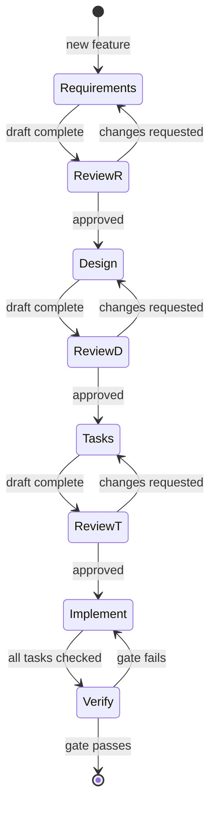

# Workflow

How a feature goes from idea to merged code in this repo. This is the
spec-driven loop the existing `.kiro/specs/` were built with; `.claude/specs/`
continues it.

## The loop



**Each gate is a human approval, not a self-assessment.** Do not start `design`
before `requirements` is approved, and do not write code before `tasks` is
approved.

## Artifacts

A spec is a directory `.claude/specs/<feature-name>/` in kebab-case, holding
three files written in this order:

### 1. `requirements.md` — *what*, never *how*

- `## Introduction` — one paragraph: the change and why it matters.
- `## Glossary` — every domain term with a capital letter, defined once.
  Reviewers and agents both rely on this; it is not filler.
- `## Baseline assumptions` — which branch, and whether the spec depends on the
  `0010` merge. **Required in this repo** given the branch divergence.
- `## Requirements` — numbered, each with a **User Story** and
  `#### Acceptance Criteria` in **EARS** form:

  ```
  THE <Component> SHALL <observable behaviour>.
  WHEN <trigger> THE <Component> SHALL <behaviour>.
  IF <condition> THEN THE <Component> SHALL <behaviour>.
  WHILE <state> THE <Component> SHALL <behaviour>.
  ```

Criteria are **testable and observable**. "The page SHALL be fast" is not a
criterion; "THE LandingPage SHALL reach interactive within 2.5 s on a simulated
Fast 3G profile" is.

No file paths, no function signatures, no library choices. Those are design.

### 2. `design.md` — *how*

- `## Overview` — the approach in a paragraph.
- `## Architecture` — a Mermaid diagram of what changes. Reference
  [architecture.md](./architecture.md) rather than restating it.
- `## Key design decisions` — each with the alternative that was rejected and
  why. A decision with no rejected alternative is not a decision.
- `## Components and Interfaces` — new files, modified files, and the exact
  TypeScript signatures of anything crossing a boundary.
- `## Data Models` — domain types, `*Row` interfaces, migration SQL.
- `## Correctness Properties` — the invariants that must hold, numbered, each
  phrased so `fast-check` can falsify it.
- `## Error Handling` — what fails, how it degrades. Must respect
  [ADR-003](./decisions.md#adr-003--queries-never-throw).

Anything that contradicts an architectural invariant
([architecture.md](./architecture.md#architectural-invariants)) needs a new ADR
in the same change, not a quiet exception.

### 3. `tasks.md` — *in what order*

- Numbered, nested, checkbox tasks. One task is one coherent commit.
- Every task cites the requirement it serves: `_Requirements: 3.2, 4.1_`.
- Dependency order is **strict**: schema → types → data layer → server → UI →
  tests.
- `- [ ]*` marks an optional task. Used in `.kiro/specs/` for property tests.
- End with a `## Task Dependency Graph` Mermaid diagram and a `## Notes`
  section for anything a future implementer would otherwise rediscover.

Check tasks off as they land. When every subtask of a parent is checked, check
the parent.

## Implementing

1. **Re-read [current-state.md](./current-state.md).** The repo moves; the file
   says where it is.
2. **Read the relevant Next.js guide in `node_modules/next/dist/docs/` before
   writing router, caching, image, or metadata code.** This is a hard rule from
   `AGENTS.md`: this Next.js version has breaking changes your training data
   predates. [tech.md](./tech.md#nextjs-16--breaking-changes-that-bind-this-codebase)
   summarises them but is not a substitute.
3. **One task at a time.** Finish it, check it off, run the gate, then move on.
4. **Match the surrounding code** — comment density, naming, idiom. New code
   should be indistinguishable in style from the file it lives in.
5. **Update steering docs in the same commit** as behaviour they describe
   ([ADR-014](./decisions.md#adr-014--claudesteering-is-the-authoritative-context-tree)).

## Definition of done

All four, every time:

```bash
npm run typecheck   # tsc --noEmit
npm run lint        # 0 errors; 8 pre-existing warnings are expected
npm run test        # vitest run
npm run build       # next build
```

Plus:

- [ ] Tasks checked off in `tasks.md`.
- [ ] Steering docs updated if behaviour changed.
- [ ] New ADR if an architectural invariant moved.
- [ ] No new file over 2 MB in `public/`
      ([structure.md](./structure.md#asset-budget)).
- [ ] No secret carrying a `NEXT_PUBLIC_` prefix.

> The gate currently **fails on a clean checkout** — see
> [current-state.md](./current-state.md#build-health). Run `npm install` and
> `rm -rf .next` first, and confirm the gate is green *before* starting work, so
> you can tell your breakage from the pre-existing kind.

## Git

- Branches: `feature/release-awesome/NNNN`. PRs target
  `feature/release-awesome/0000`.
- Commit subject: `[feat-NNNN] <summary>`, matching the existing log.
- Commit or push only when asked.

## Available subagents

`.claude/agents/kfc/` defines `spec-requirements`, `spec-design`, `spec-tasks`,
`spec-judge`, `spec-impl`, `spec-test`, and `spec-system-prompt-loader`. The
full orchestration protocol — including parallel generation and tree-based judge
evaluation — is in `.claude/system-prompts/spec-workflow-starter.md`.

These are **opt-in**. Do not spawn them unless asked for; the loop above works
run directly, and a cold subagent re-derives context this tree already holds.
